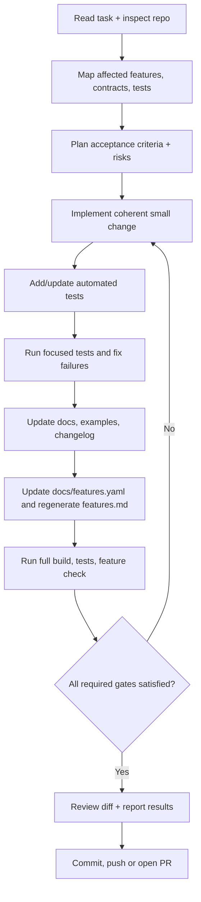

# AI Instructions for BPMN Server Product Development

**Audience:** AI coding agents and human contributors building, fixing and maintaining the BPMN Server product—not application developers who merely use it.

This document expands the mandatory workflow in [CONTRIBUTING.md](CONTRIBUTING.md). AI systems should read both at the beginning of any coding task.

## 1. Operating contract

You are working inside a workflow-engine **monorepo**. First inspect the actual code, package versions, relevant tests, `docs/features.yaml` and documentation. Never assume a feature exists because it appeared in a design proposal or prior chat. Distinguish **implemented**, **proposed** and **unsupported** behavior in your outputs and docs.

Preserve existing public contracts by default: model XML, instance persistence, APIs, interfaces, delegate services, and supported sample applications. Do not substitute a new design for an existing pattern without reviewing backwards compatibility. Keep `appDelegate` available as a supported extension point.

Prefer focused changes with tests to broad speculative rewrites. Minimize unrelated refactors. Ask for design approval when changes affect architecture or compatibility; for an already-approved scoped task, execute through validation rather than repeatedly asking permission.

## 2. AI-assisted change workflow



### Stage A — Understand

- Inspect implementation and actual API signatures. Search for equivalent existing functionality and prior design decisions.
- Read tests/examples and locate all affected packages, host integration and documentation.
- Read `docs/features.yaml` for affected features. Do not change catalog status to `supported` before validating real behavior.
- Identify whether the request is a bug, behavior change, documentation update, refactor or architecture proposal.
- Write acceptance criteria with observable outcomes, including failure and security cases.

### Stage B — Change

- Implement the approved change in the responsible package; keep dependency boundaries clear.
- Reuse engine APIs and established execution behavior. Do not invent undocumented APIs in examples.
- For API or storage changes, verify callers, persistence compatibility, startup/recovery, and multi-server concurrency where applicable.
- Add deterministic automated tests that would fail before the fix and pass afterward.
- Avoid changes that silently alter model semantics or security policy.

### Stage C — Evidence

Perform these **before committing or pushing**:

```bash
npm run build
npm test
npm run features
npm run features -- --check
git diff --check
git status --short
```

Also run package-specific tests and model verification or end-to-end scenarios affected by the change. `npm run features` **writes** `docs/docs/features.md` and test annotations, so inspect those changes before commit.

The above are documented gates, not a claim that CI or Git hooks currently enforce them. Report actual pass/fail results. If you cannot execute the checks, explicitly label them **NOT RUN** and do not claim the change was verified.

### Stage D — Documentation maintenance

For every observable change, inspect and update:

| Artifact | Requirement |
| --- | --- |
| Source and automated tests | Required for behavior changes |
| `docs/features.yaml` | Update feature entry, supported/partial status and code/test/example links |
| `docs/docs/features.md` | Regenerate using `npm run features`; do not hand-edit |
| `docs/docs/` | Update affected user documentation, API pages, setup/configuration and examples |
| `packages/*/CHANGELOG.md` | Update affected package(s) for externally visible changes |
| `docs/docs/whats-new-*.md` | Update when preparing a release or explicitly requested |
| Design/ADR | Record substantial architectural choices and migration plan |

Do not mark a proposal as shipped. Do not document a speculative endpoint as an existing endpoint. Preserve the current feature catalog's reference and test-tag conventions.

### Stage E — Final report / PR handoff

Every completed change must include:

```text
Change: <what and why>
Affected packages / features: <paths and feature IDs>
Implementation: <key changes>
Tests: <commands and exact PASS / FAIL / NOT RUN>
Documentation: <updated pages and examples>
Feature catalog: <YAML updates and generated page status>
Changelog: <package/version section or explicit internal-only rationale>
Compatibility / migration: <impact or none>
Open risks: <unverified areas>
Commit/PR: <link or SHA, only after actual creation>
```

## 3. Specific quality rules

**Automated testing.** New features require positive, negative and regression cases. Bug fixes require a reproducer where feasible. Tests must validate behavior and observable outcomes, not simply exercise functions. The application test harness (`testSampleApp`) is an appropriate place for integration scenarios.

**Model verification.** Check BPMN XML import/export and execution behavior where relevant. Include wait-state, message correlation, duplicate notification and failed-call scenarios for connectors, triggers and User Tasks.

**Persistence.** Exercise MongoDB/SQLite/memory where the change touches shared storage interfaces; if a backend cannot run locally, describe exactly what wasn't tested. Preserve instance/item identifiers, locks, timers and restart semantics.

**Security.** Enforce authenticated task operations and connector authorization; check input validation, secrets, injection, data exposure and application separation where relevant.

**Compatibility.** Preserve delegates as an escape hatch. For breaking changes, document migration, tests and release notes before merge.

**Truthfulness.** Never fabricate test results, checked-in files, commit SHA, or runtime capability. Document limits explicitly.

**Scope discipline.** Do not commit generated noise, unrelated files or secrets. Prefer maintainable interfaces/adapters to plugin-specific dependencies in the engine.

## 4. Reusable instruction to an AI assistant

> You are contributing to the BPMN Server product. Follow repository `AGENTS.md`, `CONTRIBUTING.md` and this guide. Inspect actual code/tests/catalog before making assumptions. Implement the requested change with automated regression tests; update affected documentation, `docs/features.yaml`, regenerate `docs/docs/features.md`, and update affected package changelogs. Run build, tests, catalog check and diff validation before commit/push. Report exact outcomes and never claim an unrun check passed.

This is a project instruction to agents, **not** a runtime prompt for end users of BPMN Server.
