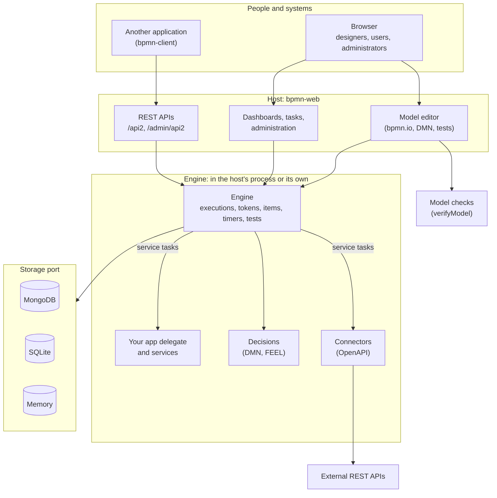

# bpmnServer

`bpmn-server` is a BPMN-based workflow engine that integrates easily into your Node.js app. It supports built-in state persistence, variable management, and concurrency across clusters—ideal for long-running processes, durable services, and scheduled tasks.

This repository holds the engine (`bpmn-server`), its web application (`bpmn-web`), its REST client (`bpmn-client`), the documentation and the sample application: see [This repository](#this-repository).

## Getting started

Choose how you want to start ([Choose Your Journey](https://bpmnserver.github.io/bpmn-server/journeys)):

| Journey | For | Start with |
|---|---|---|
| **A. Online demo** | Trying it with nothing installed | [Online demo](https://bpmnserver.github.io/bpmn-server/first-workflow) |
| **B. Build an application** | A workflow application of your own, on bpmn-web | [Build an application](https://bpmnserver.github.io/bpmn-server/build) |
| **C. Integrate an existing application** | An application that keeps its own UI and users, and runs its processes here | [Integrate an existing application](https://bpmnserver.github.io/bpmn-server/integrate) |
| **D. Embed the engine** | Running processes from your own Node.js code | [Embedding the engine](https://bpmnserver.github.io/bpmn-server/embedding) |

The [tutorials](https://bpmnserver.github.io/bpmn-server/tutorial/start) take one leave request from installing to
automated testing, in nine steps: security, the employee's and the manager's tasks, the results, Node.js, the REST
APIs, connectors and Gherkin tests.

### See it in action

[The videos](https://omniworkflow.com/videos/): one for each tutorial, and the features one at a time, such as
[testing a model](https://omniworkflow.com/videos/#2-testing) (record scenarios, add checks, see what breaks when
the model changes) and [a connector to GitHub](https://omniworkflow.com/videos/#7-github).

## Architecture Overview

The following diagram illustrates the core components of `bpmn-server` and how they interact:



- **The host, bpmn-web**: the model editor (bpmn.io) with its checks and tests, the decision editor,
  dashboards and task lists, administration (users, connectors, backups), and the REST APIs. Only signed-in
  users use it. It doesn't run anything itself: it asks the engine.
- **The engine, bpmn-server**: executes BPMN workflows and timers, evaluates DMN decisions, and runs tests. It
  holds your app delegate and services, in the host's process or in one of its own.
- **Your application**: starts bpmn-web (or embeds the engine), and provides the app delegate and the services
  that service tasks call.
- **Connectors**: REST APIs described by OpenAPI that an administrator adds with their keys; service tasks call
  them with no code.
- **Storage**: instances, models and history through one storage port: MongoDB (the default), SQLite, or memory.
- **bpmn-client**: another Node.js application drives the server through the REST APIs.
- **bpmn-mcp**: AI clients use a running server over MCP.

### Ways to run it

| Setup | Host | Address | Engine |
|---|---|---|---|
| Development and test | 1 | 1 | 1, in the host's process |
| Production | 1 | 1 | 1, in its own process |

See [Architecture](https://bpmnserver.github.io/bpmn-server/architecture) and [Ways to run it](https://bpmnserver.github.io/bpmn-server/setup#ways-to-run-it).

## Quick Start

### Create an application

```sh
npx bpmn-server init my-app      # asks for the database; --memory to try it without MongoDB
cd my-app
npm run setup                    # the database's indexes
npm start                        # http://localhost:3000
```

Open your browser to [http://localhost:3000](http://localhost:3000). The first page asks for the administrator, with the setup token the server printed when it started.

`init` creates the sample application, with `bpmn-server` and `bpmn-web` as its dependencies;
`npx bpmn-server init --help` lists its options, and `--minimal` creates a one-model Hello application
instead. `init` ships with bpmn-server 3.5 and later.

```
my-app/
  package.json      deps: bpmn-server, bpmn-web; scripts: start, dev, setup, cli, verify
  .env              generated keys, the database URL, what is served
  index.ts          starts bpmn-web with the settings, delegate and connectors below
  settings/         config.ts: only the settings you override; bpmn-web supplies the defaults
  processes/        the models: Hello, Buy Used Car, Leave Application, employee-onboarding, Business Rules, GitHub repository
  connectors/       the services service tasks call (appServices.ts), and element templates (*.json)
  delegates/        the app delegate (on bpmn-web's WebAppDelegate): services, data objects, events
```

### Install on a server

On a new Linux server (Ubuntu 22.04 or 24.04), one line installs everything (Node.js, MongoDB, the application,
nginx, a service; HTTPS with `--domain`) and prints the address and a generated admin password:

```sh
curl -fsSL https://raw.githubusercontent.com/bpmnServer/bpmn-server/main/deploy/install.sh | sudo bash
```

It also works as a cloud server's launch script (AWS Lightsail's "Add launch script"). See
[deploy/](https://github.com/bpmnServer/bpmn-server/tree/main/deploy).

### Call it from another application (bpmn-client)

```sh
npm install bpmn-client
npx bpmn-client-setup            # writes .env: set API_KEY to the server's, HOST and PORT to where it runs
npx bpmn-client-cli              # a console on the server: start processes, list and invoke items
```

```js
import 'dotenv/config';
import { BPMNClient2 } from 'bpmn-client';

const client = new BPMNClient2(process.env.HOST, process.env.PORT, process.env.API_KEY);
const instance = await client.engine.start('Hello', { name: 'Ada' });
```

See [bpmn-client](https://bpmnserver.github.io/bpmn-server/bpmn-client) for its API.

### Programmatic Usage Example

```js
import { BPMNServer, Logger } from 'bpmn-server';
import { configuration } from './configuration.js';

const server = await BPMNServer.create(configuration, new Logger({ toConsole: false }));

const result = await server.engine.start('invoice', { amount: 1200 });
console.log('Process started with instance id:', result.instance.id);
```

See [Embedding the engine](https://bpmnserver.github.io/bpmn-server/embedding), the
[Engine API](https://bpmnserver.github.io/bpmn-server/api-summary) and the
[API reference](https://bpmnserver.github.io/bpmn-server/api/readme).

---

## Modeling

`bpmn-server` provides a modeling tool based on `bpmn.io` with a customized property panel, eliminating the need to manually edit BPMN files.


You can also import BPMN models from other tools.

Each model is defined in a BPMN XML file and consists of various elements. An `element` can be a `node` (such as events, tasks, or gateways) or a `flow`.

Models are managed by `bpmn-server` and can be queried using the [Model API](https://bpmnserver.github.io/bpmn-server/api/interfaces/IAPIModel).

All BPMN 2.0 elements are supported. [See Modeling Support](https://bpmnserver.github.io/bpmn-server/examples)

## Execution

`bpmn-server` is primarily an execution engine for BPMN models.

Each time a model is started, an `instance` is created. For every `element` that is executed, an `item` is generated.

Execution follows the BPMN model logic and supports extensions such as scripting and application context access.

During execution, both Model Listeners and Application Listeners are invoked.

Access the execution engine via the [Engine API](https://bpmnserver.github.io/bpmn-server/api/interfaces/IAPIEngine).

- [Invoking the Execution Engine](https://bpmnserver.github.io/bpmn-server/invokation)
- [Execution Behavior](https://bpmnserver.github.io/bpmn-server/execution)

## Datastore

Execution data, including instances and their items, are persisted to a datastore: MongoDB (the default), SQLite,
or memory, through one storage port that you can also implement yourself.

You can query this data through the [Data API](https://bpmnserver.github.io/bpmn-server/api/interfaces/IAPIData).

- [Data and persistence](https://bpmnserver.github.io/bpmn-server/data)
- [Custom persistence](https://bpmnserver.github.io/bpmn-server/persistence)

## Users and Security

Every call to the engine says which user it acts for, and the engine applies the model's rules to that user.

1. Model designers assign tasks with `assignee`, `candidateUsers` and `candidateGroups`, as names or expressions
   (`$(this.data.requester)`). A task in a lane is also offered to the group with the lane's name.
2. **bpmn-web** signs users in and keeps their groups. A new server has no users: its first page asks for the
   administrator, with a setup token it prints where it runs.
3. **Another application** keeps its own users: it calls the APIs with a key, and names the user and their groups on
   each call to the task API.
4. **Embedded**, your code passes the user (`SecureUser`) to each call.

`REQUIRE_AUTHENTICATION` and `ENFORCE_SECURITY` are on in a new application.

- [Security](https://bpmnserver.github.io/bpmn-server/security)

## Demo Web Application

<details>
<summary>Explore the `bpmn-web` application.</summary>

Features include:

- Persistent modeling tool (based on `bpmn.io`)
- Property panel supporting all `bpmn-server` features
- Execution with input forms for defined fields


- Task and workflow lists
- Instance detail view


- Model specification viewer


</details>

## Live Demo

A live demo is available at: [https://bpmn.omniworkflow.com](https://bpmn.omniworkflow.com)

## Installation

This package requires Node.js 20 or later and MongoDB (or `--memory`, to try it without one).

If MongoDB is not installed, you can [create a free cloud account](http://bit.ly/cyd-atlas), [install it locally](https://www.mongodb.com/docs/manual/installation/), or run the one `init` puts in the application (`docker compose up -d`).

```sh
npx bpmn-server init my-app --mongo mongodb://localhost:27017/my-app
cd my-app
docker compose up -d             # a MongoDB on this machine, if you do not have one
npm run setup                    # the database's indexes
npm start                        # prints the setup token; the first page asks for the administrator
```

The application's settings are in `.env` (the database, the port, the API keys, what is served) and
`settings/config.ts`: see [Settings](https://bpmnserver.github.io/bpmn-server/settings). MongoDB is the default;
`init --memory` runs without a database, and SQLite is chosen in the settings
([Custom persistence](https://bpmnserver.github.io/bpmn-server/persistence)).

## Docker Installation

<details>
<summary>Install `bpmn-server` and dependencies with Docker.</summary>

### 1. Create a project folder

### 2. Add a `docker-compose.yml` file:
```yaml
version: "3.7"
name: bpmn-server
services:
  bpmn-web:
    image: ralphhanna/bpmn-web
    command: sh -c "
        npm run setup &&
        npm run start"
    ports:
      - 3000:3000
    volumes:
      - 'app:/app'
    depends_on:
      - mongo

  mongo:
    image: mongo
    ports:
      - 27017:27017
    volumes:
      - mongodb:/data/db

volumes:
  mongodb:
    driver: local
    driver_opts:
      type: 'none'
      o: 'bind'
      device: './mongodb_volume'

  app:
    driver: local
    driver_opts:
      type: 'none'
      o: 'bind'
      device: './bpmn_server_volume'
```

### 3. Start the container
```sh
docker compose up -d
```
</details>

## Command Line Interface

<details>
<summary>Use `bpmn-server` via CLI for common operations.</summary>

In your application:

```sh
npm run cli

server started..
Commands:
  q     quit
  s     start process
  lo    list outstanding items
  li    list items
  l     list instances for a process
  di    display instance information
  i     invoke task
  sgl   signal task
  msg   message task
  d     delete instances
  lm    list models
  lme   list model elements
  ck    check locked instances
  re    recover hung processes
  lu    list users
  spw   set user password
  ?     show this help menu
```

`npx bpmn-server verify processes/` checks the models without running them.
</details>

## Updating to Latest Release
```sh
npm update bpmn-server bpmn-web
```

## Application Integration

`bpmn-server` is designed to be embedded into your application. [See customization guide](https://bpmnserver.github.io/bpmn-server/customization)

## Documentation

The [documentation site](https://bpmnserver.github.io/bpmn-server/), and its
[site map](https://bpmnserver.github.io/bpmn-server/map) of every page.

- **Getting started**: [Choose your journey](https://bpmnserver.github.io/bpmn-server/journeys),
  [Installation](https://bpmnserver.github.io/bpmn-server/setup), [Settings](https://bpmnserver.github.io/bpmn-server/settings),
  [What's new in 3.6](https://bpmnserver.github.io/bpmn-server/whats-new-3.6)
- **Tutorials**: [1 to 9](https://bpmnserver.github.io/bpmn-server/tutorial/start), and [the videos](https://omniworkflow.com/videos/)
- **Concepts**: [Invoking workflows](https://bpmnserver.github.io/bpmn-server/invokation),
  [Execution](https://bpmnserver.github.io/bpmn-server/execution), [Data](https://bpmnserver.github.io/bpmn-server/data),
  [Scripting](https://bpmnserver.github.io/bpmn-server/scripting), [Security](https://bpmnserver.github.io/bpmn-server/security)
- **Modeling**: [Model editor](https://bpmnserver.github.io/bpmn-server/modeler),
  [Checking models](https://bpmnserver.github.io/bpmn-server/verify),
  [Testing and debugging models](https://bpmnserver.github.io/bpmn-server/testing),
  [Connectors](https://bpmnserver.github.io/bpmn-server/connectors), [Decisions (DMN)](https://bpmnserver.github.io/bpmn-server/decisions),
  [Examples](https://bpmnserver.github.io/bpmn-server/examples)
- **Development**: [Embedding the engine](https://bpmnserver.github.io/bpmn-server/embedding),
  [Engine API](https://bpmnserver.github.io/bpmn-server/api-summary), [API reference](https://bpmnserver.github.io/bpmn-server/api/readme),
  [Application integration](https://bpmnserver.github.io/bpmn-server/customization),
  [Custom persistence](https://bpmnserver.github.io/bpmn-server/persistence),
  [Custom delegates](https://bpmnserver.github.io/bpmn-server/delegates),
  [Architecture](https://bpmnserver.github.io/bpmn-server/architecture)

## This repository

| | |
|---|---|
| `packages/bpmn-server` | The workflow engine (npm `bpmn-server`), and `npx bpmn-server init`. |
| `packages/bpmn-client` | The REST client (npm `bpmn-client`). |
| `packages/bpmn-web` | The web host: tasks, instances, the model editor, administration, the REST APIs, `start()` (npm `bpmn-web`). |
| `packages/bpmn-mcp` | Connects AI clients to a running server over MCP, Codex and Claude Code among them (npm `bpmn-mcp`); `npx bpmn-server init` installs it. |
| `sampleApp` | The sample application (processes, connectors, delegates) on bpmn-web: what `npx bpmn-server init` creates. |
| `testSampleApp` | The working application: the models tests run on, beside their `.feature` files, the app to start and debug from, and the tests of bpmn-web, the engine and the models. |
| `docs` | The documentation site. |
| `docker` | Docker images. |
| `catalog` | The model catalog bpmn-web browses and imports from. |

### Work on the source

```sh
git clone https://github.com/bpmnServer/bpmn-server.git
cd bpmn-server
npm install                      # every package, linked to each other (npm workspaces)
npm run build                    # bpmn-server, bpmn-client, bpmn-web

cd testSampleApp
cp .env.example .env             # set MONGO_DB_URL
npm run setup                    # the database's indexes
npm start                        # or npm run debug (Node inspector); npm start at the root runs it too
```

### Develop with changes picked up

```sh
npm run dev                      # at the root: testSampleApp from the sources, and the model editor's build, both watching
```

`npm run dev` runs testSampleApp on the TypeScript sources of bpmn-server and bpmn-web (their `bpmn-source`
export condition, under tsx), with `node --watch`: a change to `packages/bpmn-server/src`,
`packages/bpmn-web/src` or the app's code restarts it, without a build. The model editor (`modeler/src`) is
rebuilt as it changes; refresh the browser. Views (`.pug`) and `public/` need only a refresh. Models
(`processes/`) do not restart it (the editor saves there): a model changed outside the editor loads on the
next restart.

In testSampleApp alone: `npm run dev`, or `npm run dev:debug` with the Node inspector. In VS Code, **testSampleApp:
dev (debug)** does the same with breakpoints in the app and both packages; **Test: current file** runs the
open test file under the debugger (on the builds: `npm run build` first).

| Tests | |
|---|---|
| `npm test` (root) | bpmn-server, bpmn-client and testSampleApp |
| `npm test` (testSampleApp) | bpmn-web's unit, client, engine and web tests, the models' tests (`test/custom`) and the engine's scenarios |
| `npm run test:ui` (testSampleApp) | the browser tests (Playwright) |
| `npm run test:coverage` (root) | all of these with code coverage, and each model's saved scenarios with what they reach: the browsable report in `coverage/`, the summaries kept in `reports/coverage/`; fails if a suite fails or `bpmn-server` is under 90% of lines, functions or branches. The browser code is not measured |
| `npm run test:scenarios` (testSampleApp) | the engine's feature scenarios alone |

The tests use databases of their own on a local MongoDB (`mongodb://localhost:27017`; `TEST_MONGO_URL` and
`BPMN_TEST_MONGO_URL` change it): bpmn-web's tests one per run, dropped when they end; the scenarios
`bpmn_scenarios`, emptied before each run.

Publishing: `npm publish -w bpmn-server`, then `-w bpmn-client`, `-w bpmn-web` and `-w bpmn-mcp`, all with the same version (they
depend on each other's, and `init` installs them together); packing bpmn-server copies `sampleApp` into it as `init`'s template.

## License

Licensed under the MIT License.

## Acknowledgments

`bpmn-server` builds upon [bpmn-io/bpmn-moddle](https://github.com/bpmn-io/bpmn-moddle) by [bpmn.io](http://bpmn.io), and is inspired by [bpmn-engine](https://github.com/paed01/bpmn-engine).
