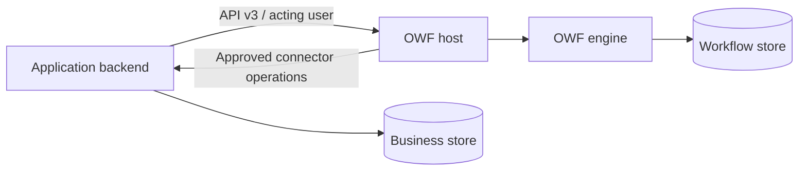
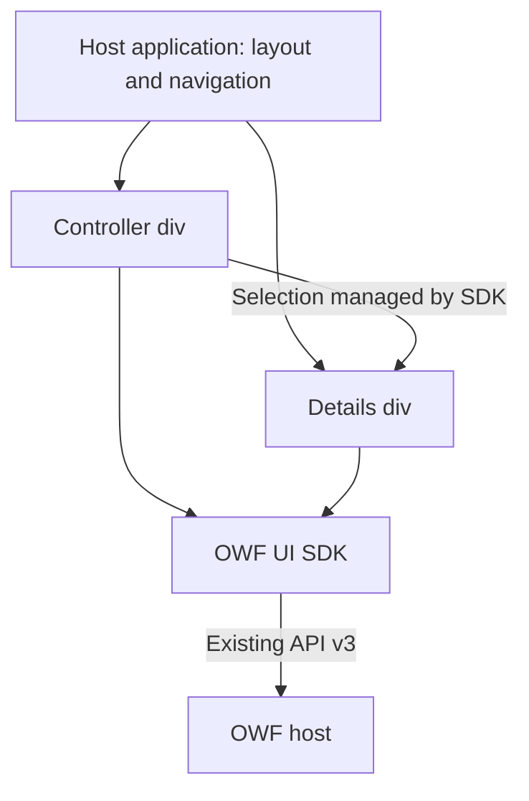

# OWF — Side-by-side application integration: services and embedded UI

**Status:** Design decision, 2026-11-26. Proposed implementation, not shipped functionality.
**Related:** [Integration protocol](integration-protocol.md) (canonical service contract), [3.8 roadmap](roadmap-3.8.md), [Application contract](app-contract.md), [Form keys](form-keys.md).

## 1. Objective and ownership

The host application and OWF run side by side. The application owns its navigation, layout, branding, identities, business records and specialized forms. OWF owns process execution, workflow data, task assignment and authorization, and reusable workflow UI. Neither accesses the other's persistence directly as a requirement. Both can be deployed independently.

Build the workflow UI once, for standalone OWF and for embedding. Embedding is optional; every workflow operation must remain available to an authorized headless client.

## 2. Delivery phases

| Phase | Deliverable | Explicit exclusions |
| --- | --- | --- |
| 1 — Services only | Two-way API integration, trusted user identity, application contract, allowed connector operations, integration tests | No embedded OWF UI, UI SDK, browser bridge, new form renderer or UI refactoring |
| 2 — Embedded OWF UI | JavaScript UI SDK, controller/details composition, native task/start forms, instance details, theming and lifecycle | No requirement to rewrite host business forms or replace its navigation |
| 3 — Advanced composition (optional) | Host-owned forms in a details region, shared details across controllers, standalone widgets and richer integration | No new workflow engine or alternate workflow API |

Phase 1 is a complete releaseable integration mode and the first 3.8 delivery priority. Phases 2 and 3 are subsequent increments; their release assignment is not fixed. An existing host UI may call the Phase 1 services; no new UI work is required. Existing standalone OWF UI and form-key behavior are unaffected. UI work must not block Phase 1.

## 3. Phase 1: service contract



- Application integration module: server-side client of OWF API v3; maps authenticated identity, starts processes, sends messages/signals, queries tasks/instances, claims and completes tasks. Reuse BPMNClient3 where appropriate; other languages may use OpenAPI.
- OWF integration module: existing API v3, identity adapter and connector registry in the OWF host. No separate competing API or mandatory custom delegate.
- Application publishes its contract (app-contract.json), roles, available functions and API references. The OpenAPI connector files remain the source of enabled operations. Do not create another contradictory allowlist. The editor and verifier consume the same effective definitions as runtime.
- OWF calls approved application operations through connectors. Business data and permissions remain authoritative in the application. Optional delegates remain an escape hatch.
- Application events enter through API v3; inbound webhook routing and durable outbound task events are separately scoped proposals. Poll authorized task/instance queries until a notification contract exists.
- Preserve existing API v3 routes and compatibility. Verify the identity adapter, service credentials and permission checks with positive and negative tests. Never trust user or role headers from the browser.

**Phase 1 acceptance:** start an HR leave request, retrieve and complete the assigned task as the correct user, call an allowlisted HR operation, deliver a correlated event, query the instance and verify history — using only services and tests. Unauthorized users, privileged role injection, invalid tokens and unapproved operations fail. Simulate unavailable services and verify recovery. No UI SDK dependency.

## 4. Phase 2: two-container UI integration

The application supplies two locations in its page:

- **Controller**: the user's entry point, e.g. a task list, process catalog or instance list.
- **Details**: a rendering destination for whatever view the controller selects, e.g. a task form, start form or instance details.

This is a master–detail composition pattern. It does not require adjacent panes. The host may place details beside/below the controller, in a tab, modal or drawer.



### 4.1 Minimal host integration

Proposed public interface; names are illustrative and not implemented. The SDK is distributed as a versioned JavaScript module; a package-manager distribution can expose the same interface later.

```html
<div id="owf-controller"></div>
<div id="owf-details"></div>
<script type="module">
  import { createOWF } from "/assets/owf-ui.js";
  const owf = createOWF({ apiBase: "/owf/api/v3" });
  const view = owf.mount({
    view: "task-list",
    controller: document.getElementById("owf-controller"),
    details: document.getElementById("owf-details")
  });
</script>
```

The example assumes a host-managed same-origin backend proxy. The SDK does not take over the document, router, header, menus or authentication. No application selection handler is needed for two visible containers. The SDK owns only the contents of the two supplied elements. The host must not render into those elements concurrently.

The public embedding contract uses ordinary DOM elements, not a required framework. Internal React, Web Components or other implementation techniques are replaceable. Evaluate current frontend reuse before choosing an implementation; do not introduce micro-frontend orchestration infrastructure.

### 4.2 Supported compositions

| Controller | Details |
| --- | --- |
| Task list | Native task form, task information |
| Instance list | Instance details, history, diagram |
| Process catalog | Start process form, new instance details |

Phase 2 initially delivers these core compositions. Additional widgets, modeler embedding and independently mounted views are later options.

### 4.3 SDK interface and lifecycle

Illustrative TypeScript contract:

```ts
interface OWFOptions {
  apiBase: string;
  getAccessToken?: () => Promise<string>;
  locale?: string;
}
interface MountOptions {
  view: "task-list" | "instance-list" | "process-list";
  controller: HTMLElement;
  details: HTMLElement;
  context?: Record<string, unknown>;
  onDetailsRequested?: () => void;
  onEvent?: (event: OWFEvent) => void;
}
interface MountedView {
  refresh(): Promise<void>;
  setContext(context: Record<string, unknown>): Promise<void>;
  clearDetails(): void;
  dispose(): void;
}
```

The SDK lists authorized records, handles selection, displays loading/error/empty states, loads the selected record into details, handles claim/start/complete, then refreshes the controller. Completion removes a task that is no longer actionable; clear details or display a completion state. Cancel leaves workflow state unchanged. Handle stale tasks and concurrent completion by refreshing on conflict rather than blindly repeating mutations.

A context filter narrows authorized data (e.g. employeeId); it is never a permission grant. Only supported server-side query filters are accepted. Changing context clears stale selection. Cancel outstanding fetches on selection change or dispose; ignore stale responses. Dispose removes owned content/listeners and releases resources. Handle dirty forms before replacing details or closing a view.

The optional onDetailsRequested callback lets the host reveal a drawer/tab/modal before rendering or focusing. The SDK handles content; the host handles the container's visibility and layout. Optional events include task-selected, task-completed, process-started, instance-selected, form-requested, cancelled and error. Payloads carry minimal identifiers; events are not authorization.

### 4.4 Authentication and deployment

Prefer a same-origin application backend proxy for the browser. The application authenticates the user, obtains or exchanges a short-lived OWF user token server-side, and forwards authorized calls to API v3. Preserve individual identity; never proxy all requests as SYSTEM. Enforce route allowlists, CSRF protection for cookie-based writes, and session expiration. If a direct browser-to-OWF connection is required, use scoped short-lived tokens with a refresh callback, explicit CORS and TLS. Do not put service keys, connector secrets or permanent tokens in HTML, URLs or browser storage.

OWF independently enforces authorization for every query and mutation. A trusted SDK is not a security boundary: it executes with host-page privileges. Pin compatible SDK/server versions, serve trusted assets with a suitable CSP, and isolate CSS (e.g. Shadow DOM) without implying security isolation. Specify SDK/API compatibility before release.

### 4.5 Presentation and reuse

The host supplies theme tokens (font, colors, spacing, borders), locale and container size. OWF owns responsive content, accessibility, keyboard navigation and error states inside the containers. Do not impose global CSS or change host routing. Refactor existing OWF view logic out of shell/router/global state only as needed. The standalone OWF shell consumes the same reusable views and API client. Measure reuse and refactoring effort against source before estimating delivery.

**Phase 2 acceptance:** in the HR demo, mount a task list and details region using two divs. Select, claim and complete a native task without host navigation or selection code. Repeat with process list/start and instance list/details. Verify identity, theme, responsive layout, independent placements, stale responses, conflicts, unmounting and authorization. Confirm the standalone UI still works and Phase 1 tests pass unchanged.

## 5. Phase 3: application-specific forms and richer composition

When a model supplies a BPMN formKey, it remains a host page address (see [Form keys](form-keys.md)), not executable JavaScript or a new mandatory registration schema.

For an embedded view, the SDK raises a form-requested event with the validated form address and task identifiers (instance/item) or process/start identifiers. A host adapter may mount its existing form in the details region through an explicit handoff; otherwise use the existing approved page/navigation protocol. Host form integration is optional. The host form reads and completes the task via the same services as the signed-in user. Pass identifiers, not sensitive case data or credentials in URLs. Validate target origin and return destinations. If using an iframe for an application form, validate postMessage origin/source and message schema; treat completion messages as hints and re-query the server. No form-specific API is required.

Advanced shared-details composition should use one explicit coordinator owning the details container. Do not allow independent mounts to overwrite one another. Define selection ownership, dirty-form handling and disposal before enabling multiple controllers. Additional standalone widgets (task count, diagram, start button) can use the same underlying views without a controller.

**Phase 3 acceptance:** a host-owned HR employee-selection form is rendered via formKey, selects an employee using existing HR APIs, and completes the OWF task with employeeId. The SDK refreshes the controller only after confirming server state. Test cancellation, unauthorized access and conflicting selections.

## 6. Decisions and open implementation questions

**Decisions:** services first; optional UI; controller/details as the default public embedding pattern; host owns layout/navigation; OWF owns workflow views and their internal interaction; reuse API v3; no direct dependency on host framework.

**Open:** exact SDK/package naming, authentication adapter implementation, final event/type schemas, current view extraction effort, theming contract and accessibility details, release assignment for later UI phases. No UI implementation is authorized by this design alone.

