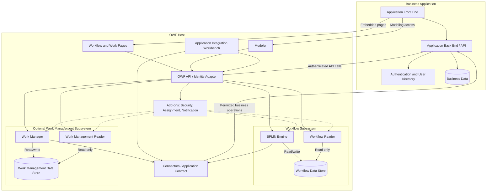

# OmniWorkflow — Target Architecture

**Status:** Proposed architecture for 3.8 and subsequent releases; release strategy (section 10) agreed

**Date:** November 25, 2026

## 1. Purpose

OmniWorkflow (OWF) provides workflow orchestration and, optionally, independent work management capabilities to an existing business application. The business application and OWF Host operate side by side, rather than requiring one to contain the other.

The architecture preserves the existing BPMN engine, formalizes subsystem boundaries, supports application-aware modeling and allows progressive integration without requiring a complete integration upfront.

## 2. Logical architecture

The diagram is logical, not a mandatory physical deployment topology. Add-ons participate through hooks and events; they are not necessarily an intermediary for every call. Readers access their respective data stores directly, without going through either execution component.

## 3. Responsibilities and boundaries

| Component | Responsibility |
|---|---|
| Business application | Business objects, business rules, business data, users, roles, authentication and business authorization |
| OWF Host | Composition, API exposure, user context, configuration, integration and user-facing facilities |
| BPMN Engine | BPMN execution, process state transitions and engine-managed items |
| Workflow Reader | Independent query access to workflow instances, items and execution history |
| Work Manager | Independent management of projects, work requests and manually managed work items |
| Work Management Reader | Independent query access to work management data |
| Add-ons | Optional security, assignment, notification and other policies or extensions |
| Connectors | Controlled access to external application services |
| Integration Workbench | Application discovery, contract management, connection testing and simulation |

The engine remains independent of the host application's business semantics and does not depend on Work Management. Work Management does not depend on BPMN.

## 4. Security and identity integration

**The business application manages authentication. OWF manages workflow and work management authorization.**

The user logs into the business application once. OWF establishes a trusted user context containing a stable user identifier, roles and groups where applicable. The application may issue a signed, short-lived token for OWF, use a shared identity provider, or make authenticated server-to-server calls on behalf of the user.

OWF validates the identity assertion through an API authentication adapter. It must validate the appropriate issuer, audience, signature and expiration where tokens are used, and must never accept unverified user identifiers or roles from a browser.

The Security add-on evaluates visibility and action permissions for the relevant subsystem. Assignment determines who should perform work; it does not replace authorization. Both read and write paths must enforce authorization, with security failures handled without granting unauthorized access. Labels, search and sorting must not expose restricted data.

The business application retains control over access to its own data and APIs. Connectors use explicitly authorized service credentials or delegated identity where supported. Secrets are stored separately from application contracts and exported packages.

Standalone OWF installations may retain their existing authentication mechanism. Integrated installations rely on trusted application identity rather than requiring a second user directory or login.

## 5. Independent data ownership

| Workflow Data Store | Work Management Data Store |
|---|---|
| Process instances and execution state | Project and work request instances |
| Engine-managed items | Manually managed work items |
| Process variables | Work properties and progress |
| Execution history | Work history |

Workflow and Work Management own their respective definitions and model artifacts as well; these need not be stored in the runtime database.

The two subsystems have independent logical data stores. They may use separate databases or share physical database infrastructure, but neither directly accesses the other's data. Each owns its schema, migrations, lifecycle and persistence operations.

A Project Instance contains manually managed project items only. A BPMN workflow instance contains engine-managed items only. Do not mix ownership or execution lifecycles in a single instance.

A BPMN process may create a work request through the Work Management API and wait for completion. Work Management returns the outcome through a Workflow API call or event. Cross-subsystem operations should use explicit identifiers and correlation, with retry and duplicate handling defined when implemented.

A unified My Work page can aggregate results from both Readers without merging the data stores. Authorization applies independently to each source.

## 6. Application-aware modeling and integration

Full integration is not a prerequisite for modeling. OWF supports three progressive levels:

| Level | Awareness | Execution |
|---|---|---|
| Independent modeling | No host application knowledge required | Simulated |
| Application-aware modeling | Known APIs, roles, schemas and services | Stubs and selected permitted development APIs |
| Full integration | Configured application connections | Real services and data |

The Application Integration Workbench is a small design-time facility built on the existing application contract, OpenAPI connectors, verification and testing infrastructure. It is not a new execution engine.

### Application discovery

The user may provide the application URL, OpenAPI location, authentication mechanism, role/group source and source repository location. Only relevant information is required; discovery progresses iteratively.

Two modes produce the same integration artifacts:

- Manual discovery: import OpenAPI, configure connections, identify roles and select operations.
- AI-assisted discovery: the user's local AI agent examines accessible application source and APIs and proposes or implements integration changes with approval.

Deterministic OWF tools handle specification parsing, connectivity testing, operation allowlisting, configuration validation and test execution. AI handles semantic discovery, interpreting business objectives, identifying gaps, generating stubs and integration code, and diagnosing failures. AI is optional.

The application contract provides a single integration entry point for available and required services, schemas, identities and roles, forms, events and operation permissions. It should reference existing OpenAPI operation identifiers rather than duplicate interface definitions unnecessarily.

### Simulation and progressive integration

Each integration capability can be proposed, simulated or connected. A stub is tied to an actual or proposed application interface, so its eventual replacement is clear. Existing Gherkin stubs provide a testing foundation; interactive simulation may require further support.

Use permitted development APIs where appropriate, and simulate unavailable or restricted operations. No production writes or unrestricted API access should be enabled by default.

## 7. Alternative development journeys

OWF offers two starting points rather than imposing a single development methodology.

| Model-first | Application-first |
|---|---|
| Create or import workflow models | Identify business objectives |
| Identify integration requirements | Discover application capabilities |
| Discover relevant application capabilities | Identify and model workflows |
| Resolve gaps, simulate and integrate | Resolve gaps, simulate and integrate |
| Verify end to end | Verify end to end |

Discovery and modeling are iterative. Discover enough to model, and model enough to identify additional discovery needs.

These journeys may eventually be represented as BPMN processes performed by users, deterministic tools and AI agents. Execution of the methodology as BPMN is optional and is not a prerequisite for the architecture.

## 8. Initialization and portability

Initialization, development methodology and integration are independent decisions.

| Operation | Responsibility |
|---|---|
| `init` | Establish the OWF environment, standalone or alongside an existing application |
| `export` | Export a portable workflow package |
| `import` | Import a package into an initialized environment |
| Integration | Progressive development activity through the workbench and/or AI agent, not a separate installer |

These are proposed command semantics. A separate `integrate` installation command is not required under this approach.

For existing models, the sequence is export, initialize, import, launch the local AI agent, assess, implement and verify. Initialization must precede import. The agent performs assessment, implementation and verification with user approval where necessary.

A portable package should include BPMN models, associated DMN decisions and policies, forms/templates, connector definitions, application contract, verification scenarios and a versioned manifest. Exclude credentials, users, sessions, production data, running instances and execution history. Extend existing export/import capabilities where possible instead of creating another format unnecessarily. This is the 3.7.6 work (section 10): selecting several processes and decisions, finding each one's dependencies (called processes, decisions, policy files, templates, connector definitions, tests) and writing them into one zip, or a single file; and the import that reads it, asking before it replaces anything.

The OWF Host may reside in a separate repository or development workspace. The local AI agent can be given access to both repositories without OWF itself having to read application source code. No specific host-application technology is required.

## 9. Impact on the existing 3.7.5 architecture

The proposed architecture builds on the existing implementation rather than replacing it.

| Existing capability | Proposed treatment |
|---|---|
| `BPMNServer.create()` / `BPMNServer.launch()` | Preserve independent server instances and local, remote or absent engine support |
| BPMN Engine | Preserve existing execution responsibilities |
| Reader / Data Store | Retain direct, independent query access and workflow ownership |
| `IDocumentStore` | Reuse storage abstractions where appropriate |
| `Connectors` / `AppContract` | Extend into host-level application discovery and integration |
| `AddOns.ts` | Retain extension mechanism; extract common services as needed |
| `pre-query` / `pre-action` | Retain and extend authorization hooks with subsystem-specific policies |
| `TestStubs` | Reuse simulation foundation |
| API and pages | Extend to support independent optional subsystems |

Introduce an OWF Host composition layer above the existing BPMN server where practical. Preserve existing consumers and public interfaces during transition.

Current assignment and security add-ons contain BPMN-specific logic, such as checking `bpmn:UserTask` and evaluating instance/item policies. They cannot simply be reused unchanged for Work Management. Extract common identity, policy evaluation, notification delivery and event mechanisms only when needed, while retaining subsystem-specific policy and lifecycle implementations.

The existing architecture assessment was based on targeted source inspection, not a complete dependency analysis or executed regression suite. The exact refactoring scope remains to be validated.

## 10. Release strategy

Agreed November 25, 2026. 3.7.5 is released; the architecture above arrives in 3.8 and later.

| Release | Content | Notes |
|---|---|---|
| **3.6.x** | Security fixes only | The line customers are on today. No API v3, add-ons or other backports from 3.7: they would bring half of 3.7 without its upgrade guide. Issues #294 and #295 are assessed for a targeted fix only. |
| **3.7.5** | The work done: API v3, add-ons, the security model, the application contract, Simulate, the document-store users, the upgrade guide | Published first under the npm `next` dist-tag, then promoted to `latest` (below). |
| **3.7.6** | Export and import of several models with their dependencies in one package (section 8) | Additive: no change to an API contract. Built on the 3.7.5 tag, on a branch of its own. |
| **3.8** | Application integration only ([roadmap-3.8.md](roadmap-3.8.md)): the OWF Host composition layer, external identity integration (including issuer and audience validation), application-aware modeling and the Integration Workbench | Architecture changes: not squeezed into patch releases. |
| **Later** | Tenants and quotas (held past 3.8, decided 2026-11-25), optional Work Management, separate persistence, a unified My Work view | Incremental. A complete Work Management is not required to release 3.8. |

### Why 3.7.5 is released, and how

Holding 3.7.5 back would build every later change (export and import, the Host layer) on an unreleased base, and the
architecture here builds on what 3.7.5 has: add-ons, the application contract, connectors, `pre-query` and `pre-action`,
`IDocumentStore`, `BPMNServer.create()` and `launch()`, the test stubs, and per-user API v3 tokens.

One change in 3.7.5 alters results without an error: `/api` and `/api2` act as the service account, and a user a call
names is ignored. An application that depends on `^3.6.0` would take it on `npm update`. So:

1. Publish 3.7.5 under `next`. Anyone who wants it installs `@next`.
2. Promote it to `latest` after a soak period and an upgrade of an application like a customer's (the upgrade guide,
   `docs/docs/upgrade-3.7.md`, was written from such a run).
3. If it must reach everyone at once, make `API_IMPERSONATION=true` the 3.7.5 default and change it at 4.0: safer for
   customers, but the old behavior stays on by default.

### Before the 3.7.5 tag

- the full test suite passes (the `leave-application` test, in which a task's `assignee` comes back undefined, is open);
- the four packages' versions move together, with dated changelog sections in each;
- `publish.yml` is on the branch the tag is made from, and the npm trusted publisher allows `npm publish`;
- a fresh install and a rollback each pass a smoke test;
- the Linux installer has run on a real server.

This is a strategy, not a schedule. Backport dependencies and compatibility are verified before anything is published.

## 11. Architectural principles

1. Business application and OWF operate side by side.
2. Application owns authentication; OWF owns authorization for its own resources.
3. Reader and execution components access their own persistence independently.
4. Workflow and Work Management remain independently installable and independently owned.
5. No cross-subsystem direct database access or mixed item ownership.
6. Share infrastructure, not domain lifecycles.
7. Discover and model iteratively; integrate progressively.
8. Prefer deterministic tools for deterministic operations; use AI for interpretation and generation.
9. Keep initialization, import and development methodology independent.
10. Preserve the existing BPMN engine and avoid premature generalization.
