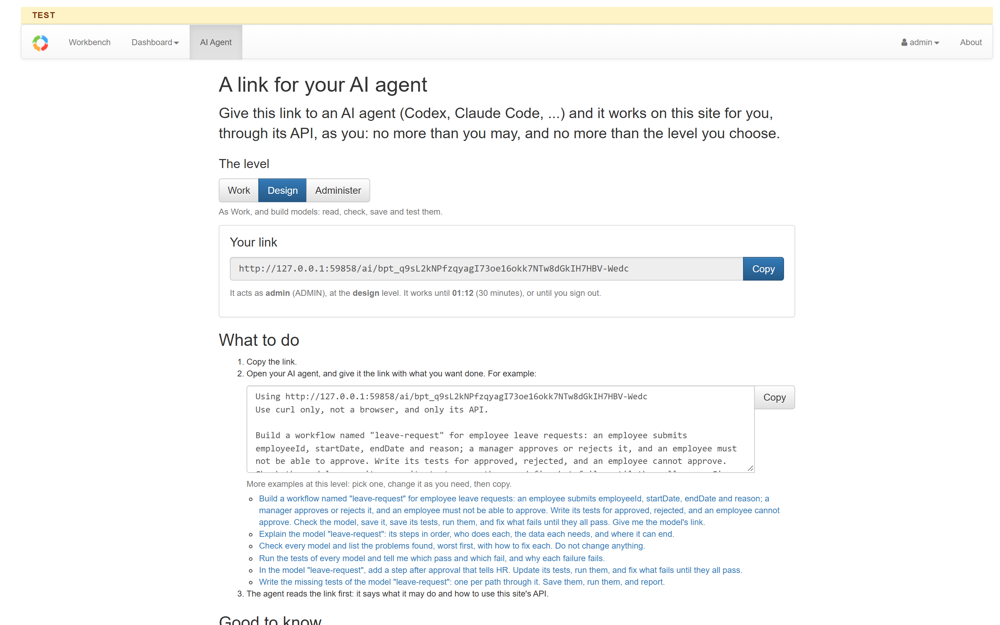

# AI Agents (add-on)

The **AI Agents** add-on lets a person give their AI agent a link to this site: the agent then works as them. Turn it
on or off on its area of the [Settings page](../integration-settings.md) (**Dashboard ▸ Settings ▸ AI Agents**).

## What it does

- **AI Agent**, a menu item of its own for everyone signed in (`/ai/key`): a link for their AI agent, an API key that
  acts as the person, at the level they choose (work, design, administer), for minutes. The agent opens the link
  first (`/ai/<key>`), which says whom it acts as and where to start. A person revokes their links there.
- **Examples of what to ask**, by level, on the same page: one click puts one in the box, to change and copy.
  - Work: my waiting tasks, what I can start, starting a request, where my cases wait and why, completing a task.
  - Design: build a workflow with its tests, explain a model, check every model, run every model's tests, change a
    model and its tests, write the missing tests.
  - Administer: what to fix for production, the settings' failing checks, defaults that matter, email for the
    notifications, the add-ons that are on. It advises and changes nothing.
- **In an application that signs people in itself** (a host user manager, such as the HR demo): the same. The
  application's sign-in says who the person is, and API v3 takes the link besides the application's own credentials.
  The application shows the item when API v3's `/me` says `may.aiLink`.

This site's guide for agents, `/llms.txt`, is the server's: it is there whether the add-on is on or off.

## Its settings

| Setting | |
|---|---|
| `AI_ACCESS` | The link levels offered |
| `AI_GUIDE` | The guide for AI agents |

## When it is off

The menu has no link, the `/ai` pages answer 404, and the API refuses the links given before (`403`, `AI_OFF`).
