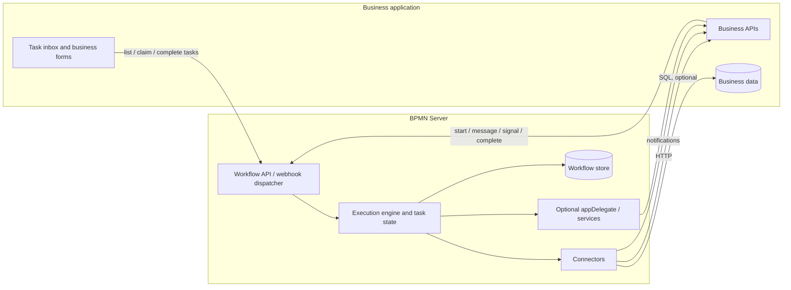

# Application Integration — Architecture and Design Proposal

- **Status:** Proposed design; nothing here is implemented unless it says so. Phase 1, the task API, is built.
- **Date:** 2026-11-04, revised 2026-11-05
- **Scope:** BPMN Server 3.5+ evolution, including future multi-application hosting
- **Placement:** the integration is built in `bpmn-web`, where the API is, with as little change to `bpmn-server` as possible

## 1. Overview

BPMN Server should integrate with an existing business application without requiring custom TypeScript for ordinary operations. The application owns its user interface, business rules, authoritative business data and identities; BPMN Server owns process execution, waiting items, task state, tokens, timers and workflow history.

The integration model has five complementary surfaces:

| Surface | Direction | Contract |
| --- | --- | --- |
| Inbound process events | App → BPMN | Authenticated HTTP API / named webhook routes |
| Outbound application operations | BPMN → App | Connector operations (`<connector>/<operationId>`); later, manually configured HTTP or SQL |
| Human tasks | Both | BPMN creates/waits; app lists or receives notification, shows its UI and completes task via workflow API |
| Workflow data | Both | Shared store, selective replication, event notification or on-demand workflow API |
| Custom extensions | Both | Existing appDelegate/services remain optional escape hatches |

The server may host multiple logically isolated applications in a future release. Multi-app configuration and isolation are **future design requirements**, not existing 3.5 capabilities.

## 2. Current baseline and gaps

This proposal builds on the current repository documentation:

- [Application integration](customization.md) documents embedding, the sample host, delegates/services, API callers, and ownership of business data.
- [Connectors](connectors.md) documents **implemented** OpenAPI 3.0/3.1-backed REST connectors for service and send tasks, with admin registry, secrets, modeler wizard and execution policies. Connector identifiers currently use `<connector>/<operationId>`.
- [Scripting](scripting.md) documents JavaScript execution/model listeners, task listeners and application-wide event listeners. Scripts currently expose `appServices`, `appUtils` and `appDelegate`; they do not document calling a connector from a script, though section 4.3 shows that it works.
- [Managing data](data.md) describes instance, item and workflow-data queries; [Custom persistence](persistence.md) describes MongoDB, SQLite, memory and an `IDocumentStore` adapter.

**Identified gaps:** a task API for an application acting for its users; task events that survive a crash; a clear inbound webhook-to-event contract; direct SQL operation configuration; explicit data-sharing/replication choices; comprehensive User Task integration examples; future application scoping. These are proposals, not claims of current implementation.

### 2.1 What the server does today

Each of these is checked by a "today" test in `testSampleApp/test/web/task-api.test.mjs`. The design works with them; none is changed in the engine.

| Behavior | What it means for integration |
| --- | --- |
| `/api2` acts as one configured service account and ignores any user the caller sends. | An application cannot complete a task as its user. |
| `BPMNAPI` narrows a call to the item: a user with no part in a task cannot complete it. | The rule for outsiders exists and is reused. |
| A candidate can complete a task assigned to someone else through `BPMNAPI`. | The task API adds the assignee check itself, in `bpmn-web`. |
| A second `engine.invoke` of an item is refused under the instance's lock (`ITEM_NOT_WAITING`). | Completing twice is safe, and can be answered with a 409. |
| Failed `/api2` calls such as invoke and `throwMessage` answer 200 with `errors`. | An application cannot rely on the status. New routes answer with real ones. Existing routes stay as they are. |
| A lifecycle subscriber hears of a waiting task before it is saved. | A call made from there can reach the application before the task can be found. |
| A subscriber's failure does not reach the execution; a model listener's failure stops it. | Notifying from a model listener can stop the process when the application is down. |
| `throwMessage` needs a `SYSTEM` service account. | An ordinary API key cannot deliver a message. |
| A message nothing waits for starts a process if a model has it as a start event, each time it is delivered. | A retried webhook can start a second process, so webhooks do not use `throwMessage`. |
| A script reaches `appDelegate.server.connectors.call(ref, input)`, except in the sandbox. | Calling a connector from a script needs no new engine API. |

## 3. Conceptual architecture



A **connector operation** such as `HR/getEmployee` or `HR/notifyTask` is the stable name a model uses. It already decouples models from the endpoint and the credential: the administrator can change the base URL or the key without touching a model. A **delegate** is an optional code implementation.

## 4. Outbound connectors

### 4.1 Reuse the existing OpenAPI connector capability

- Keep the current OpenAPI REST connector registry and service/send-task support. Do not replace or break the existing `camunda:connector` XML format or `<connector>/<operationId>` references.
- **No separate registry of named integrations for now.** `<connector>/<operationId>` is the name. A registry can be added if applications need to swap the implementation behind a name.
- Prefer OpenAPI discovery when the app publishes a specification; also allow manually configured HTTP operations for apps without OpenAPI.
- Business writes should generally go through the app API so authorization, validation, audit and events remain authoritative.

### 4.2 SQL integration

Allow an operation to execute a parameterized, approved SQL query against a configured application database. Use a driver/adapter internally; **do not require SQL to be transported over HTTP**. If a remote SQL service is preferred for deployment reasons, it may also be reached using HTTP.

Protect database access using least-privilege credentials, parameter binding, allowlisted statements or operations, timeouts, quotas, audit logs and explicit write permissions. The application owns its schema and business rules; direct SQL writes are opt-in and should not silently bypass application invariants.

### 4.3 Calling a connector from a script

Service/send tasks **already** support REST connectors. A script can already reach the same call, so this needs documentation and tests rather than a new engine API:

```js
// In a script or listener. Works today; not available in the sandbox.
try {
  const { output } = await appDelegate.server.connectors.call('HR/getManager', { employeeId: data.employeeId });
  data.manager = output.userName;
} catch (error) {
  // Without this, a failed call stops the process: a listener's failure reaches the execution.
}
```

This call runs inside the execution, under the instance's lock and before the save, and its connector's `groups` are not checked at run time. **Task notifications do not use it**: they use the task events of section 7.1.

Existing `appServices` and `appDelegate` contracts remain supported as an **escape hatch**. No deprecation is proposed.

## 5. Inbound webhooks and API

The business application can initiate a process, deliver a message/signal to a waiting execution, or complete a User Task via BPMN APIs. Named webhook routes are an optional friendly facade over existing engine operations, **not a second event engine**.

**Proposed example, not an existing route:**

```http
POST /apps/hr/hooks/contract-signed
Content-Type: application/json

{"employeeId":"123","contractId":"456"}
```

A route configuration maps the payload to a `start`, `message` or `signal` operation and establishes correlation (application id, business key, instance id or message matching key). Validate signature/token, replay protection, payload schema, authorization and deduplication. Keep internal engine IDs out of external contracts when a stable business key suffices.

The routes live in `bpmn-web`. They do not call `throwMessage`, which can start a process when it meant to resume one (section 2.1). A route says which it does: to resume, it finds the waiting item with `engine.waitingFor` and invokes it, and answers 404 when nothing waits; to start, it records the delivery's ID first, so that a retry starts nothing. The engine has no business key field today, so correlation uses a data path, as a message matching key does.

## 5.1 Phase 1 contract: the task API

**Built.** The tests are in `testSampleApp/test/web/task-api.test.mjs`. The routes are in `bpmn-web` (`routes/taskApi.ts`); the engine is unchanged.

**Who calls.** A new secret, `API_ACTING_USER_KEY`, is for applications trusted to authenticate their own users. It is unset by default, and then the routes answer 404.

| Header | Meaning |
| --- | --- |
| `x-api-key` | `API_ACTING_USER_KEY`. `API_KEY` is refused here, and this key opens no other route. |
| `x-acting-user` | The user the application has authenticated. Required. |
| `x-acting-groups` | That user's groups, comma separated. `SYSTEM`, `ADMIN` and `DESIGNER` are refused with a 403: this key cannot make an administrator. |

The tenant is the service account's (`API_SERVICE_TENANT_ID`), never taken from a header.

**Routes**

| Route | Does | Answers |
| --- | --- | --- |
| `GET /api2/tasks?limit=&after=` | The waiting user tasks this user can work on. | 200 `{ tasks, next }` |
| `GET /api2/tasks/:id` | One task, with its instance's data. | 200, 404 |
| `POST /api2/tasks/:id/claim` | Assigns the task to this user. | 200, 403, 404, 409 |
| `POST /api2/tasks/:id/complete` | Body `{ data }`. Completes the task, recording this user. | 200 `{ task, instance }`, 400, 403, 404, 409 |

**Rules**

- A user **has a part** in a task when they are its assignee, a candidate user, in a candidate group, or the task has no assignment at all.
- With no part, or no such task, or an item that is not a user task: 404, the same answer each way, so an ID cannot be probed.
- A task assigned to someone else: 403 to complete, 409 to claim.
- A task that has ended: 409. Completing relies on the engine's own check under the lock (`ITEM_NOT_WAITING`).
- Errors are `{ errors, code }`, with a real status. A lock still busy after its retries is a 503.

**Claims.** A claim holds the lock manager's `claim` across its check and its assignment, so two at the same moment cannot both succeed: the other answers 409. A server that crashes holding one leaves that task unclaimable until the claim goes stale (`staleAfter`, five minutes by default), while completing it still works.

## 6. User Task integration

A User Task is not a call that launches a remote user interface. When BPMN reaches it, the task is persisted and the execution **waits**.

1. BPMN creates a waiting User Task (assignee, candidate roles/users, business key, optional form/task type).
2. `bpmn-web` **may** send a task event to the application (section 7.1). Notification is optional; an app may instead query the task API.
3. The application presents the task in its own inbox, notification center or existing case/task system.
4. The user initiates opening the application form. The app retrieves business data from its own API/DB and task state from BPMN if needed.
5. The authenticated application calls the workflow task completion API with result data; BPMN validates authorization and resumes execution.

```mermaid
sequenceDiagram
  participant W as BPMN Server
  participant A as Business App
  actor U as User
  W->>W: Create User Task; persist WAIT
  opt Task events configured
    W->>A: task.created, after the task is saved
  end
  U->>A: Open inbox / task
  A->>W: Query task (optional)
  A-->>U: Render application form
  U->>A: Submit decision
  A->>W: Complete waiting task via authenticated API
  W->>W: Advance process
```

Do **not** add a notification subsystem to the engine. Task events are a lifecycle subscriber in `bpmn-web`, and they call the application through a connector. A form reference is application metadata, not an instruction to open a browser remotely.

For task assignment, a task names a role (by default its lane) or an assignment policy, and the application resolves it to users with an optional `appDelegate.resolveAssignment(item, intent)`, which may call a connector operation (`hr/getEmployee`). The engine remains responsible for assignment state and enforcement: see [Business labels, task roles and assignment](https://github.com/bpmnServer/bpmn-server/blob/main/docs/design/business-labels-roles-assignment.md). The app may act on its own business transaction before completing the BPMN task, or the workflow may orchestrate the business API update; document idempotency/recovery for partial success in either mode.

## 7. Workflow data-store integration

Workflow records include instances, items (including waiting User Tasks), tokens, execution data, logs/history and event-related state. Four supported integration patterns should be available **per application**:

| Pattern | Mechanism | Ownership / caution |
| --- | --- | --- |
| **Shared data store** | Configure BPMN's store adapter to persist into the app-managed database or shared database namespace. | Share physical persistence, **not engine write ownership**; app reads through stable views/API; completion and state mutation still go through engine API. |
| **Selective replication** | Publish selected workflow/task projections to app storage via listeners + integration connectors (initial design). | App's tables are read models, not engine source of truth; use idempotent upserts, version/order handling and reconciliation. |
| **Event notification** | Emit task/instance/item lifecycle notifications using existing JavaScript listeners and connectors. | App decides what to fetch/store; at-least-once delivery requires deduplication. |
| **On-demand access** | App queries BPMN APIs for tasks, instances and history. | Least coupling and simplest initial model; API latency/availability applies. |

**Default recommendation:** on-demand access, optionally accompanied by event notifications. Selective replication is valuable when an existing application must maintain a local inbox or search index. Shared storage is supported as a deliberate deployment/adapter choice, not a requirement for integration.

Important subtleties:
- Existing `IDocumentStore` supports custom persistence; a production shared-store adapter needs explicit schema, concurrency, transaction, migration and lock compatibility checks.
- Workflow data should normally store business IDs, small execution variables and required audit snapshots, not become the authoritative application record.
- For notification/replication guarantees, prefer durable outbox or equivalent retryable event log; arbitrary inline trigger HTTP calls alone do not guarantee delivery across a crash. No exactly-once claim.
- Publish only authorized fields; segregate credentials and personally identifiable business information.
- The application must **not** directly mutate engine-managed instances/items/tokens, even when it can read the shared database.

### 7.1 Task events, without an engine change

A lifecycle subscriber hears of a task before the task is saved, and its failure does not reach the execution. Task events in `bpmn-web` are built on both facts:

1. On a user task's `wait` or `end`, the subscriber writes a record through the `IDocumentStore` port, so it works on MongoDB, SQLite and memory. Its ID is `<item.id>:<event>`, under a unique index.
2. A worker in `bpmn-web` picks up each record and delivers it through the configured connector operation only once the store shows that state saved, and so after the task can be found.
3. Delivery retries with a growing delay. A failure leaves the process untouched.
4. A record whose state is never saved, because the server crashed first, is dropped after a time limit: the application never hears of a task that does not exist.

**Delivery is at least once.** The application removes duplicates by the event's ID.

**Known limits**, to be covered by tests and stated in the guide: if writing the record itself fails, the subscriber's failure is only logged and that event is lost, so an application that cannot miss a task reconciles against the task API. Each user task adds a write to the store. Workers on several servers need to claim a record, which `lockManager.claim` offers.

## 8. Configuration and multiple applications

Settings are split in two, as [Settings](settings.md) describes:

```text
.env                  # the installation: what differs per machine, and secrets
settings/config.ts    # the application: how it behaves (typed, in Git)
```

There is no separate `configuration.json`. Application behaviour (label templates, list columns, default assignment policies, connector and hook settings) goes in the application's `settings/config.ts`. Code (resolvers, hooks) goes on its delegate. Secrets stay in `.env` or a secret store and are referenced, never checked in. New settings are read from the server's configuration object, not from module-level state or `process.env` at request time. See [Business labels, task roles and assignment](https://github.com/bpmnServer/bpmn-server/blob/main/docs/design/business-labels-roles-assignment.md).

Several applications on one server, and tenants, are planned for 3.8, in their own design note, [Several applications on one server, and tenants](https://github.com/bpmnServer/bpmn-server/blob/design-multi-app/docs/design/multi-app-tenants.md) (draft). Each application (a workspace) would have its own `settings/config.ts`, delegate, models, users and data. Until then this is a constraint: nothing added may be global in a way that would block it. An installation must never access another application's data through shared registry names or guessed task IDs.

## 9. Security and operational contract

- Authenticate inbound calls and enforce app scope, user claims, task assignment and authorization at the BPMN boundary.
- Authorize connector access **at runtime**, not merely at model-design time; validate app ownership and secret access.
- Prevent SSRF from configurable HTTP endpoints; restrict SQL permissions and query templates.
- Explicit retry/idempotency policies for remote side effects; log invocation ID, outcome and redacted diagnostics.
- Document delivery semantics for task notifications and replication (eventual consistency, duplicates and failure recovery).
- Correlate all requests and callbacks with app ID, integration ID, instance ID, item ID and business key as appropriate.
- Audit task decisions, connector calls and privileged data access without logging secrets.

## 10. Implementation increments

| Phase | Work | Verification |
| --- | --- | --- |
| **1 — Task API** | The routes of section 5.1, in `bpmn-web`. Existing routes unchanged. | The contract tests pass; an unassigned outsider is refused; history shows the real user; completing twice runs nothing again. |
| **2 — Task events** | Section 7.1, in `bpmn-web`. | A crash loses no saved task's event and reports no unsaved task; duplicates carry an ID; a failed delivery leaves the process untouched. |
| **3 — Worked example** | A small external application with its own inbox and form, using only phases 1 and 2. | An end-to-end test on MongoDB and SQLite; the guide is based on it. |
| **4 — Connector calls from scripts** | Document section 4.3. | A test of the same operation from a service task and a listener, including a failure and the sandbox. |
| **5 — Inbound webhooks** | Section 5, in `bpmn-web`. | A retry never starts a second instance; signature, correlation and no-match tests. |
| **6 — APIs without OpenAPI** | Manually configured HTTP operations, with SSRF protection. | Blocked addresses are refused. |
| **Later** | SQL, shared storage and multi-app hosting, each with its own design first. | Crash, migration, isolation and cross-app denial tests. |

Phases 1, 2 and 5 are expected to need no change to `bpmn-server`. If one turns out to need it, keep the change small and call it out for review. They should also leave room for an application ID, so that multi-app hosting does not rework them.

## 11. Decisions and boundaries

**Agreed direction**
1. Connectors are the normal outbound integration mechanism; OpenAPI is preferred but not mandatory.
2. Scripts can call the same connector operations as Service Tasks. There is no registry of named integrations for now.
3. Task notifications are a lifecycle subscriber in `bpmn-web`, not a mechanism in the engine and not a model listener.
4. The UI belongs to the application. The engine owns waiting tasks and advances when its API receives completion.
5. The app can use shared storage, replication, notifications or on-demand queries; choose per integration need.
6. **Keep appDelegate** fully available as an optional escape hatch, with backward compatibility.
7. Plan for an eventual server capable of hosting multiple applications with isolation.
8. An application may act for its users, with a separate key, off by default, and never as an administrator.
9. Integration is built in `bpmn-web`, where the API is, with minimum impact on `bpmn-server`.

**Pending detailed contracts**
- Supported SQL engines, read/write policy and driver deployment.
- Webhook naming and correlation schema and which existing API routes are reused.
- Durable notification/replication delivery and reconciliation implementation.
- Stable task projection schemas.
- Definition of application identity/user roles and task assignment resolution across apps.

## 12. Related documentation

- [Application integration (current)](customization.md)
- [Connectors (current)](connectors.md)
- [Scripting and listeners](scripting.md)
- [Workflow data](data.md)
- [Installation, configuration and storage](setup.md)
- [Runtime APIs](api-summary.md)
