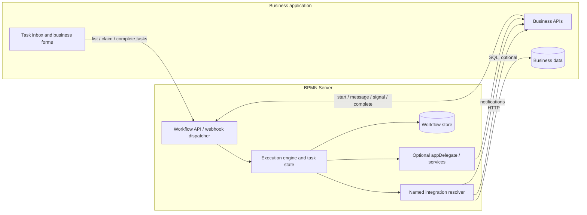

# Application Integration — Architecture and Design Proposal

**Status:** Proposed design for review  
**Date:** 2026-11-04  
**Scope:** BPMN Server 3.5+ evolution, including future multi-application hosting

## 1. Overview

BPMN Server should integrate with an existing business application without requiring custom TypeScript for ordinary operations. The application owns its user interface, business rules, authoritative business data and identities; BPMN Server owns process execution, waiting items, task state, tokens, timers and workflow history.

The integration model has five complementary surfaces:

| Surface | Direction | Contract |
| --- | --- | --- |
| Inbound process events | App → BPMN | Authenticated HTTP API / named webhook routes |
| Outbound application operations | BPMN → App | Named integrations backed by OpenAPI HTTP connectors, manually configured HTTP, SQL or other adapters |
| Human tasks | Both | BPMN creates/waits; app lists or receives notification, shows its UI and completes task via workflow API |
| Workflow data | Both | Shared store, selective replication, event notification or on-demand workflow API |
| Custom extensions | Both | Existing appDelegate/services remain optional escape hatches |

The server may host multiple logically isolated applications in a future release. Multi-app configuration and isolation are **future design requirements**, not existing 3.5 capabilities.

## 2. Current baseline and gaps

This proposal builds on the current repository documentation:

- [Application integration](customization.md) documents embedding, the sample host, delegates/services, API callers, and ownership of business data.
- [Connectors](connectors.md) documents **implemented** OpenAPI 3.0/3.1-backed REST connectors for service and send tasks, with admin registry, secrets, modeler wizard and execution policies. Connector identifiers currently use `<connector>/<operationId>`.
- [Scripting](scripting.md) documents JavaScript execution/model listeners, task listeners and application-wide event listeners. Scripts currently expose `appServices`, `appUtils` and `appDelegate`; they do **not** document a general `integrations.invoke` API.
- [Managing data](data.md) describes instance, item and workflow-data queries; [Setup](setup.md#storage) describes MongoDB, SQLite, memory and an `IDocumentStore` adapter.

**Identified gaps:** a shared named-integration invocation API for JavaScript listeners; a clear inbound webhook-to-event contract; direct SQL operation configuration; explicit data-sharing/replication choices; comprehensive User Task integration examples; future application scoping. These are proposals, not claims of current implementation.

## 3. Conceptual architecture



An **integration** is a stable, application-visible operation such as `HR.getEmployee` or `HR.notifyTask`. A **connector** is its technical implementation/transport (HTTP, SQL, email); a **delegate** is an optional code implementation. This distinction decouples BPMN models from endpoint, credential and storage details.

## 4. Outbound connectors and named integrations

### 4.1 Reuse the existing OpenAPI connector capability

- Keep the current OpenAPI REST connector registry and service/send-task support. Do not replace or break the existing `camunda:connector` XML format or `<connector>/<operationId>` references.
- Register a named application integration that refers to an existing connector and operation; optionally bind inputs, outputs, timeout and version. The name is stable even if the underlying endpoint or implementation changes.
- Prefer OpenAPI discovery when the app publishes a specification; also allow manually configured HTTP integrations for apps without OpenAPI.
- Business writes should generally go through the app API so authorization, validation, audit and events remain authoritative.

### 4.2 SQL integration

Allow a named integration to execute a parameterized, approved SQL query against a configured application database. Use a driver/adapter internally; **do not require SQL to be transported over HTTP**. If a remote SQL service is preferred for deployment reasons, it may also be reached using HTTP.

Protect database access using least-privilege credentials, parameter binding, allowlisted statements or operations, timeouts, quotas, audit logs and explicit write permissions. The application owns its schema and business rules; direct SQL writes are opt-in and should not silently bypass application invariants.

### 4.3 Unified invocation API

Service/send tasks **already** support REST connectors. Extend the same operation resolver to JavaScript execution/task listeners, and optionally to delegates, without forcing models to implement a new JavaScript-based service task.

**Proposed API, not implemented:**

```js
// In an execution listener; exact runtime scope to be finalized.
await integrations.invoke('HR.notifyTask', {
  taskId: item.id,
  instanceId: instance.id,
  event: 'TaskCreated',
  assignee: item.assignee
});
```

The script runtime must expose a scoped, authorized invocation interface (not unrestricted connector internals). Invocation should return a well-defined result/error, with configurable timeout and idempotency handling. It must work in asynchronous listeners, not necessarily in synchronous expression evaluation.

Existing `appServices` and `appDelegate` contracts remain supported as an **escape hatch**. No deprecation is proposed.

## 5. Inbound webhooks and API

The business application can initiate a process, deliver a message/signal to a waiting execution, or complete a User Task via BPMN APIs. Named webhook routes are an optional friendly facade over existing engine operations, **not a second event engine**.

**Proposed example, not an existing route:**

```http
POST /apps/hr/hooks/contract-signed
Content-Type: application/json

{"employeeId":"123","contractId":"456"}
```

A route configuration maps the payload to a `start`, `message` or `signal` operation and establishes correlation (application id, business key, instance id or message matching key). Validate signature/token, replay protection, payload schema, authorization and deduplication. Keep internal engine IDs out of external contracts when a stable business key suffices.

## 6. User Task integration

A User Task is not a call that launches a remote user interface. When BPMN reaches it, the task is persisted and the execution **waits**.

1. BPMN creates a waiting User Task (assignee, candidate roles/users, business key, optional form/task type).
2. An existing execution/task JavaScript listener **may** invoke `HR.notifyTask` using the common integration API. Notification is optional; an app may instead query workflow tasks.
3. The application presents the task in its own inbox, notification center or existing case/task system.
4. The user initiates opening the application form. The app retrieves business data from its own API/DB and task state from BPMN if needed.
5. The authenticated application calls the workflow task completion API with result data; BPMN validates authorization and resumes execution.

```mermaid
sequenceDiagram
  participant W as BPMN Server
  participant A as Business App
  actor U as User
  W->>W: Create User Task; persist WAIT
  opt Configured JavaScript listener
    W->>A: HR.notifyTask (via connector)
  end
  U->>A: Open inbox / task
  A->>W: Query task (optional)
  A-->>U: Render application form
  U->>A: Submit decision
  A->>W: Complete waiting task via authenticated API
  W->>W: Advance process
```

Do **not** introduce a dedicated User Task notification subsystem. Reuse supported listeners and the common integration resolver. A form reference is application metadata, not an instruction to open a browser remotely.

For task assignment, optionally resolve a user or role through a named integration (`HR.getManager`) while the engine remains responsible for assignment state and enforcement. The app may act on its own business transaction before completing the BPMN task, or the workflow may orchestrate the business API update; document idempotency/recovery for partial success in either mode.

## 7. Workflow data-store integration

Workflow records include instances, items (including waiting User Tasks), tokens, execution data, logs/history and event-related state. Four supported integration patterns should be available **per application**:

| Pattern | Mechanism | Ownership / caution |
| --- | --- | --- |
| **Shared data store** | Configure BPMN's store adapter to persist into the app-managed database or shared database namespace. | Share physical persistence, **not engine write ownership**; app reads through stable views/API; completion and state mutation still go through engine API. |
| **Selective replication** | Publish selected workflow/task projections to app storage via listeners + integration connectors (initial design). | App's tables are read models, not engine source of truth; use idempotent upserts, version/order handling and reconciliation. |
| **Event notification** | Emit task/instance/item lifecycle notifications using existing JavaScript listeners and connectors. | App decides what to fetch/store; at-least-once delivery requires deduplication. |
| **On-demand access** | App queries BPMN APIs for tasks, instances and history. | Least coupling and simplest initial model; API latency/availability applies. |

**Default recommendation:** on-demand access, optionally accompanied by event notifications. Selective replication is valuable when an existing application must maintain a local inbox or search index. Shared storage is supported as a deliberate deployment/adapter choice, not a requirement for integration.

Important subtleties:
- Existing `IDocumentStore` supports custom persistence; a production shared-store adapter needs explicit schema, concurrency, transaction, migration and lock compatibility checks.
- Workflow data should normally store business IDs, small execution variables and required audit snapshots, not become the authoritative application record.
- For notification/replication guarantees, prefer durable outbox or equivalent retryable event log; arbitrary inline trigger HTTP calls alone do not guarantee delivery across a crash. No exactly-once claim.
- Publish only authorized fields; segregate credentials and personally identifiable business information.
- The application must **not** directly mutate engine-managed instances/items/tokens, even when it can read the shared database.

## 8. Configuration and multiple applications

Separate installation/runtime settings from application configuration:

```text
.env                         # server installation / secret references
configuration.json           # proposed server-wide logical config
apps/
  hr/
    configuration.json       # application identity and policies
    integrations.json        # named operation bindings
    webhooks.json            # inbound event mapping
    models/                  # app-owned BPMN definitions
  finance/
    configuration.json
    integrations.json
    webhooks.json
    models/
```

This is a **target layout**; the current repository uses `settings/config.ts`, `.env`, existing storage configuration and a connector registry. An implementation plan must migrate/bridge these without breaking current installations. Secrets remain outside checked-in JSON. Define schema validation, precedence and overrides before implementation; existing environment-based connector settings must continue working until migrated.

Future multi-app hosting requires namespaced routes, per-app models, tasks, workflow records, connector permissions, credentials, storage policies, audit and authorization boundaries. An installation must never access another application's data through shared registry names or guessed task IDs.

## 9. Security and operational contract

- Authenticate inbound calls and enforce app scope, user claims, task assignment and authorization at the BPMN boundary.
- Authorize connector access **at runtime**, not merely at model-design time; validate app ownership and secret access.
- Prevent SSRF from configurable HTTP endpoints; restrict SQL permissions and query templates.
- Explicit retry/idempotency policies for remote side effects; log invocation ID, outcome and redacted diagnostics.
- Document delivery semantics for task notifications and replication (eventual consistency, duplicates and failure recovery).
- Correlate all requests and callbacks with app ID, integration ID, instance ID, item ID and business key as appropriate.
- Audit task decisions, connector calls and privileged data access without logging secrets.

## 10. Implementation increments

| Phase | Work | Verification |
| --- | --- | --- |
| **1 — Common invocation** | Add named integration resolver and JS-listener invocation with existing OpenAPI connectors; retain service/send and delegates unchanged. | Same integration works from service task and listener; async/error/security tests. |
| **2 — Documentation and task example** | Add model/script example for User Task notification, app form and authenticated completion. | End-to-end test uses sample app; verify task waits until completion. |
| **3 — Inbound routes and HTTP flexibility** | Named webhook mapping with correlation; manually configured HTTP integrations, if not supported. | Start/message/signal correlation, replay and auth tests. |
| **4 — Data integration** | Document shared-store adapter contract and add selectable task notification/replication projection examples; optional SQL adapter. | Crash/retry/idempotency, migration, isolation and recovery tests. |
| **5 — Multi-app hosting** | Application registry, namespacing and config migration. | Cross-app access denial and compatibility tests. |

## 11. Decisions and boundaries

**Agreed direction**
1. Connectors are the normal outbound integration mechanism; OpenAPI is preferred but not mandatory.
2. JavaScript listeners/triggers should invoke the same named integration operations as Service Tasks.
3. Existing triggers provide notification hooks; do not build a separate User Task notification mechanism.
4. The UI belongs to the application. The engine owns waiting tasks and advances when its API receives completion.
5. The app can use shared storage, replication, notifications or on-demand queries; choose per integration need.
6. **Keep appDelegate** fully available as an optional escape hatch, with backward compatibility.
7. Plan for an eventual server capable of hosting multiple applications with isolation.

**Pending detailed contracts**
- Final API signature/scope for script integration invocation and outcome/error semantics.
- Supported SQL engines, read/write policy and driver deployment.
- Webhook naming and correlation schema and which existing API routes are reused.
- Durable notification/replication delivery and reconciliation implementation.
- Stable task projection schemas; exact per-app configuration JSON schema and migrations.
- Definition of application identity/user roles and task assignment resolution across apps.

## 12. Related documentation

- [Application integration (current)](customization.md)
- [Connectors (current)](connectors.md)
- [Scripting and listeners](scripting.md)
- [Workflow data](data.md)
- [Installation, configuration and storage](setup.md)
- [Runtime APIs](api-summary.md)
