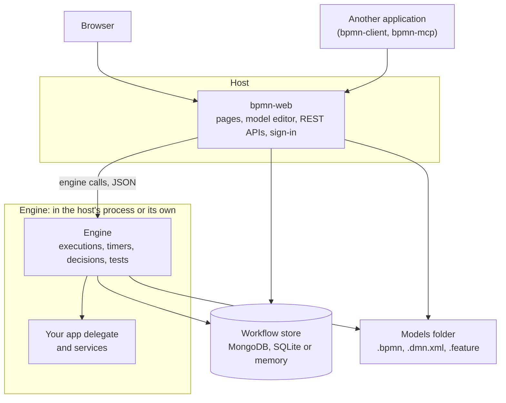

# Architecture

BPMN Server has three layers: a **host** that people and other systems talk to, an **engine** that runs processes, and a **core** of model and data handling that both of them use. The host and the engine can share a process or run apart, and the application's code always stays with the engine.

## Who does what

| Part | Does | Doesn't |
|---|---|---|
| **Host** (`bpmn-web`) | Serves the pages, the model editor and the REST APIs. Signs users in. Reads and saves models, instances and tasks. | Run a process, a timer, a decision or a test. It asks the engine. |
| **Engine** | Runs processes, timers, decisions and tests. Holds your delegate and services. | Face users. Nothing but its host should reach it. |
| **Core** (`bpmn-server`) | Reads models, checks them, and stores data, for both of the above. | Depend on the web application. |

The REST APIs stay on the host. An API call that starts or completes something is passed to the engine, and the host returns the result.

Calls between the host and the engine carry JSON, in the same process or between processes. So code behaves the same in both setups, and a test that passes against one is testing the same calls as the other.

## Ways to run it

| Setup | Host | Address | Engine | Set with |
|---|---|---|---|---|
| **Development and test** | 1 | 1 | 1, in the host's process | Nothing: this is the default |
| **Production** | 1 | 1 | 1, in its own process | `ENGINE_AT`, `ENGINE_KEY` |
| **Design only** | 1 | 1 | None | `ENGINE_AT=none` |

[Installation](setup.md#ways-to-run-it) has the settings for each one.

Your application can also embed the engine with no host at all, using `new BPMNServer(...)` or `BPMNServer.create(...)`: see [Application Integration](customization.md).

## Users

Only signed-in users use a server. There is no guest access. Each person has an account, and their groups decide what they can do: see [Security](security.md).

## Tests

Every test runs in the engine, including one started from the model editor. The host passes the test to the engine and shows the results, so a test runs your real delegate and services the way a real process does.

Tests are Gherkin `.feature` files beside their models. A scenario's last run is its test instance in the database, tagged with its process and scenario. See [Testing and debugging models](testing.md).

## Where things are kept

| What | Where |
|---|---|
| Models, decisions, their tests and version history | Files in the models folder (`DEFINITIONS_PATH`) |
| Instances, tasks, locks and test runs | The workflow store |
| Users and sessions | The application's MongoDB database |
| Your business records | Your own database. A process keeps an identifier and calls your services |

## Packages

| Package | Is |
|---|---|
| `bpmn-server` | The engine and core |
| `bpmn-web` | The host |
| `bpmn-client` | A REST client, for another Node.js application |
| `bpmn-mcp` | Connects AI clients to a running server over MCP. `npx bpmn-server init` installs it |
