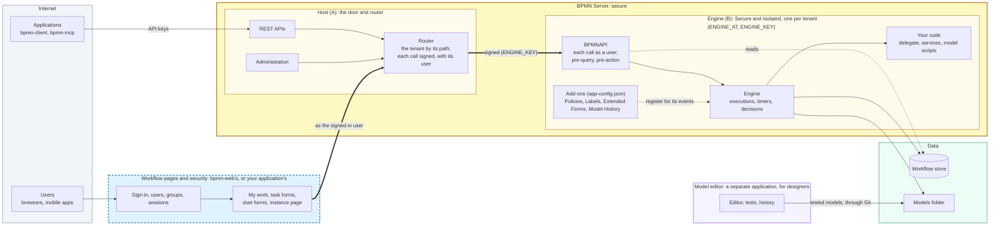
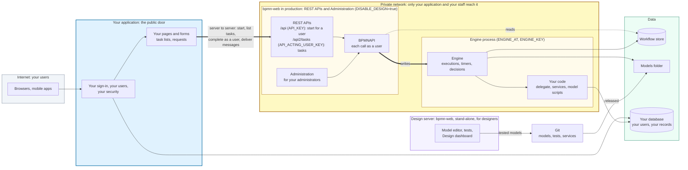
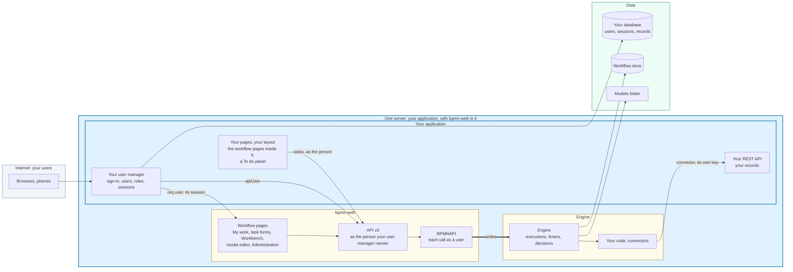
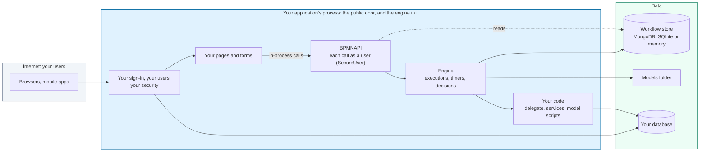

# Architecture

BPMN Server has three layers: a **host** that people and other systems talk to, an **engine** that runs processes, and a **core** of model and data handling that both of them use. The host and the engine can share a process or run apart, and the application's code always stays with the engine.

The host is the door: it signs people in, serves the pages, and routes each call to the engine. The **API** runs
with the engine, beside the data it reads and the policies that narrow it. With tenants, the host is one router for
all of them, and each tenant has an engine of its own ([Parts](#parts)).

The engine runs the flow and nothing else. What is built on it, such as who works on each task, labels and form
lists, is an **add-on**, turned on when it's needed ([Add-ons](#add-ons)).

The **workflow pages and security** are one part of their own (the dashed box): sign-in, users and groups, and the
pages people work in. bpmn-web has a set, a skeleton to start from; your own application can be that part instead,
with the same server behind it, or inside it (a user manager: [Your application with the server inside](#your-application-with-the-server-inside)).
The **model editor** is a separate application, for designers.

## Parts

Every part has one owner, may use only what it lists, and runs in one zone and one process. With tenants there are
two processes: **A**, the web host and router, shared by every tenant and holding nothing of a tenant's; and **B**,
isolated, one for each tenant, holding everything of it. Without tenants, A and B can be one process.

| # | Part | Owner | Uses | Must not use | Zone | Process |
|---|---|---|---|---|---|---|
| 1 | **Data store** | The operator runs it (MongoDB, SQLite); BPMN Server owns its interface | nothing | anything above it | Store | B |
| 2 | **Engine** | BPMN Server | the data store, through its interface; it calls 4 and 5 | add-ons, the API, the pages | Engine | B |
| 3 | **Add-ons' code** | Each add-on's author (BPMN Server for the four); the admin turns it on (`app-config.json`) | the engine's events and registrations | other add-ons, the data store directly | Engine | B |
| 4 | **Delegates and services** | The app developer | the engine's execution | the data store directly, add-ons | Engine | B |
| 5 | **Scripts, conditions, policies and decisions (DMN)** | The modeler: they are part of the models | their context only (item, data, services) | anything else | Engine | B |
| 6 | **Models, read only** | BPMN Server owns the reader; the modeler owns the models | the models folder | writing anything (saves go through the API) | Engine | B |
| 7 | **Instances, read only** | BPMN Server owns the reader; the engine owns the instances | the data store | writing anything | Engine | B |
| 8 | **API** | BPMN Server | the engine, 6, 7; it fires `pre-query` and `pre-action` | the engine's internals | Engine | B |
| 9 | **Model editor** | BPMN Server; each add-on owns its modules | the API, the add-ons' editor modules and manifests | the engine | Browser | A (served) |
| 10 | **Pages** | BPMN Server; each add-on owns its pages; the app developer owns custom pages | the API | the engine, the data store | Browser | A (served) |

**A is a router.** It logs the user in, serves the pages and the editor, and routes each call to the tenant's B. It
holds nothing of a tenant's: no code, no data, no rules. What spans tenants (the tenants, their logins) is A's.

**One writer for each kind of data.** Instances are written by the engine only. Models, with their policies and
decisions, by the modeler, through the API. `app-config.json` and the settings by the admin.

**An owner's code runs in its zone only.** The app developer's code (4) and the modeler's (5) run in the engine zone,
beside the engine. That code isn't BPMN Server's, so it is what isolation has to separate. Separating it from the
engine is planned work, apart from the add-ons.

**No part reaches into another's.** An add-on doesn't change the engine. A delegate doesn't write the store. A page
doesn't call the engine. A policy narrows a query in B, before anything is returned: A gets only what the user may
see.

**Security is two events, in B.** Before every query the API fires **`pre-query`** (`{ kind, user, query }`, kind:
`instances`, `items` or `models`); a listener adds conditions, all of them ANDed: it can narrow, never widen. Before
every action the API asks the user's one check for it (`canStart`, `canInvoke`, `canAssign`, `canModifyModel`,
`canDeleteModel`), which fires **`pre-action`** (`{ action, user, item }`); a listener may refuse. A listener that
fails refuses. With no listener (Policies off) the built-in rules apply: an admin, the task's assignee or candidates.

**A tells B who is calling.** A passes the user (name, roles, tenant) with each call, signed (`ENGINE_KEY`). B accepts
no call that doesn't come through A, and decides what that user may do.

**With tenants:**

- **Routing:** A finds the tenant from the call's path, and signs the call to that tenant's B with its key.
- **Users:** A owns the login (one login can reach several tenants); each B owns its roles.
- **Processes:** one B for each tenant; a pool of B's, each tenant isolated inside, later.
- **Per tenant:** each tenant's custom pages and its `app-config.json` are its own, in its B. A asks B which add-ons
  are on, for the menus and the editor.
- **Calls with no user:** A routes webhooks and incoming messages to the tenant's B like any call. A B with nothing to
  do may stop; a wake-up starts it again when a timer is due.

**A known gap:** today the API (8) runs in the host, and the readers (6, 7) read the store and the models folder from
there. They move to B with the multi-tenant work.

bpmn-web's pages call `BPMNAPI` in the host's process; your application's pages call the REST APIs. Either way, each
call acts as the signed-in user. In development the host and the engine are one process, with the same calls between
them. What changes when your application replaces the box: [From the skeleton to your application](#from-the-skeleton-to-your-application).

## Who does what

| Part | Does | Doesn't |
|---|---|---|
| **Host** (`bpmn-web`), A | Serves the pages, the model editor and the REST doors. Signs users in. Routes each call, with its user, to the tenant's engine. | Hold a tenant's code, data or rules; run a process, a timer, a decision or a test. It asks the engine. |
| **Engine**, B | Runs processes, timers, decisions and tests, and the API: every read and write, narrowed by the policies (`pre-query`, `pre-action`). Holds your delegate and services. | Face users. Nothing but its host should reach it. |
| **Core** (`bpmn-server`) | Reads models, checks them, and stores data, for both of the above. | Depend on the web application. |
| **Add-ons** | What is built on the engine: who works on each task, labels, form lists, the editor's Test and History tabs. Each brings its engine part, its editor part and its pages. | Be called by the engine. An add-on registers for what it needs, and depends on no other add-on. |

Calls between the host and the engine carry JSON, in the same process or between processes. So code behaves the same in both setups, and a test that passes against one is testing the same calls as the other.

## Isolation

Each zone of the diagram trusts the one inside it, and only that one:

| Boundary | What crosses it | What guards it |
|---|---|---|
| Internet → host | Pages, the model editor, REST calls | Sign-in and sessions (bpmn-web's, or your application's through its user manager), CSRF, API keys and tokens, rate limits; every call then acts as a user, with that user's rights |
| Host → engine | Every call, with the user it is for: the reads and the writes of the engine's data (starting, completing, assigning, tests, locks, the models' index, connector keys and tests) | A private address (`ENGINE_AT`) and a key (`ENGINE_KEY`); nothing else reaches the engine. The engine decides what that user may see and do |
| Engine → your systems | What your services and connectors call | Your code, and the connectors' keys, which only the engine holds |

The engine runs your code: delegates, services, and the scripts in models. Kept in a process of its own, a script that loops or a
service that crashes stops the engine, not the pages. When it restarts, the waiting tasks and the timers are in the
store as they were; a step it was in the middle of is recovered from **Administration** (see
[Hung tasks](advanced.md#hung-tasks)).

**Today** the API still runs in the host (the [known gap](#parts)): the host reads instances, tasks and locks through
a read-only view of the store, and the models through model access,
which works on the models folder's files alone: it writes a model's files and a connector's file, and then tells the
engine, which keeps its own index of the models. Everything else of the engine's (instances, locks, that index, the
connectors' keys and tests) the host changes only by asking the engine; a write past it throws `ENGINE_ONLY`. The
host keeps its own users, sessions and API tokens. See `docs/design/engine-isolation.md`.

An application with its own operations on an instance (its bookkeeping, not a BPMN action) gives them to the engine
as **engine calls**, `start({ engineCalls: (server) => ({ 'app.x': async (...args) => ... }) })`, added to bpmn-web's
own. They run in the engine, under its lock; a host route asks for one by name, `web.bpmnServer.engine.call('app.x',
...)`. With the engine elsewhere, the same calls go to its `startEngineService(server, { calls })`.

The engine can also run as a user of its own, or in a container of its own, with only its private address open: what the
separation makes possible, not what a default install does.

## Add-ons

The engine runs BPMN and nothing else. Everything built on it is an add-on, and an add-on that's off isn't loaded: the
engine, the editor and the pages show none of it.

| Add-on | What it is |
|---|---|
| **Policies** | Who works on each task (assignee, candidates, lanes as groups, roles, start permissions, assignment policies), who may see and do what (security policies), who is told what (notification policies), and the actors expressions read |
| **Labels** | What each case and task is called (`owf:label`, `owf:endLabel`), and their values as the lists' columns |
| **Extended Forms** | A form field's choices from a source: a drop-down (`owf:list`) or a search (`owf:lookup`) |
| **Model History** | The editor's Test tab (scenarios) and History tab (each save kept as a version) |

**Which are on:** the application's `app-config.json`, `{ "addOns": ["assignment", "labels"] }`, set on the
[Settings](integration-settings.md) page. With no file, every add-on is on. A change applies when the server restarts.

**How an add-on plugs in.** The engine never calls an add-on, and imports nothing of one. An add-on registers, as
the server starts:

- **for the engine's own events** (`start`, `assign`, `wait`, `end`, `process.end`, and the API's `pre-query`,
  `pre-action`), as any listener does. The Policies add-on decides who works on a task on `start`, through the engine's
  one step for it (`assign`), notifies on `assign`, and decides what a user may see and do on `pre-query` and
  `pre-action`;
- **where the engine has no event**, in the server's registrations: model checks, the names expressions read
  (`actors`), a form field's rules and choices.

An add-on depends on the engine only, never on another add-on. Each has three parts, each where it runs: its engine
part (`bpmn-server/src/addons/<name>`), its editor part, a bpmn-js module (`bpmn-web/modeler/src/addons/<name>`), and
its pages.

**A model that uses an add-on that's off** keeps what it says. The engine ignores it, the model's checks warn
(`add-on-off`), and the model report shows it read-only. Each add-on's manifest (`addon.json`: the attributes and
elements it reads) is read whether it is on or off, so this works without loading the add-on.

**Isolation is the same.** The add-ons' engine parts run in the engine, with your code, and so does the security
policy: it listens in B, where the API is ([Parts](#parts)). See `docs/design/add-ons.md`.

## Why the door is on the host, and the API with the engine

The REST APIs are a public door, so they are where the other doors are guarded: sign-in, keys, rate limits, in one
place: the host. Behind it, every call is passed on, signed and with its user, to the engine, and the host returns the
answer.

The API itself, what a call may read and do, runs with the engine: beside a tenant's data and its policies, so the
host holds none of them, and one host serves every tenant.

The engine stays private because it runs code a model brings with it: only the host reaches it, never the internet.
And the public address is the host's: the engine can be restarted, moved or replaced behind it.

An application that embeds the engine (`BPMNServer.create`) has no HTTP API at all: it calls `BPMNAPI` in its own process.

## The UI and the API

The host has three doors, and they meet at one API:

| Door | Used by | Reaches the engine through |
|---|---|---|
| Pages: My work, task forms, the instance page | Browsers | API v3's operations (My work, starting a process), else `BPMNAPI`; as the signed-in user |
| The model editor's routes (`/model/...`) | The model editor in the browser | The core, for models, checks and history; `BPMNAPI` for runs and tests |
| REST: `/api/v3` | Other applications, your pages, AI agents | `BPMNAPI`, as the user a token (or your application's own credential) stands for, or as the service account (`API_KEY`) |
| REST: `/api`, `/api2`, `/api2/tasks` (frozen) | Older applications | `BPMNAPI`, as the key's service account or as the acting user |

The pages are becoming clients of API v3 like any other: My work and starting a process use its operations, in the
host's process, as the person API v3 would take; the other pages still call `BPMNAPI` directly. One contract to secure and to test,
and, once every page is on it, a UI that can run apart from the host. [API v3](api-v3.md) has the contract.

## From the skeleton to your application

bpmn-web is where an application starts, not necessarily where it ends. What your application does with each part:

| Part of bpmn-web | In your application |
|---|---|
| Sign-in, users and groups, the setup page | **Replaced** by your own: your sign-in, your user directory, your roles. The engine needs only each call's user and groups (`IUserInfo`); bpmn-web takes them from your user manager when it runs inside your application |
| My work, task forms, the start form, the instance page | **Replaced** by your pages, which call the REST APIs (or `BPMNAPI`, embedded). bpmn-web's are working examples to copy from |
| The engine, `BPMNAPI`, your delegate and services | **Kept**: this is what runs your processes |
| REST APIs | **Kept**, behind your application, on a private network |
| Administration | **Kept**, for your administrators, on the private network |
| Model editor, tests, Design dashboard | **Kept** as a stand-alone application for designers: a design server, whose tested models reach production through Git |

### Your application in control

Your application is the dashed box: it signs its users in and serves its own pages, and the rest of the diagram runs
on a private network behind it, with design off (`DISABLE_DESIGN=true`): the REST APIs, Administration and the engine.
In detail:

- BPMN Server signs nobody in here: it trusts the user your application names, because your application holds its
  keys. Keep the keys on your application's server, and bpmn-web where only your application and your staff reach it.
- Your application starts a process **for** one of its users, lists, claims and completes their tasks with
  `/api2/tasks` and `API_ACTING_USER_KEY`: the user is the initiator, and each task comes with its form. `/api2` would
  start it as its service account. [Integrate an existing application](integrate.md) has the steps.
- Designers work on a design server of their own. A model reaches production as a file, tested, through Git: see
  [Release](tutorial/release.md).

### Your application with the server inside

Your application and bpmn-web are one server: bpmn-web runs in your application's process, with your routes and pages
mounted in it, and **your application signs people in**. bpmn-web keeps no users, sessions or credentials of its own:
it takes the person from your application's **user manager**. Your pages show the workflow pages (My work, the
Workbench, the model editor, Administration) in your own layout, and your models call your application's API through a
connector. `apps/hrdemo` is this setup: an HR application with the server in it.

**Who signs people in: your user manager.** bpmn-web asks one thing of your application, an `IUserManager` given to
`start({ userManager })`:

| It does | When |
|---|---|
| `init(app)`: your sessions, and on each request `req.user` (the person: `userName`, `userGroups`) | First, before bpmn-web's middleware |
| `setup(app)`: `/login` and `/logout`, your own pages or sending people to them | Before bpmn-web's routes |
| `apiUser(req)` (optional): who a call to API v3 is from, by your own credential (your session, your token) | Each call to `/api/v3` |

- **Your roles become groups.** The groups `req.user` carries are what the models name: a lane, a task's candidate
  groups, `ADMIN` and `DESIGNER` for administering and designing. The HR demo's roles give `Employee`, `Manager`,
  `HR` and `ADMIN`.
- **Your application issues the credentials.** API v3 takes the person your `apiUser` names; bpmn-web issues no tokens
  and no links for AI agents (`POST /api/v3/tokens` and `/ai/key` refuse). The service key (`API_KEY`) stays, for
  server-to-server calls. Signing out of your application signs out of the workflow pages too: they have no session
  of their own.
- **bpmn-web manages no users.** No setup page at the first start, no sign-up; Administration and `/api/v3/users` say
  your application manages them. bpmn-web's own sign-in is its default user manager, unchanged.
- **The engine is unchanged.** It needs only each call's `IUserInfo`: task assignment is by name and group, checked
  against that person. Finding people (a group's members, an email) is your application's, in its delegate.

**Your pages and the workflow pages, one site.** Your routes are mounted in bpmn-web's server (`start({ routes })`),
before its own, so your pages, your API and the workflow pages share one address and one sign-in:

- The workflow pages open inside your layout, in a frame of the same site: framed so, a page leaves out its own menu
  bar (the browser says it is framed, on HTTPS and localhost; its body has the class `framed`). The HR demo's sidebar
  has a Workflow section, and `/hr/workflow/<page>` shows bpmn-web's `<page>`.
- Your pages call API v3 with the person's session: the HR demo's **To do** panel lists their tasks (assigned to them,
  available to them, recently done) on every page, and opens a task's form.
- *Planned:* a task can name one of your forms instead of its fields (`camunda:formKey="app:<name>"`): see the design
  note `docs/design/form-keys.md`.

**Your models call your application.** A connector, made from your API's OpenAPI document, is how a model reaches your
records: the HR demo's `hr` connector (Assign Employee reads an employee and creates an assignment). It calls with a
key of its own (`HR_SERVICE_KEY`, kept encrypted with `CONNECTORS_KEY`); your API takes that key or a signed-in
person, and nothing else.

The design: `docs/design/host-users.md`.

### Embedded

Your application holds the engine in its own process, with no HTTP between them: your pages call `BPMNAPI`.

The simplest, and the least isolated: a model's scripts run in your web application's process. See
[Embedding the engine](embedding.md).

### The four, side by side

| | Public door | Who signs users in | Workflow pages | Model code runs |
|---|---|---|---|---|
| bpmn-web's pages and security | bpmn-web | bpmn-web | bpmn-web's | In the engine's process, private |
| Your application with the server inside | Your application, bpmn-web in its server | Your application (its user manager) | bpmn-web's in your layout, and yours | In the engine's process |
| Your application in control | Your application | Your application | Yours, through the REST APIs | In the engine's process, private, behind bpmn-web |
| Embedded | Your application | Your application | Yours, through `BPMNAPI` | In your application's process |

## Ways to run it

| Setup | Host | Address | Engine | Set with |
|---|---|---|---|---|
| **Development and test** | 1 | 1 | 1, in the host's process | Nothing: this is the default |
| **Production** | 1 | 1 | 1, in its own process | `ENGINE_AT`, `ENGINE_KEY` |
| **Design only** | 1 | 1 | None | `ENGINE_AT=none` |

[Installation](setup.md#ways-to-run-it) has the settings for each one.

Your application can also embed the engine with no host at all, using `new BPMNServer(...)` or `BPMNServer.create(...)`: see [Application Integration](customization.md).

## Users

Only signed-in users use a server. There is no guest access. Each person has an account, and their groups decide what they can do: see
[Security](security.md). The accounts are bpmn-web's own (its default user manager), or your application's when it
signs people in ([Your application with the server inside](#your-application-with-the-server-inside)).

## Tests

Every test runs in the engine, including one started from the model editor. The host passes the test to the engine and shows the results, so a test runs your real delegate and services the way a real process does.

Tests are Gherkin `.feature` files beside their models. A scenario's last run is its test instance in the database, tagged with its process and scenario. See [Testing and debugging models](testing.md).

## Where things are kept

| What | Where |
|---|---|
| Models, decisions, their tests and version history | Files in the models folder (`DEFINITIONS_PATH`) |
| Which add-ons are on | The application's `app-config.json` |
| The policies | Decision tables in the models folder's `assignment`, `security`, `notification` |
| Connectors | Files in the models folder's `connectors` folder (`connectors/<id>.connector.json`); their keys, encrypted, in the workflow store |
| Instances, tasks, locks and test runs | The workflow store |
| Users and sessions | bpmn-web's: the workflow store, beside the instances (MongoDB, SQLite or memory). Your application's, with its user manager: your database |
| Your business records | Your own database. A process keeps an identifier and calls your services |

## Packages

| Package | Is |
|---|---|
| `bpmn-server` | The engine and core, and the add-ons' engine parts (`src/addons/`) |
| `bpmn-web` | The host, and the add-ons' editor parts and pages |
| `bpmn-client` | A REST client, for another Node.js application |
| `bpmn-mcp` | Connects AI clients to a running server over MCP. `npx bpmn-server init` installs it |
