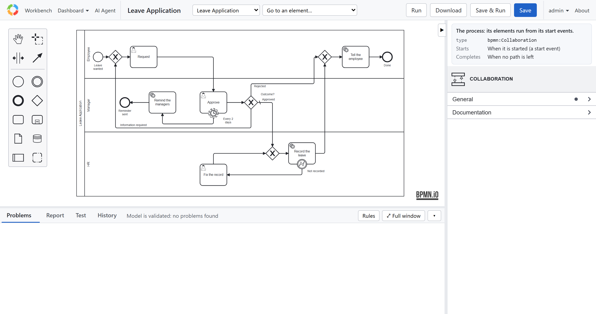
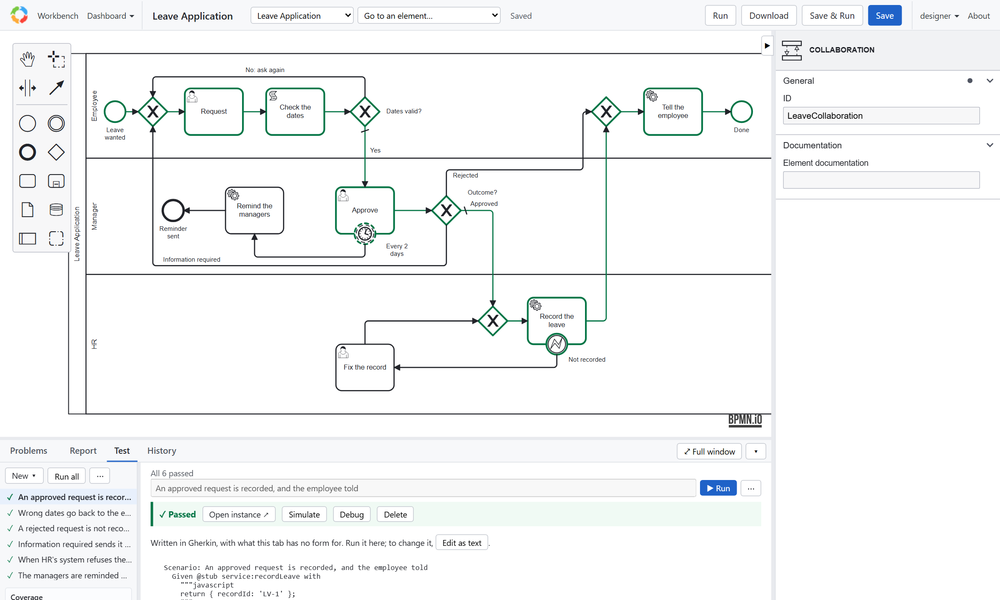

# bpmn-web: the web application

`bpmn-web` is the web host for `bpmn-server`: it provides the Workbench, task lists, model and decision editors,
administration pages, and REST APIs. Your application supplies the models, settings, users, and app delegate.

Please [see bpmn-server for full documentation](https://github.com/bpmnserver/bpmn-server)

## The menu

Every page has the same menu: **Workbench** (the home page: models, pending tasks, instances), then
**Dashboard**. For a designer or an administrator, Dashboard is a drop-down: **My work** (their tasks and
processes), **Design** (the models and decisions, their tests) and, for administrators, **Administration**;
everyone else has **My work** alone. On the right: the user (My account, Sign out) and About. The model and
decision editors show the same places in their header. A page's own links (the Workbench's sections, the docs' pages)
are in the page, not in the menu, and pages that only say something (not found, not allowed, an error) have the menu too.

# Create an application

You need Node.js 20 or later. MongoDB is the default production database, but SQLite and in-memory development setups
are also supported.

Create an application with the setup wizard:

```sh
npx bpmn-server init my-app      # creates the application and asks for its settings
cd my-app
npm start
```

For a quick local run without MongoDB:

```sh
npx bpmn-server init my-app --memory
cd my-app
npm start
```

For an existing application, run `npx bpmn-server setup` to review or change its settings. Use `--profile production`
or `--profile development`, and `--yes` to accept the profile's values without prompts. See [Installation](setup.md)
for the full setup flow and production checklist.

The application's `.env` holds machine-specific values and secrets. A typical production configuration includes:

```env
PORT=3000
MONGO_DB_URL=mongodb://localhost:27017/my-app
API_KEY=...                      # generated; callers of the REST APIs send it
```

Open http://localhost:3000. On first start, the server prints a setup token and the browser asks you to create the
administrator. The setup page can also add the sample `user1` and `manager1` accounts.

## The current interface

The Workbench is the starting point for models, pending tasks, and instances:



The model editor's **Test** tab runs model scenarios without sending real notifications or calling real external
systems:



`init` creates the sample application: a few models, the services they call, the app delegate and settings
(`--minimal`: a one-model Hello application). The repository,
[bpmnServer/bpmn-server](https://github.com/bpmnServer/bpmn-server), has it as `sampleApp`, and the working
application with more models and the tests as `testSampleApp`: see [Installation](setup.md).

## Docker installation
bpmn-web and MongoDB in two containers. Docker is all you need, and two files. On Linux or macOS:

```sh
mkdir bpmn-web && cd bpmn-web
curl -O https://raw.githubusercontent.com/bpmnServer/bpmn-server/main/docker/docker-compose.yml
curl -O https://raw.githubusercontent.com/bpmnServer/bpmn-server/main/docker/up.sh
sh up.sh
```

On Windows (PowerShell):

```powershell
mkdir bpmn-web; cd bpmn-web
curl.exe -O https://raw.githubusercontent.com/bpmnServer/bpmn-server/main/docker/docker-compose.yml
curl.exe -O https://raw.githubusercontent.com/bpmnServer/bpmn-server/main/docker/up.cmd
.\up.cmd
```

Open http://localhost:3000 and sign in as `admin`. The first start creates `.env` next to `docker-compose.yml`
with random keys and the password, and prints the password; see [Docker](docker.md).

## Command-line interface

bpmnServer provide some basic functionalities using CLI. In the application's folder run `npm run cli`; in a
Docker installation it runs in the container: `sh owf cli`, `.\owf.cmd cli` on Windows, or
`docker compose exec server npm run cli` (see [Docker](docker.md#the-console-cli)).

```sh
npm run cli


server started..
Commands:
        q       to quit
        s       start process
        lo      list outstanding items
        li      list items
        l       list instances for a process
        di      display Instance information
        i       Invoke Task
        sgl     Signal Task
        msg     Message Task
        d       delete instnaces
        lm      List of Models
        lme     List of Models
        ck      Check locked instnaces
        re      Recover hung processes
        lu      List Users
        spw     Set User Password
        ?       repeat this list
Enter Command, q to quit, or ? to list commands
>
```

## Update an existing application

```sh
npm update bpmn-server bpmn-web bpmn-mcp
```
