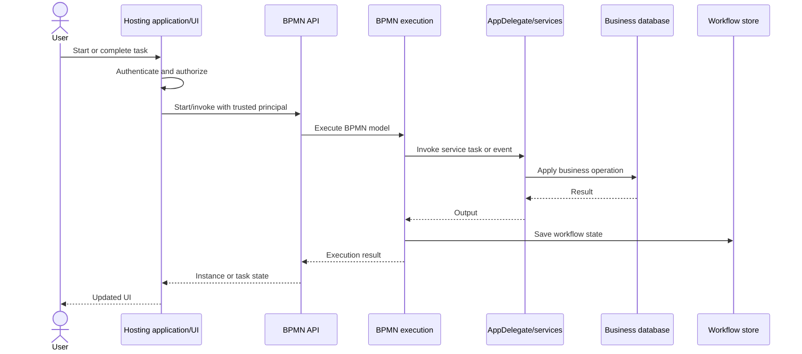

# Integrating BPMN Server into your application

BPMN Server is an **embeddable execution engine**, not a stand-alone process server. Your application hosts the engine, owns authentication and business data, and provides the business behavior invoked by workflows. Use [bpmn-web](bpmn-web.md) if you also want a packaged UI, modeler and HTTP API.

This guide follows the **3.5 monorepo** and its [sample application](https://github.com/bpmnServer/bpmn-server/tree/main/sampleApp), rather than the retired `WorkflowApp` layout.

## Choose your integration

| Option | When to choose it | Entry point |
| --- | --- | --- |
| Use the starter | You want a complete web application with tasks, modeling, and admin | `npx bpmn-server init my-app` |
| Embed the engine | You already have a Node.js server/UI and want to control its lifecycle | `BPMNServer.create(...)`, `BPMNAPI` |
| Call a remote host | Another application already runs BPMN Server and exposes its API | `bpmn-client` |
| Integrate an external HTTP service | A BPMN task must call a REST service described by OpenAPI | [Connectors](connectors.md) |

Start with [Installation](setup.md). For a local evaluation without MongoDB, `npx bpmn-server init my-app --memory` creates a starter that uses in-memory storage.

## Component responsibilities



| Concern | Owner |
| --- | --- |
| User interface, sessions, authentication | Hosting application (or `bpmn-web`) |
| Application authorization and business rules | Hosting application, with engine-level task access checks |
| Process definitions, instances, tokens and task state | BPMN Server and its configured workflow store |
| Business records such as orders, claims, and employees | Hosting application's business services/database |
| User/task interactions | Application calls `BPMNAPI.engine` with a trusted principal |
| Service tasks and domain operations | Application services exposed by the delegate |
| External OpenAPI operations | Connector registry and configured connector credentials |

A process can store a business identifier such as `claimId` and call the application to read or update the claim. Do **not** depend on workflow variables as the authoritative store for business transactions.

## Start with the sample application

The source is at [`sampleApp/`](https://github.com/bpmnServer/bpmn-server/tree/main/sampleApp). The starter command copies its application structure:

```text
my-app/
├── processes/                 # BPMN and DMN definitions
├── connectors/
│   ├── appServices.ts         # Code called by service tasks
│   └── *.json                 # Editor element templates
├── delegates/
│   └── appDelegate.ts         # App-specific hooks and service provider
├── settings/
│   └── config.ts              # Engine/web configuration
├── index.ts                   # Hosts bpmn-web
└── .env                       # DB, port and API keys (keep private)
```

`index.ts` starts the web host using `start` from `bpmn-web`. This is the [same pattern as the checked-in sample](https://github.com/bpmnServer/bpmn-server/blob/main/sampleApp/index.ts):

```ts
import { start } from 'bpmn-web';
import { config, connectorsPath } from './settings/config.js';
import { AppDelegate } from './delegates/appDelegate.js';

await start({
  config: config(),
  appDelegate: AppDelegate,
  elementTemplatesPath: connectorsPath,
  api: true,
  ui: true
});
```

Configure `api` or `ui` to `false` when the host should serve only the other surface. The sample also uses `setupOnly` and `console` modes. The host, not the engine package alone, serves HTTP routes.

### What cases and tasks are called

The pages and the APIs show each case and task by its label, which its model defines (`camunda:label`, with its
values named: `Client: ${Client = data.clientId}`). An application whose labels must be computed in code
implements the delegate's optional `instanceLabel(instance)`. See [Labels](labels.md).

## Embed only the engine

For an existing Node.js host, create the engine with application configuration and keep the reference for its lifetime:

```ts
import { BPMNServer, BPMNAPI, Logger } from 'bpmn-server';
import { configuration } from './configuration.js';

const server = await BPMNServer.create(
  configuration,
  new Logger({ toConsole: false })
);
const api = new BPMNAPI(server);

// Pass an authenticated principal to runtime API calls.
// For example: await api.engine.start('Leave Application', { days: 3 }, user);

// At application shutdown:
await server.shutdown();
```

The application supplies `configuration` (including `appDelegate`, `definitionsPath`, and storage). See [Setup / Configuration](setup.md#configuration), [Invoking workflows](invokation.md), and [Security](security.md). Use `BPMNAdminAPI` only for model administration; normal runtime code should use `BPMNAPI`.

## Implement service tasks in application code

In the starter, [`connectors/appServices.ts`](https://github.com/bpmnServer/bpmn-server/blob/main/sampleApp/connectors/appServices.ts) exports `AppServices`. One of its methods is:

```ts
class AppServices {
  constructor(private readonly delegate: unknown) {}

  async greet({ name }: { name?: string }, context: any) {
    return `Hello ${name || 'there'}, from ${context.instance?.name}`;
  }
}
```

The application delegate exposes the service provider to the engine:

```ts
import { WebAppDelegate } from 'bpmn-web';
import { AppServices } from '../connectors/appServices.js';

export class AppDelegate extends WebAppDelegate {
  private services?: AppServices;

  async getServicesProvider(_context: unknown) {
    return this.services ??= new AppServices(this);
  }
}
```

These are **abbreviated examples** of the starter's real implementation. In the sample, the delegate also inherits web-specific functionality (notifications/startup), implements lifecycle callbacks, and can load data objects. The `greet` method is wired by a BPMN service task and its input/output mappings, not by copying TypeScript into the BPMN XML. See [Service tasks](examples/serviceTask.md) and [Scripting](scripting.md).

For complex business rules, prefer maintainable, testable application services. Use [DMN](decisions.md) for decision tables, and [connectors](connectors.md) for REST operations that do not need custom application code.

## Events and data objects

An app delegate can subscribe to execution lifecycle hooks such as `executionStarted`, `executionEnded` and `executionEvent`. Keep side effects idempotent where a retry or recovery might re-enter work.

To load external data into workflow variables, implement `loadDataObject(name, item)` on the delegate and associate the BPMN data object with the element that needs it. See [Data objects](data-objects.md) for lifecycle and persistence details.

## Persistence and deployment

BPMN Server supports MongoDB by default, `SqliteDocumentStore` for small persistent installs on Node.js 22.5+, and `MemoryDocumentStore` for tests and demos. Custom adapters use the `documentStore` configuration port. Locking, timer scheduling, and shutdown are described in [Setup](setup.md#storage).

Before exposing an instance to real users, configure the host's authentication, task authorization, connector keys, persistence, backups, and process recovery. See [Security](security.md) and [Advanced topics](advanced.md).

## Next steps

- [Build your first workflow](setup.md)
- [Model editor and tests](modeler.md)
- [Runtime API](api-summary.md)
- [Remote client](bpmn-client.md)
