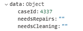
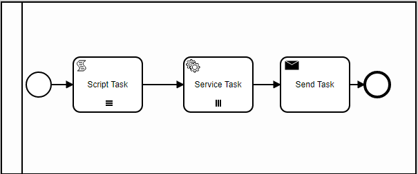
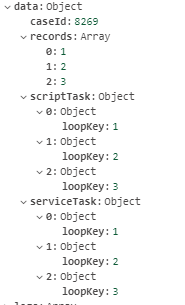

# Managing data

A case's state lives in the store, which is why a process can run for days or months and across several servers. This
page is about the data a case carries, where it is kept, and how to find it again.

## What is stored

| | Holds |
|---|---|
| `wf_instances` | The cases: their data, items, tokens and logs |
| `wf_models` | The models, so cases can be found by what their models contain |
| `wf_locks` | The locks running cases take, so two servers never run the same case at once |

The same three exist whichever store is used, MongoDB, SQLite or memory: see
[Custom persistence](persistence.md).

## The data a case carries

| | Lives | Is |
|---|---|---|
| `instance.data` | In the store, with the case | The case's own data: what forms wrote, what services returned, what scripts set |
| `item.vars` | In the store, with the item | Values belonging to one step |
| `item.input` | In memory, while the step runs | What was given to the step |
| `item.output` | In memory, while the step runs | What the step produced, before it is written into the case |

All four are reachable from a process's scripts, expressions and listeners: see [Scripting](scripting.md).

In code, `api.data` reads and writes cases and items, and `api.model` reads the models.

## What a case looks like


The instance object is similar to: 


```json

{
  "_id": {
    "$oid": "66500c3ff0dedc85988cf6fa"
  },
  "version": 0,
  "data": {
        "caseId": 9787,
        "starterUserId": "system",
        "needsRepairs": "Yes",
        "needsCleaning": "No"
      },
  "items": [
  {
      "id": "fd3d38fb-2eab-4ee4-a61e-0fe992f969c2",
      "seq": 2,
      "itemKey": null,
      "tokenId": 0,
      "elementId": "task_Buy",
      "name": "Buy",
      "status": "end",
      "userName": "system",
      "startedAt": {       "$date": "2024-05-24T03:40:47.744Z"     },
      "endedAt": {        "$date": "2024-05-24T03:43:48.045Z"      },
      "type": "bpmn:UserTask",
      "timeDue": null,
      "vars": {},
      "instanceId": null,
      "messageId": null,
      "signalId": null,
      "assignee": "system",
      "candidateGroups": [        "Employee",        "Manager"      ],
      "candidateUsers": [        "User1",        "User2"      ],
      "dueDate": {        "$date": "2024-05-29T03:40:47.746Z"      },
      "followUpDate": {        "$date": "2023-10-31T00:00:00.000Z"      },
      "priority": "5"
    },
    
  ],
  "tokens": [/*Tokens Data */ ],
  "loops": [],
  "id": "0a081355-8050-45df-91db-8dd473b58bc0",
  "name": "Buy Used Car",
  "source": "/* ... bpmn in xml format */"
  "savePoints": {/* SavePoints Data to restart at any point */}
  "saved": {"$date": "2024-05-24T03:40:47.761Z"  },
  "endedAt": {"$date": "2024-05-24T03:44:01.463Z"  },
  "parentItemId": null
}
```

### Where instance.data is visible

The entire execution will have one data scope object, shared among all nodes, except the following will have own item part of the data object

- SubProcess
- and Loops (Multi-instances)



However, for SubProcess and Loop elements a seperate scope




## Finding cases and tasks

The syntax follows MongoDB standards.

the query syntax must be
- instance attributes unqualified
- item attributes are qualified by `items.\<attributeName\>`
- data attributes are qualified by `data.\<attributeName\>`

### A page of instances: dataStore.find

The most flexible query: a filter on instances and their items, a sort, and pages walked by a cursor, reading only
the fields asked for. A list of cases is built on it. See [Finding instances](data_find.md).

### Finding items

| example                                                        | will retrieve                              |
| -------------------------------------------------------------- | ------------------------------------------ |
| `{ "items.id": "value-of-id" }`                                | find items by id only - unique             |
| `{ id: instanceId, "items.elementId": 'Approve' }`        | find items by instance id and elementId    |
| `{"data.caseId": caseId ,"items.elementId" : 'Request' }` | find items by caseId and item elementId    |
| `{ "name" : "Leave Application" , "items.status": "wait"}`           | find items for the process in a wait state |
| `{ id: instanceId, "items.status": 'wait' }`                   | check for items in "wait"                  |
| `{"items.status": "wait" , "items.elementId": "task_Buy" }`    | find all items that has "wait" status      |

```ts

items = await api.data.findItems({ "items.id": item.id  , "items.status": "wait"});
```
`findItems` performs the following 
- Adds security conditions

- Parses the query and converts it to MongoDB syntax

- Issue mongoDB query; mongoDb returns instances (not items)

- Filters the items and converts object into items

As an example if the api calls

 -  findItems query: ```{"id":"e213ff1b-bb09-43cf-9392-665036903a2c","items.elementId":"task_clean"} ```
 -  it converts to: ```{"id":"e213ff1b-bb09-43cf-9392-665036903a2c","items":{"$elemMatch":{"elementId":"task_clean"}}} ```
 -  returns on instance with several items
 -  it filters the items and returns only the 1 item as required

### Indexes

On MongoDB, setup (`npm run setup`, and each start of bpmn-web) creates these indexes on the instances. Creating an index that already exists does nothing, so an existing database gets any new ones at its next start:

| index | serves |
| --- | --- |
| `id` (unique) | one instance |
| `items.id` | one item, as invoked |
| `tag.process` | queries by tag |
| `items.status`, `items.elementId` | the waiting items of an element; the count of waiting instances |
| `items.status`, `items.type` | task lists: the waiting user tasks, for an administrator or a user |
| `name`, `status` | a process's instances, running or ended |
| `status` | counts by status |

An item query becomes one `$elemMatch` on `items`, so both fields of an `items.*` index are used. `items.status` comes first because once many instances have ended, few still have a waiting item. With 50,000 ended instances and 1,000 waiting, these indexes take the task list from about 300 ms to about 30 ms (a user's list from about 1,100 ms to about 35 ms), and the dashboard counts from 80–330 ms to under 5 ms.

A query on your own fields (`data.caseId`, a label) still reads every instance. If you run it often on a large database, add an index for it yourself in MongoDB.

The in-memory and SQLite stores make only the unique indexes. They check each instance on every query, and are meant for tests and small installs.

### Finding instances

Instance Queries are similar to Items Query but return entire Instances with all the items

```ts
// find instances having elementId

instances = await api.data.findInstances({
  'items.elementId': 'task_Buy',
});

//  find instance by itemd id

instances = await api.data.findInstances({ 'items.id': item.id });

// find instance by caseId

instances = await api.data.findInstances({ 'data.caseId': 3030 });
```
For many instances, or a page at a time, use [`dataStore.find`](data_find.md) instead: it filters, sorts and pages.


## Input and output

Input and output is used in the following scenarios:

- Subprocess (input/output)
- Service Tasks (input/output)
- Call Tasks (input/output)
- Throw Message/Signal (input)
- Catch Message/Signal (output)
- User Task (input)

### With scripts

| variable        | description                                                         |
| --------------- | ------------------------------------------------------------------- |
| **data**   | refers to Instance Data or the token data for multi-instance tokens |
| **item.input**  | refers to input variable into the called task/event                 |
| **item.output** | is the output of the called task/event                              |

```xml
    <bpmn2:serviceTask id="Activity_00ticbc" name="Add 2 Using scripts" implementation="add" camunda:delegateExpression="add">
        <bpmn2:extensionElements>
        <camunda:executionListener event="start">
          <camunda:script scriptFormat="JavaScript">

            item.input.v1=33;
            item.input.v2=25;

          </camunda:script>
        </camunda:executionListener>
        <camunda:executionListener event="end">
          <camunda:script scriptFormat="JavaScript">

            item.data.result2= item.output + 100;

          </camunda:script>
        </camunda:executionListener>
      </bpmn2:extensionElements>

```

### With input and output parameters

```xml
    <bpmn2:serviceTask id="Task_0xh2iwa" name="service1" implementation="service1">
      <bpmn2:extensionElements>
        <camunda:inputOutput>
          <camunda:inputParameter name="repeat">item.data.count</camunda:inputParameter>
          <camunda:outputParameter name="sequence">this.output.seq</camunda:outputParameter>
          <camunda:outputParameter name="returnText">'out text:'+this.output.text</camunda:outputParameter>
        </camunda:inputOutput>
      </bpmn2:extensionElements>
```

- parameter name is the name of variable
- value is a JavaScript expression

| Scenario     | before call                              | caller Syntax           | after call                                              |
| ------------ | ---------------------------------------- | ----------------------- | ------------------------------------------------------- |
| Throw Msg    | parameters.var1= '123';<br />output.var1 | throw(msg,parameters)   | -                                                       |
| Catch Msg    | -                                        | catch(msg,parameters)   | data.var1= parameters.var1;                             |
| Call Process | parameters.var1= '123';                  | result=call(parameters) | data.var1= result.var1;                                 |
| Service Call | parameters.var1= '123';                  | result=call(parameters) | data.var1= result.var1;                                 |
| Start Event  | -                                        | start(parameters)       | data.var1= parameters.var1;<br /> data.var1=input.var1; |

