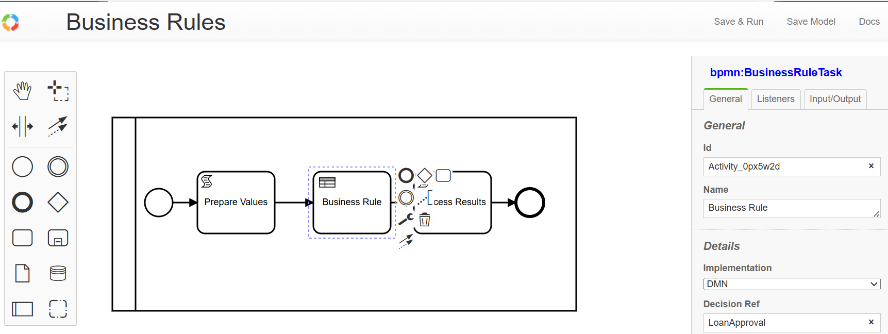

# Business rule task

A business rule task runs a DMN decision table: the model asks a question, and the table answers it from the case's
data. The rules live outside the diagram, so they can be changed without redrawing the process, and tested on their
own.



The task names its decision, and its input and output mappings say which of the case's values go in and what comes
back:

```xml
<bpmn:businessRuleTask id="Approve" name="Loan approval" camunda:decisionRef="loanApproval" />
```

`decisionRef` is the decision's name, which is the file's name without `.dmn.xml`.

## Where the tables live

A decision table is a `.dmn.xml` file in the models folder, beside the processes
(`DEFINITIONS_PATH`). The decision editor in the web application creates and edits them, and they can be tested like a
model: [Decisions (DMN)](../decisions.md).

## Calling one directly

Outside a process, from your own code, with the engine's DMN engine:

```ts
import { DMNEngine } from 'bpmn-server';

const decision = await new DMNEngine().load('./processes/loan_approval.dmn.xml');
const result = decision.evaluate({ credit_score: 800, income: 120000 });
// { approvalStatus: 'Approved', maxAmount: 5000 }
```

The decision editor runs a table the same way, against the test cases saved with it:
[Decisions (DMN)](../decisions.md).

## What the tables support

DMN 1.3 decision tables, with several input and output columns.

**Hit policies**, which decide what happens when more than one rule matches:

| Policy | Answers |
|---|---|
| `FIRST` | The first matching rule |
| `UNIQUE` | The one matching rule; an error if several match |
| `PRIORITY` | The matching rule with the highest priority |
| `COLLECT` | Every matching rule |
| `RULE ORDER` | Every matching rule, in the order written |
| `SUM` | The sum of the matching rules' numbers |

**In a cell:** comparisons (`>`, `<`, `>=`, `<=`, `==`, `!=`), a dash or empty for "any value", and FEEL expressions
written between braces:

```text
{credit_score in [500 .. 600]}
```

## The policies are decision tables too

The add-ons use the same tables for their own questions: who a task goes to, who may see a case, and who is told
what. They differ only in their outputs and where they live:
[Assignment policies](../assignment-policies.md),
[Access Control](../add-ons/security.md),
[Notification policies](../notification-policies.md).

## Models to look at

`apps/testSampleApp/processes/Business Rules.bpmn` calls a table, with its `.feature` tests, and `loanApproval.dmn.xml`
beside it is the table itself.
