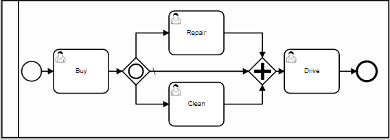
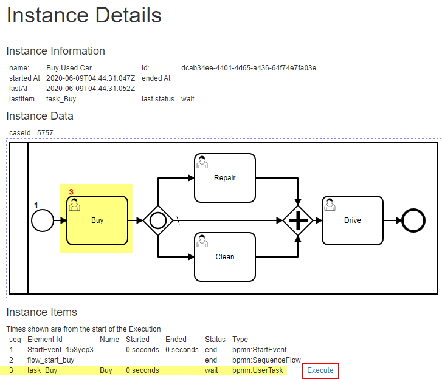
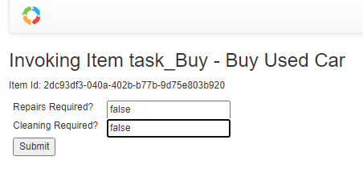
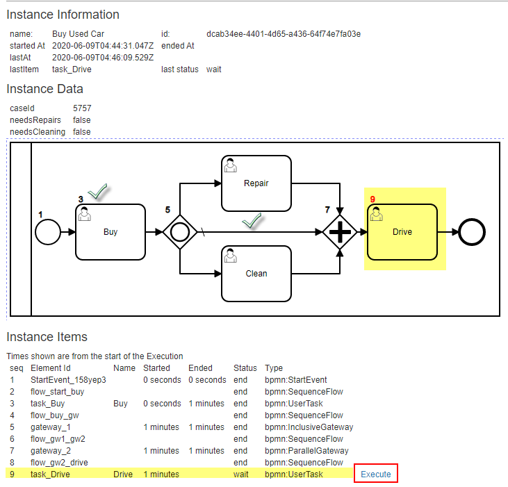

# The Buy Used Car example

One small process, run three ways: in the web application, from code in the engine's own process, and from another
application over the API. The model is the sample application's `apps/testSampleApp/processes/Buy Used Car.bpmn`.



The buyer **buys** the car (a user task, with a form: `model`, `needsCleaning`, `needsRepairs`). A gateway sends it to
**Clean** and **Repair** when they are needed, then to **Drive**, the last task. A case that needs neither goes
straight to Drive.

## In the web application

1. On the **Workbench**, start **Buy Used Car**. The instance page opens: the case waits at **Buy**.

    

2. Open **Buy**. Its form asks for the model and whether the car needs cleaning or repairs: answer No to both, and
   submit.

    

3. The case skips Clean and Repair, and waits at **Drive**. Complete it: the case ends.

    

The instance page shows each step, and its **Rationale** says why the gateway went the way it did. Click an element
on the diagram for its details.

## From code, in the engine's process

With the engine in your own Node.js process ([Embedding the engine](../embedding.md)):

```ts
import { BPMNServer, BPMNAPI, SecureUser, Logger } from 'bpmn-server';
import { configuration } from './configuration.js';

const server = await BPMNServer.create(configuration, new Logger({ toConsole: false }));
const api = new BPMNAPI(server);
// every call acts as a user, under the model's rules: Buy and Drive are the Driver lane's
const buyer = new SecureUser({ userName: 'sam', userGroups: ['Driver'] });

// start it: the engine runs until the case waits, here at Buy
let execution = await api.engine.start('Buy Used Car', {}, buyer);
const buy = execution.instance.items.find(item => item.elementId === 'task_Buy' && item.status === 'wait');

// complete Buy with its form's data: neither cleaning nor repairs, so on to Drive
execution = await api.engine.invoke({ 'items.id': buy.id }, { model: 'Thunderbird', needsCleaning: 'No', needsRepairs: 'No' }, buyer);

// a waiting task found by its case and its element, as later calls do
execution = await api.engine.invoke({ id: execution.instance.id, 'items.elementId': 'task_Drive' }, {}, buyer);
console.log(execution.instance.status);   // 'end'

await server.shutdown();
```

A query names the item to complete: by its id (`items.id`), or by its case and element. It can come much later, from
another call: the case waits in the store. More: [Invoking workflows](../invokation.md), [Workflow data](../data.md).

## From another application, over the API

With [bpmn-client](../bpmn-client.md) and [API v3](../api-v3.md), from any Node.js application that has the
server's key:

!!! note "Not yet checked by a test"
    The previous section's code runs in the test suite (`packages/bpmn-server/test/docs-buy-used-car.test.mjs`); this
    section's does not yet: starting this model over API v3 as a member of the Driver lane is refused today (`NOT_STARTABLE`),
    which is being looked into.

```ts
import { BPMNClient3 } from 'bpmn-client';

const service = new BPMNClient3({ url: 'http://localhost:3000', apiKey: process.env.API_KEY });
const sam = service.as('sam', ['Driver']);        // every call acts as sam, in the lane's group, with a token the client renews

const { instance, task } = await sam.processes.start('Buy Used Car');      // its first task: Buy
await sam.tasks.complete(task.id, { model: 'Thunderbird', needsCleaning: 'No', needsRepairs: 'No' });

const { items } = await sam.tasks.list({ model: 'Buy Used Car' });         // Drive, now
const drive = items.find(t => t.instanceId === instance.id && t.elementId === 'task_Drive');
const done = await sam.tasks.complete(drive.id);
console.log(done.instance.status);        // 'end'
```

Any other language calls the same API over HTTP: its operations are described at `GET /api/v3/openapi.json`. How an
application maps its users to tokens: [Integrate an existing application](../integrate.md).
