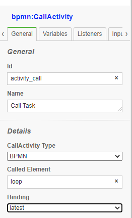

# Call activity: one process calling another

A call activity runs another process as a step. The calling case waits at that step until the called process ends,
then carries on.

{align=left}

<div style="clear:both"></div>

```xml
<bpmn:callActivity id="activity_call" name="Buy a car" calledElement="Buy Used Car" />
```

`calledElement` is the name of the process to run, as the models folder holds it.

## Two separate cases

The called process runs as a **case of its own**, with its own id, its own items and its own history. The calling
case has one item, the call activity, that waits while it runs. On the instance page you can open the called case and
see its steps.

That separation is the reason to use a call activity rather than a subprocess:

| | Call activity | [Subprocess](subProcess.md) |
|---|---|---|
| The steps live in | Another model, reusable by many | The same model |
| Produces | A separate case | Items inside the same case |
| Good for | A process several others need, with its own tests and its own releases | Grouping steps, or putting a boundary event around a group |

## Data between them

The calling case's data is given to the called process when it starts. When the called process ends, **all of its
data** comes back into the calling case, unless the call activity has output parameters, in which case only those
values do:

```xml
<bpmn:callActivity id="activity_call" name="Check credit" calledElement="checkCredit">
  <bpmn:extensionElements>
    <camunda:inputOutput>
      <camunda:outputParameter name="creditScore">$(output.score)</camunda:outputParameter>
    </camunda:inputOutput>
  </bpmn:extensionElements>
</bpmn:callActivity>
```

Here `output` is the called process's data, and only `creditScore` is written into the caller's. Naming the values
that come back keeps a called process's working data out of every case that calls it.

## Models to look at

`apps/testSampleApp/processes/CallTask.bpmn` calls another model as a step, with its `.feature` tests beside it.
