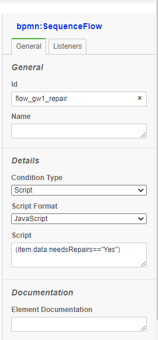

# Conditional flow

A sequence flow can carry a condition, so the path is taken only when the condition is true. It is how a case takes
one route rather than another, usually out of a [gateway](gateways.md).

{align=left}

<div style="clear:both"></div>

```xml
<bpmn:sequenceFlow id="ToApprove" sourceRef="LongLeave" targetRef="Approve">
  <bpmn:conditionExpression xsi:type="bpmn:tFormalExpression" language="JavaScript">
    data.days &gt; 5
  </bpmn:conditionExpression>
</bpmn:sequenceFlow>
```

The flow is taken when the condition's value is `true`. A condition reads the case's data as `data`, and the item
being run as `this`.

## FEEL instead of JavaScript

`language="FEEL"` writes the condition in FEEL, over the data's values by name. The editor's **Language** field
chooses it, and the Problems tab checks it:

```xml
<bpmn:conditionExpression xsi:type="bpmn:tFormalExpression" language="FEEL">days &gt; 5</bpmn:conditionExpression>
```

## Always leave one way out

Out of an exclusive gateway, the first true condition wins. If no condition is true and no flow is left
unconditional, the case stops there with nowhere to go. Give one flow no condition at all, as the "otherwise" path.
The model's checks warn when every flow out of a gateway has a condition: [Checking models](../verify.md).

## In the editor, and in the Rationale

Select a flow and its **Condition** field holds the expression; the Problems tab reports one that cannot be parsed
before the model ever runs.

When a case runs, its Rationale records which conditions were true and false at each gateway, so the path a case took
needs no guessing.

More on what an expression may contain, and the other places one can go:
[Scripting](../scripting.md). The gateways themselves: [Gateways](gateways.md).
