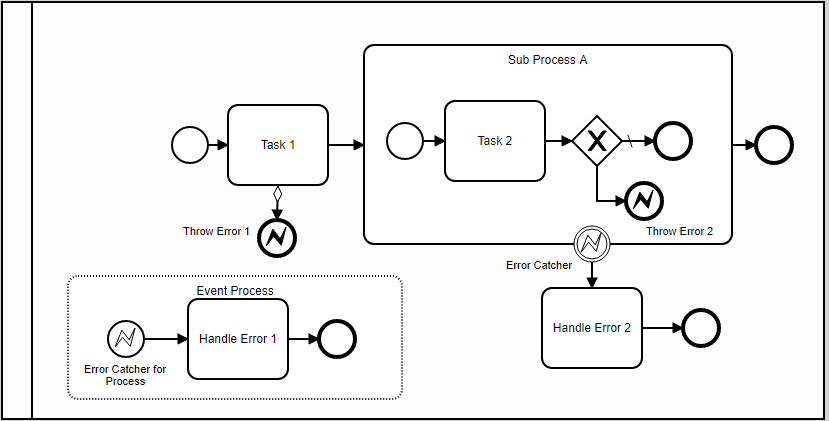

# Errors and escalations

When a step cannot do its work, the model should say what happens next. BPMN has two ways of saying it: an **error**,
which means the step failed, and an **escalation**, which means someone higher up should deal with it while the
process carries on.



## Raising an error

**From a step's own code.** A service or a script returns the error instead of throwing it, naming it so the model
can catch that particular one:

```js
return { bpmnError: 'RecordFailed' };     // an error: the step failed
return { escalation: 'NeedsManager' };    // an escalation: pass it up, carry on
```

**From the diagram.** An end event of type error ends that path by raising the error:

```xml
<bpmn:endEvent id="EndEvent_error1" name="Throw Error 1">
  <bpmn:errorEventDefinition />
</bpmn:endEvent>
```

**Throwing a real exception** is different: `throw new Error('...')` is not a BPMN error. It stops the case at that
step, with the error recorded, for someone to look at. Use it for what should never happen, and a BPMN error for
what the process is expected to handle.

## Catching one

The engine looks for a catcher in this order:

1. **A boundary event** on the task that raised it. The case leaves the task along the boundary event's path:

```xml
<bpmn:boundaryEvent id="BoundaryEvent_catchErrors" name="Error Catcher" attachedToRef="Task_1yw3plw">
  <bpmn:errorEventDefinition />
</bpmn:boundaryEvent>
```

2. **An event subprocess** inside the process, started by an error start event. It catches errors from anywhere in
   the process:

```xml
<bpmn:subProcess id="SubProcess_0hpeg3q" name="Event Process" triggeredByEvent="true">
  <bpmn:startEvent id="StartEvent_catchErrors" name="Error Catcher for Process">
    <bpmn:errorEventDefinition />
  </bpmn:startEvent>
</bpmn:subProcess>
```

3. **Nothing catches it**, and the case stops at the failed step with its error, as an unhandled failure.

An event definition with no error named catches every error. Naming one catches only that error, so different
failures can take different paths.

## Error or escalation

| | Error | Escalation |
|---|---|---|
| Means | The step failed | Something needs attention higher up |
| The path it came from | Interrupted: the task is left | Continues, if the boundary event is non-interrupting |
| Usual use | Retry, take another path, fail the case | Tell a manager, raise a flag, start a parallel review |

## A whole group of steps

To catch anything that goes wrong across several steps, put them in a [subprocess](subProcess.md) and attach the
error boundary event to the subprocess. To undo the steps that had already succeeded, make it a
[transaction](transactions.md).

## Models to look at

`apps/testSampleApp/processes/Error events.bpmn` raises and catches errors, with its `.feature` tests.
[Tutorial 6](../tutorial/services.md) builds a process around a service that fails.
