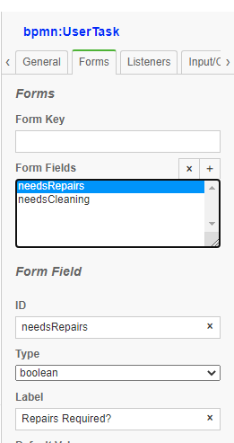

# Form fields on a user task

A user task can carry a form: the fields the person fills in to complete it. The fields are part of the model, so the
Workbench, the application's own screens and the API all see the same form.

{align=left}

<div style="clear:both"></div>

```xml
<bpmn:userTask id="task_Buy" name="Buy">
  <bpmn:extensionElements>
    <camunda:formData>
      <camunda:formField id="model" label="Which model?" type="string" />
      <camunda:formField id="needsRepairs" label="Repairs required?" type="boolean" />
      <camunda:formField id="needsCleaning" label="Cleaning required?" type="boolean" />
    </camunda:formData>
  </bpmn:extensionElements>
</bpmn:userTask>
```

Each field has an `id`, which is the name it is stored under in the case's data, a `label` shown to the person, and a
`type`: `string`, `long`, `boolean`, `date`, `enum`.

## What the fields are for

- **The Workbench draws the form** from them, and writes what the person enters into the case's data.
- **The model's gateways and scripts read those values**: a field `needsCleaning` is `data.needsCleaning`
  afterwards.
- **An application's own screens** get the fields from the API (`GET /api/v3/tasks/{id}` answers the task with its
  `form`), so it can draw its own form and still send back what the model expects.

## Rules on a field

A field can be required, have a range, or be held to a list of choices. The server checks what is submitted against
those rules, so a form cannot be bypassed by calling the API directly: see [Form rules](../form-rules.md).

A field's choices can also come from a source rather than being written into the model: a drop-down or a search over
the application's own data. See [Lists and lookups in forms](../form-lookups.md).

## An application drawing its own form

An application that has its own screens reads the task's fields from the API and draws the form itself, sending back
the values under the same ids. The model stays the one place the fields are defined.

Naming one of the application's own forms in the model instead (`camunda:formKey`) is planned, not yet built: see
[Architecture](../architecture.md).

## Models to look at

`apps/testSampleApp/processes/Buy Used Car.bpmn` has the form above on its Buy task, and
[Example: Buy Used Car](buy-used-car.md) fills it in three different ways.
