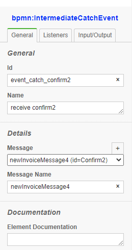
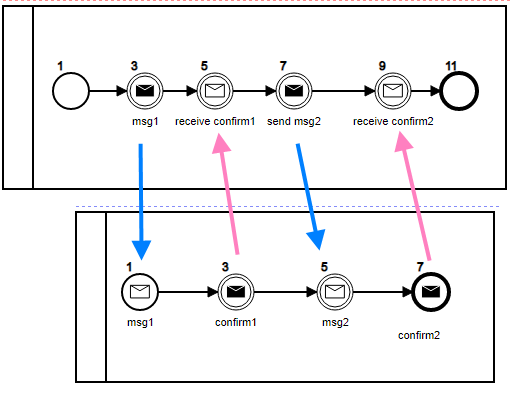

# Throwing and Catching Messages

Two separate processes can talk to each other with messages. One throws a message. The engine then gives it to a
waiting instance that catches it, or starts a process whose start event catches it. Only when nothing catches it does
it go to the application delegate (`issueMessage`).



### 1 Throw a message with data

A throw event's output fields are what it throws:

```xml
    <bpmn2:intermediateThrowEvent id="throw_msg1" name="msg1">
      <bpmn2:extensionElements>
        <camunda:inputOutput>
          <camunda:outputParameter name="caseId">$(data.caseId)</camunda:outputParameter>
        </camunda:inputOutput>
      </bpmn2:extensionElements>
      ...
      <bpmn2:messageEventDefinition id="messageEventDef1" messageRef="Msg1" />
    </bpmn2:intermediateThrowEvent>
```

This throws:

- Message: `Msg1`
- Data: `{ caseId: <its value> }`

### 2 Catch a message with data

The second process has a start event that catches `Msg1`:

```xml
    <bpmn2:startEvent id="StartEvent_1w66wpl" name="msg1">
      ...
      <bpmn2:messageEventDefinition id="messageEventDef4" messageRef="Msg1" />
    </bpmn2:startEvent>
```

So the engine starts a new instance of the second process, with the message's data (the `caseId`).

### 3 Throw a message to one instance: the matching key

The second process then sends a confirmation, `Confirm1`, back to the first. Many instances of the first process may
be waiting for `Confirm1`. The **matching key** says which: a query on the waiting instances, such as
`{ 'data.caseId': 7 }`. Without one, the message goes to the first instance found waiting.

The simplest way is an output field named **`matchingKey`**. It is the key, and it is not thrown with the data:

```xml
    <bpmn2:intermediateThrowEvent id="throw_confirm1" name="confirm1">
      <bpmn2:extensionElements>
        <camunda:inputOutput>
          <camunda:outputParameter name="confirm">$(true)</camunda:outputParameter>
          <camunda:outputParameter name="matchingKey">$({ 'data.caseId': data.caseId })</camunda:outputParameter>
        </camunda:inputOutput>
      </bpmn2:extensionElements>
      ...
      <bpmn2:messageEventDefinition id="messageEventDef2" messageRef="Confirm1" />
    </bpmn2:intermediateThrowEvent>
```

This throws:

- Message: `Confirm1`
- Data: `{ confirm: true }`
- Matching key: `{ 'data.caseId': <this instance's caseId> }`, so only the instance with that `caseId` gets it

A script can set the key instead, as models made before 3.7.5 do: `this.context.messageMatchingKey = { ... }` in the
throw event's start listener:

```xml
        <camunda:executionListener event="start">
          <camunda:script scriptFormat="JavaScript">this.context.messageMatchingKey = { 'data.caseId': this.token.data.caseId };</camunda:script>
        </camunda:executionListener>
```

Either way, the key belongs to that throw alone. A later throw in the same run has no key unless it sets its own.

Signals take a matching key the same way. A signal goes to every waiting instance that the key matches.

From outside, the API takes the key with the message:
`POST /api/engine/throwMessage` with `{ "messageId": "Confirm1", "data": { ... }, "messageMatchingKey": { "data.caseId": 7 } }`.



### 4 Who got it: the Rationale

The instance page's Rationale, and the editor's Test tab, say where each message and signal went:

- **The thrower:** `throws message 'Confirm1': reaches msgThrow #7 at 'confirm1' (catch_confirm1)`, or
  `starts MsgCatch #7 at 'msg1' (StartEvent_1w66wpl)`, or `reaches none: no instance waits for it, no process starts
  on it`. A signal lists every instance it reached. The row's why says the matching key.
- **The receiver:** `receives message 'Confirm1' from MsgCatch #7 at 'confirm1' (throw_confirm1)`, or, on the start
  event of an instance a message started, `is started by message 'Msg1' from ...`. A message from the API says
  `from outside (an API call)`.

The receiver is saved first and the thrower after, so both rows are there once the throw's step is done.
