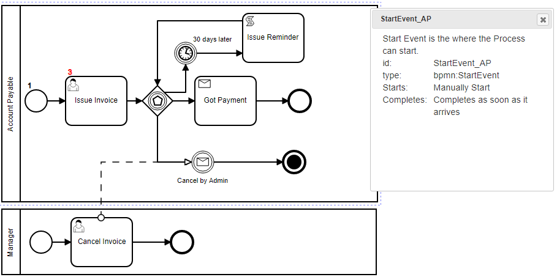
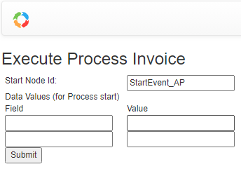

# Multiple start events

A process can have more than one start event, so the same model can be entered in different ways: a person starting
it, a message arriving, a timer firing. Each start event can have its own form and its own rules about who may use
it.



## Saying which one to start at

When a process has several start events, the one to use must be named.

In the Workbench, starting the process asks which:



Over the API:

```ts
// the engine, in your own process
const execution = await api.engine.start('invoice', { caseId, reminderCounter: 0 }, user, { startNodeId: 'StartEvent_AP' });
```

```ts
// API v3, from another application
const { instance, task } = await client.processes.start('invoice', { caseId }, { startNodeId: 'StartEvent_AP' });
```

Without `startNodeId`, the first start event the person may use is taken.

## Who may start which

Each start event carries its own assignment: its lane, or its candidate users and groups. A person is offered only
the start events they may use, and the processes they can start are the ones with at least one such event. So one
model can be started by a customer at one event and by a clerk at another.

See [Assignment](../add-ons/assignment.md) for how candidates and lanes are read.

## Events that start a process

A start event does not have to be a person at all:

- **A message start event** starts a case when a message arrives and nothing is waiting for it:
  [Messages](msg-throw-catch.md).
- **A timer start event** starts a case on a schedule: [Timers](../timers.md).
- **A signal start event** starts a case when a signal is thrown: [Signals](signal-throw-catch.md).

## Models to look at

`apps/testSampleApp/processes/Invoice.bpmn` has several start events, one of them for a manager, with its `.feature`
tests beside it.
