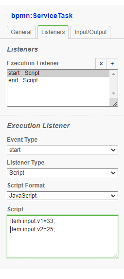

# Listeners: scripts on an element's start and end

Any element can carry listeners: small scripts the engine runs just before the element starts and just after it ends.
They are useful for preparing data a step needs, or recording something once a step is done, without adding a step to
the diagram.

{align=left}

<div style="clear:both"></div>

```xml
<bpmn:startEvent id="StartEvent_1">
  <bpmn:extensionElements>
    <camunda:executionListener event="start">
      <camunda:script scriptFormat="JavaScript">
        data.records = [1, 2, 3];
      </camunda:script>
    </camunda:executionListener>
    <camunda:executionListener event="end">
      <camunda:script scriptFormat="JavaScript">
        this.log('started with ' + data.records.length + ' records');
      </camunda:script>
    </camunda:executionListener>
  </bpmn:extensionElements>
</bpmn:startEvent>
```

| Event | When it runs |
|---|---|
| `start` | Before the element does its work. Data set here is what the element sees |
| `end` | After the element's work, before the case moves on |

A listener sees the same things a [script task](scriptTask.md) does: `data`, `this` (the item), and the
application's services. A user task also has **task listeners**, which run as the task is assigned and completed.
All of them, and everything a script can reach: [Scripting](../scripting.md).

## When to use one, and when not

A listener is right for a line or two that belongs to one element: setting a default, stamping a timestamp, logging
something for the case's history.

It is the wrong place for business logic. A listener is invisible on the diagram, so a reader cannot see that it
runs, and it is harder to test than a service. Anything of substance belongs in a
[service task](serviceTask.md) calling the application's code.

A listener that throws fails the element, and with it the case's step, so keep one simple and sure.

## Input and output mappings instead

To shape what a step receives and what it writes back, input and output parameters usually read better than a
listener, because they name the values:

```xml
<camunda:inputOutput>
  <camunda:inputParameter name="owner">${data.owner}</camunda:inputParameter>
  <camunda:outputParameter name="starsCount">${output.stargazers_count}</camunda:outputParameter>
</camunda:inputOutput>
```

See [Scripting](../scripting.md) and [Service task](serviceTask.md).
