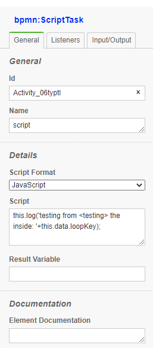

# Script task

A script task runs a small piece of JavaScript on the case's data, with no person and no outside call. Use it for
things like working out a total, formatting a value or setting a flag the next gateway reads.

{align=left}

<div style="clear:both"></div>

```xml
<bpmn:scriptTask id="Activity_06typtl" name="Work out the total" scriptFormat="JavaScript">
  <bpmn:script>
    data.total = data.days * data.dailyRate;
    this.log('total ' + data.total);
  </bpmn:script>
</bpmn:scriptTask>
```

A script reaches:

- **`data`**, the case's data. Changing it changes the case: `data.total = ...` is how a script passes a value on.
- **`this`**, the item being run: `this.log(...)` writes a line into the case's log, and `this.token` and
  `this.context` reach the case's state.
- the application's own services and variables, when it provides them.

Everything a script can see, and the other places a script can go (a flow's condition, an element's listeners, an
input or output mapping): [Scripting](../scripting.md).

## Keeping scripts out of the model

A script in a model is convenient and hard to test on its own. For anything beyond a line or two, put the logic in
the application's services and call it from a [service task](serviceTask.md): the code can then be unit-tested, and
the model stays readable.

A server can also refuse to run scripts as they are: `SCRIPT_SANDBOX=true` runs them in a sandbox, which a public
demo server does. A script that needs the application's services will not work there unless the sandbox is allowed
to reach them.

## Failing

An error thrown by a script fails the step, and the case stops there with the error. To handle it in the model
instead, raise a BPMN error and catch it with a boundary event: see [Errors and escalations](error_events.md).

The model's checks warn about a script that cannot be parsed before the case ever runs:
[Checking models](../verify.md).
