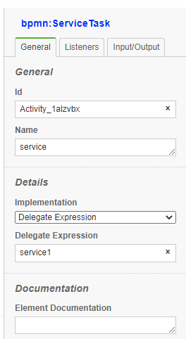

# Service task

A service task is a step the process does by itself, with no person involved. It calls either the application's own
code or a REST API through a [connector](../connectors.md).

{align=left}

<div style="clear:both"></div>

## Calling the application's code

The task names a function of the application's services, and the engine calls it when the case reaches the task:

```xml
<bpmn:serviceTask id="Record" name="Record the leave" implementation="recordLeave" />
```

`implementation` (or `camunda:delegateExpression`, as models written for Camunda have it) names a function of the
application's services. A service takes the task's input and the context, and what it returns becomes output:

```ts
class AppServices {
    /** HR's system records the approved leave, or refuses it. */
    async recordLeave({ requester, days }, context) {
        if (!requester || !(days > 0)) return { bpmnError: 'RecordFailed' };
        return { recordId: `LV-${Date.now()}` };
    }
}
```

What it returns is written into the case's data. Returning `{ bpmnError: 'RecordFailed' }` raises that BPMN error
instead, for an error boundary event on the task to catch; throwing fails the step.
See [Errors and escalations](error_events.md).

The services an application offers, and how an expression or script reaches them:
[Custom delegates](../delegates.md) and [Scripting](../scripting.md).

## Calling a REST API through a connector

A connector is a REST API an administrator added, described by its OpenAPI document. The task names one of its
operations, maps the case's data to the call's inputs, and maps the answer back:

```xml
<bpmn:serviceTask id="GetRepo" name="Get the repository">
  <bpmn:extensionElements>
    <camunda:connector>
      <camunda:connectorId>github/repos/get</camunda:connectorId>
      <camunda:inputOutput>
        <camunda:inputParameter name="owner">${data.owner}</camunda:inputParameter>
        <camunda:inputParameter name="repo">${data.repo}</camunda:inputParameter>
        <camunda:outputParameter name="description">${output.description}</camunda:outputParameter>
        <camunda:outputParameter name="starsCount">${output.stargazers_count}</camunda:outputParameter>
      </camunda:inputOutput>
    </camunda:connector>
  </bpmn:extensionElements>
</bpmn:serviceTask>
```

- `connectorId` is the connector and the operation, as the editor offers them.
- An **input** takes a value from the case's data (`${data.owner}`) and gives it to the call.
- An **output** takes a value from the answer (`${output.stargazers_count}`) and writes it into the case's data.

No code is needed: the keys belong to the connector, kept encrypted on the server. See
[Connectors](../connectors.md), and [Tutorial 11](../tutorial/tutorial-connectors.md), which connects one.

## When a call fails

A connector call that fails raises an error the model can catch, with the HTTP status in its code (`HTTP_401`,
`HTTP_500`). Put an error boundary event on the task to decide what happens then: retry, ask a person, or take
another path. [Tutorial 6](../tutorial/services.md) does this with a failing service.

A service task that is slow holds the case at that step; nothing else in the case moves until it answers.
`SERVICE_TASKS=false` stops service tasks from running at all, which a public demo server uses.

## Models to look at

`apps/testSampleApp/processes/GitHub repository.bpmn` calls a real connector. The starter application's
`Leave Application.bpmn` (in `apps/sampleApp/processes/`, and the HR demo's copy) calls `recordLeave` above. Each has
its `.feature` tests beside it.
