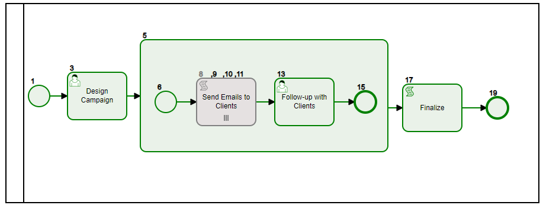

# Subprocess

A subprocess groups steps inside a process. It has its own start event and its own end event, and the case carries on
after it when its own end event is reached.



```xml
<bpmn:subProcess id="review" name="Review the request">
  <bpmn:startEvent id="reviewStart"><bpmn:outgoing>r1</bpmn:outgoing></bpmn:startEvent>
  <bpmn:userTask id="reviewTask" name="Check the details">
    <bpmn:incoming>r1</bpmn:incoming><bpmn:outgoing>r2</bpmn:outgoing>
  </bpmn:userTask>
  <bpmn:endEvent id="reviewEnd"><bpmn:incoming>r2</bpmn:incoming></bpmn:endEvent>
  <bpmn:sequenceFlow id="r1" sourceRef="reviewStart" targetRef="reviewTask" />
  <bpmn:sequenceFlow id="r2" sourceRef="reviewTask" targetRef="reviewEnd" />
</bpmn:subProcess>
```

The steps inside it are items of the **same case**: one instance, with the subprocess and everything in it on its
list of items. That is the difference from a [call activity](callProcess.md), which runs another model as a separate
case.

## Why group steps

- **A boundary event over several steps.** A timer on the subprocess puts one deadline over everything inside it:
  when it fires, the whole group is interrupted at once, wherever the case had got to.
- **An error from anywhere inside.** An error boundary event on the subprocess catches an error raised by any step
  within it. See [Errors and escalations](error_events.md).
- **Reading the diagram.** A collapsed subprocess hides detail that does not matter at the top level.

## Repeating it

A subprocess marked multi-instance runs once for each item in a list, in sequence or in parallel: see
[Multi-instance (loops)](loop.md). That is the usual way to run a group of steps per department, per line of an
order, or per approver.

## A transaction

A subprocess can be a transaction, so that cancelling it compensates the steps that had already finished:
[Transactions](transactions.md).
