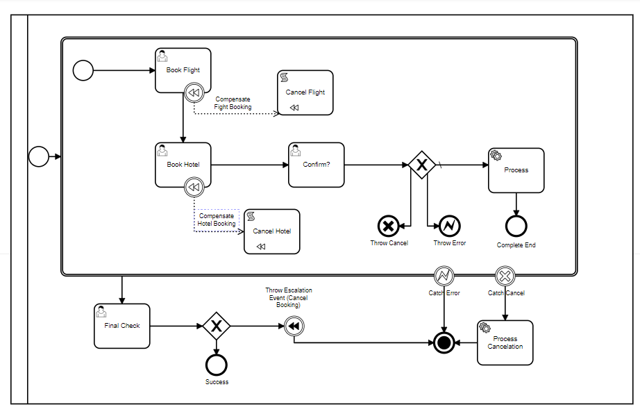
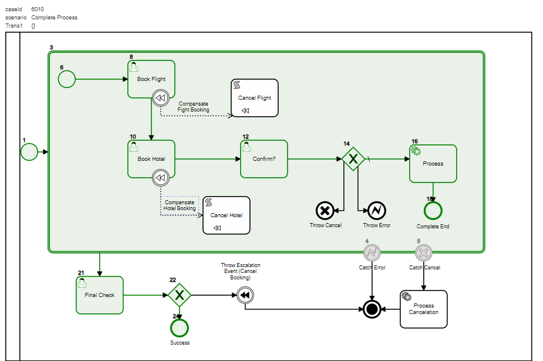

# Transactions and compensation

A transaction is a [subprocess](subProcess.md) whose steps belong together: either they all stand, or the ones that
already finished are undone. Undoing a finished step is **compensation**, and it is a step of its own in the model,
attached to the step it reverses.

In the diagram above, `Cancel Flight` compensates `Book Flight`. If the transaction is cancelled after the flight
was booked, the engine runs `Cancel Flight`.

## What makes a transaction compensate

Three things cancel a transaction and run the compensations for the steps that had finished:

| | |
|---|---|
| **An error event** raised inside the transaction | Something went wrong in a step |
| **A cancel event** thrown inside it | The process itself decided to call it off |
| **A compensate event** after the transaction has ended | Something later decided the whole thing must be undone |

## How it runs

In this example the case took a conditional flow to a **throw cancel event**. That fired the transaction's
**cancel boundary event**, which carried on to `Process Cancellation`, and the transaction itself was marked
cancelled. The steps that had already completed, and that have a compensating activity, were compensated.

The case's items show what happened, in order, and its Rationale says why the branch to the cancel event was taken.

## Writing one

- Draw the transaction as a subprocess with the transaction marker.
- For each step that may need undoing, attach a **compensation boundary event** and join it to the activity that
  does the undoing (`Cancel Flight` above).
- Decide how it gets cancelled: an error inside it, or an explicit cancel event on a path.
- Put a **cancel boundary event** on the transaction for what happens afterwards.

Only steps that **completed** are compensated. A step that never ran, or that was still waiting, has nothing to undo.

## Models to look at

`apps/testSampleApp/processes/Trans.bpmn` is the model above, with its `.feature` tests.
`Flight Distruption.bpmn` is a longer example.
