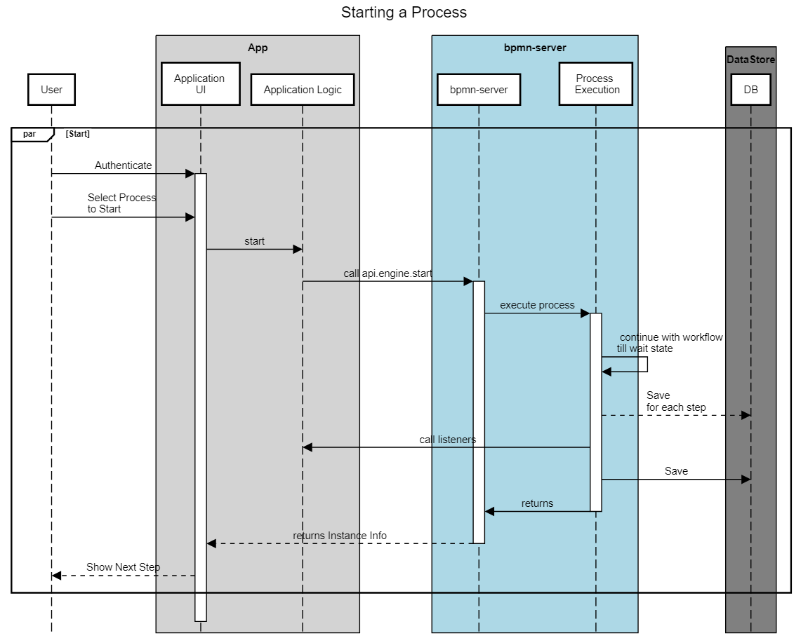
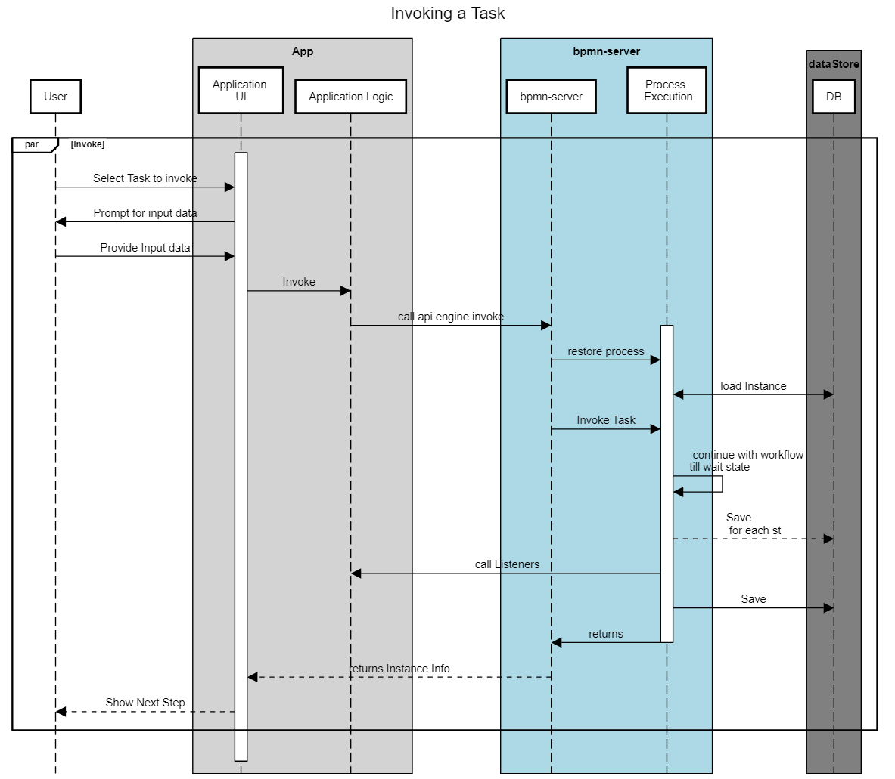

# Workflow Execution

Execution is based on the model logic that is enhanced by various extensions that allow scripting and access to your application.

During Execution, Model Listeners and Application Listeners are invoked.

Process Execution is performed based on BPMN 2.0 standards providing access to the following components to participate:
- Event Listener
- Scripts
- Services
- AppDelegate

See [more about scripts](scripting.md)

The execution `engine` is availabe through an API [see API.engine](api/interfaces/IAPIEngine.md).
## Starting a Process
For more details about scenarios of Invoking Execution Engine [Engine Invokation](invokation.md)

<table><tr><td>
This illustrate the flow of Model Execution:
Once the process goes into a **wait** state, it waits for some external input:

- User Input
- Message/Signal to be received
- Timer to expire

</td><td>



</td></tr></table>

## Invoking a User Task



## Execution Sequence

Below is the sequence of events after each command:

### engine.start

```
---Event: -->process.start { option1: 1234 }
=========== Process Start ===============

---Event: -->transformInput item: StartEvent_1 { option1: 1234 }
---Event: -->enter item: StartEvent_1 { option1: 1234 }
---Event: -->start item: StartEvent_1 { option1: 1234 }
---Event: -->process.saving { option1: 1234 }
---Event: -->end item: StartEvent_1 { option1: 1234 }
---Event: -->enter item: Request { option1: 1234 }
---Event: -->start item: Request { option1: 1234 }
---Event: -->wait item: Request { option1: 1234 }
---Event: -->process.wait { option1: 1234 }
---Event: -->process.saving { option1: 1234 }

```
### engine.assign
```
---calling assign-----

---Event: -->process.restored { option1: 1234, restored: true }
---Event: -->assign item: Request { option1: 1234, restored: true }
---Event: -->validate item: Request { option1: 1234, restored: true }
---Event: -->process.saving { option1: 1234, restored: true }
```

### engine.invoke
```

---calling invoke-----

---Event: -->process.restored { option1: 1234, restored: true }
---Event: -->process.invoke { option1: 1234, restored: true }
---Event: -->transformInput item: Request { option1: 1234, restored: true }
---Event: -->validate item: Request { option1: 1234, restored: true }
---Event: -->end item: Request { option1: 1234, restored: true }
---Event: -->enter item: Approve { option1: 1234, restored: true }
---Event: -->start item: Approve { option1: 1234, restored: true }
---Event: -->enter item: Event_1lkpj3z { option1: 1234, restored: true }
---Event: -->start item: Event_1lkpj3z { option1: 1234, restored: true }
---Event: -->wait item: Event_1lkpj3z { option1: 1234, restored: true }
---Event: -->wait item: Approve { option1: 1234, restored: true }
---Event: -->process.invoked { option1: 1234, restored: true }
---Event: -->process.saving { option1: 1234, restored: true }

```
## engine.invoke (with validation failure)

```
---invoke Approve-----

---Event: -->process.restored { option1: 1234, restored: true }
---Event: -->process.invoke { option1: 1234, restored: true }
---Event: -->transformInput item: Approve { option1: 1234, restored: true }
---Event: -->validate item: Approve { option1: 1234, restored: true }
---Event: -->process.error { option1: 1234, restored: true }
***************BPMNServer UNCAUGHT ERROR***********

Error Message: Error: Validation failed with error:Not a valid value
```


# Scope and variables
[See Scope and Variables in Scripts](scripting.md#Scripts_scope_and_variables)

# Scripts and Services Impact on Execution
Scripts and Services can impact workflow in the following manners:
- Change workflow Data
- Service Tasks and Script Tasks, receive input and return output
- Scripts and Service Task can raise Errors and Exceptions

# Raisng Errors , Escalations and Exceptions
## Validation Scripts
Validation Scripts can return an error as such:
```
    return {error:'Invalid input'};
```

As a result execution will raise an exception and the command will fail.

## BPMN Errors

All Scripts and Services can Raise `BPMN Errors`, to be handled by the appropriate Error node
```
    return {bpmnError:'error code'};

```
All Scripts and Services can Raise `BPMN Escalation`, to be handled by the appropriate Catch Escalation Event
```
    return {escalation:'escalation code'};

```
The current item status will be `error` and execution will continue at the Error node.

## Throwing Exceptions
```
    throw new Error('error message');
```

An exception is not a BPMN error: by default an error event does not catch it. The call that ran the task
(`engine.start`, `invoke`, ...) fails with the exception, and the task is saved with the status `error` and the
exception's message (`statusDetails.error`, with its `code` when it has one). The instance waits there: its page
shows **failed at** the task and why, and an administrator's **Retry** runs the task's work again, then the
instance goes on (`engine.retry({ 'items.id': id })`, `api.engine.retry(...)`).

### Exceptions as BPMN errors
A service, send or script task can choose otherwise: **Exceptions raise a BPMN error** in its properties
(`camunda:exceptionsAsErrors="true"`). An exception of its work, a service that throws or a connector that can not
be called, is then raised as a BPMN error, caught as one returned with `{bpmnError}`:

- its error code is the exception's `code` when it has one (`ECONNREFUSED`, `ETIMEDOUT`), else its name
  (`TypeError`);
- an error event with no error catches any exception; one whose error has that `errorCode` catches only it;
- with no error event to catch it, it is an exception as above.

```xml
<bpmn:error id="Refused" errorCode="ECONNREFUSED" />
...
<bpmn:serviceTask id="Notify" implementation="notify" camunda:exceptionsAsErrors="true" />
<bpmn:boundaryEvent id="Unreachable" attachedToRef="Notify">
  <bpmn:errorEventDefinition errorRef="Refused" />
</bpmn:boundaryEvent>
```

## Why the engine took a path

The instance's log keeps a **decision** entry (`type: 'decision'`) each time the engine chooses: a flow's
condition, a gateway's flows, a join that waits, the event that won after an event-based gateway, a timer, an
exception raised as a BPMN error. Each is a block: the item's `seq` and the element, the `action`, and `why`:

```text
seq: 3   flow 'repair' (flow_gw1_repair)
action: taken
why:
    from 'Needs repairs?' (gateway_1) to 'Repair' (task_repair)
    condition
        (item.data.needsRepairs=="Yes") || item.data.needsRepairs
    result: true (needsRepairs="Yes")

seq: 2   gateway 'Needs repairs?' (gateway_1)
action: takes 'repair' (flow_gw1_repair)
why:
    of 'repair' (flow_gw1_repair), 'clean' (flow_gw1_clean), flow_gw1_gw2
    its default flow flow_gw1_gw2 only when no other holds

seq: 6   gateway gateway_2
action: waits
why:
    joins its branches
    waits for 1 still on the way (at 'Clean' (task_clean))

seq: 9   gateway gateway_2
action: continues
why:
    joins its branches: all have arrived
```

The entry also keeps `seq`, `element` and `action`, to filter on. The instance page shows them under **Instance
logs**; a test reads them with `run.log()`.

Each operation on the instance is logged too, as a JSON entry: `{"type":"execution","label":...}` when it begins
(`Start Process`, `Invoke Item`, `Timer Fired` for a timer the server fires, `Invoke Event`, `Retry Item`,
`Restart Item`, with who and the data), and `{"type":"outcome",...}` when it saves: the instance's `status`, the
items whose status `changed` (each with its new status) and the items `waiting`. The **Rationale** is the log cut at
each operation: on the instance page each step is a line that opens to its rows, and in the Test tab each step of
the timeline has **What happened**, its checks offered from the outcome as logged.
