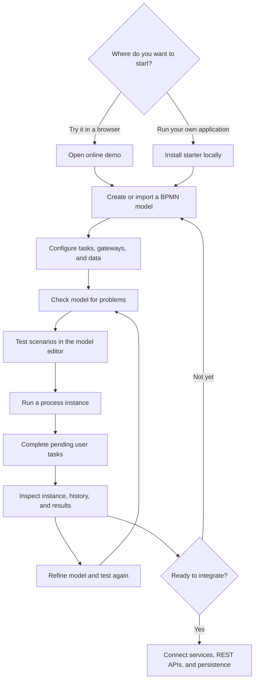

# Your first workflow: from model to execution

**The quickest way to understand BPMN Server is to build, test, and run a small process.** You can start in the [online workbench](https://bpmn.omniworkflow.com/) without installing anything, or create a local application and follow the same steps.

## The workflow in one view



This sequence has three distinct concepts: **model** (what should happen), **test** (whether the model behaves as intended), and **instance** (one real execution of the process). Testing a model does not replace running an instance and completing user tasks.

## Path A — Online demo: no installation

1. Open **[BPMN Server Workbench](https://bpmn.omniworkflow.com/)**.
2. From **Models**, inspect an existing model or select **New model** (or **Import** to load BPMN XML).
3. In the **model editor**, add a start event, a user task, and an end event. Set the user task's name and any assignment or form fields it needs.
4. Open **Problems** and correct validation issues. Use the editor's **Test** tab to create or run a scenario; step through the process and inspect outcomes.
5. Save the model if your demo session permits it, then select **Run process** from the Models view to create an instance.
6. Open **Pending tasks** to complete the user task, then inspect the process in **Instances** and its execution history.

!!! note "Public demo behavior"
    Public workbench permissions and example models can vary with session and demo configuration. If a model, test, or execution action is unavailable, use the local starter below. The public demo may restrict scripts, connectors, service tasks and timers for safety. Do not enter confidential data.

**Try this first:** create a “Request approval” process: **Start → Submit request (user task) → Approve request (user task) → End**. Once that works, add a gateway for **Approved?** and a rejection path. This exercises modeling, validation, scenario testing, execution and task completion without requiring an external integration.

## Path B — Local starter: own the application

Install Node.js 20 or later. To avoid database setup for a first run:

```sh
npx bpmn-server init my-app --memory
cd my-app
npm start
```

Open **http://localhost:3000**, sign in with the starter's development credentials (`admin` / `admin`) and change the password before exposing the app. The in-memory database is **temporary** and is cleared when the application stops.

Then follow the same steps as the online demo: **Models → Edit → Problems → Test → Run → Pending tasks → Instances**. Try the included Hello or Leave Application model before creating your own.

For durable workflow state, create the starter without `--memory` and configure a supported store (MongoDB or SQLite). See [Installation](setup.md#storage). The generated project contains:

| Location | Role |
| --- | --- |
| `processes/` | BPMN process models and DMN decisions |
| `connectors/appServices.ts` | TypeScript services called by service tasks |
| `delegates/appDelegate.ts` | Application lifecycle hooks and service provider |
| `settings/config.ts` | Engine and storage configuration |
| `index.ts` | Starts the host web application |

## From prototype to application

Once your workflow behaves correctly, replace demonstration operations with real application behavior:

1. Connect service tasks to your TypeScript services or [OpenAPI connectors](connectors.md).
2. Use [DMN decisions](decisions.md) for business-rule tables, or application code for complex logic.
3. Keep authoritative business records in your application database; store workflow state separately. See [Application integration](customization.md).
4. Configure authentication and task authorization, persistent storage, error handling and recovery before production.
5. Re-run model verification and regression scenarios after each change.

For details, see [Model editor](modeler.md), [Testing and debugging](testing.md), [Workflow execution](execution.md), and [Application integration](customization.md).
