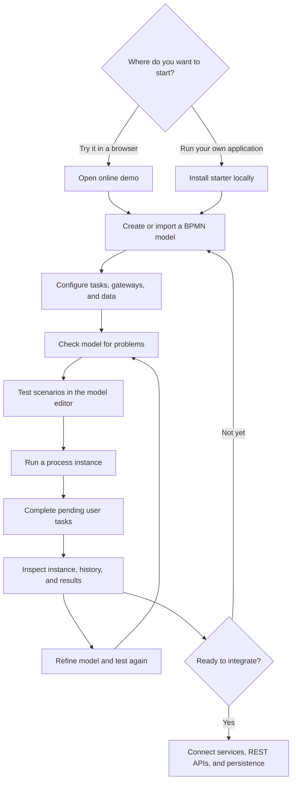

# Online demo

Journey A: **the quickest way to understand BPMN Server is to build, test, and run a small process.** Start in the [online workbench](https://bpmn.omniworkflow.com/), with nothing to install. The same steps work in your own application: [Build an application](build.md).

## The workflow in one view

This sequence has three distinct concepts: **model** (what should happen), **test** (whether the model behaves as intended), and **instance** (one real execution of the process). Testing a model does not replace running an instance and completing user tasks.

## In the online workbench

1. Open **[BPMN Server Workbench](https://bpmn.omniworkflow.com/)**.
2. From **Models**, inspect an existing model or select **New model** (or **Import** to load BPMN XML).
3. In the **model editor**, add a start event, a user task, and an end event. Set the user task's name and any assignment or form fields it needs.
4. Open **Problems** and correct validation issues. Use the editor's **Test** tab to create or run a scenario; step through the process and inspect outcomes.
5. Save the model if your demo session permits it, then select **Run process** from the Models view to create an instance.
6. Open **Pending tasks** to complete the user task, then inspect the process in **Instances** and its execution history.

!!! note "Public demo behavior"
    Public workbench permissions and example models can vary with session and demo configuration. If a model, test, or execution action is unavailable, use the local starter below. The public demo may restrict scripts, connectors, service tasks and timers for safety. Do not enter confidential data.

**Try this first:** create a “Request approval” process: **Start → Submit request (user task) → Approve request (user task) → End**. Once that works, add a gateway for **Approved?** and a rejection path. This exercises modeling, validation, scenario testing, execution and task completion without requiring an external integration.

Next: [Build an application](build.md), or learn by doing with the [tutorials](tutorial/start.md).
