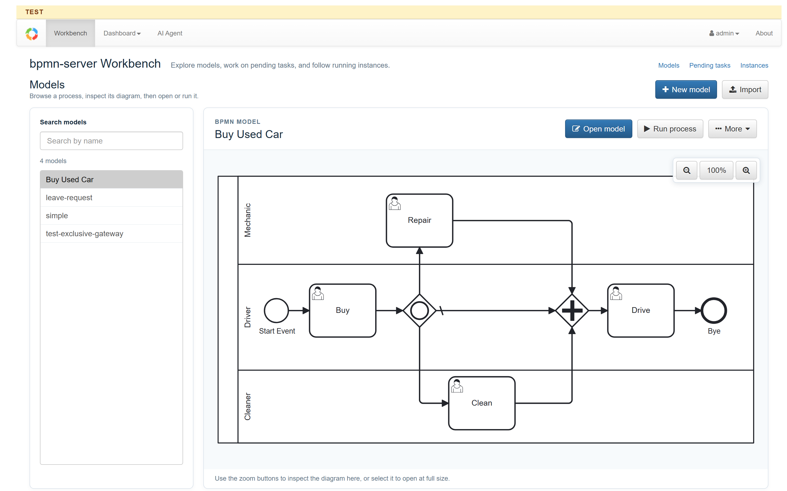
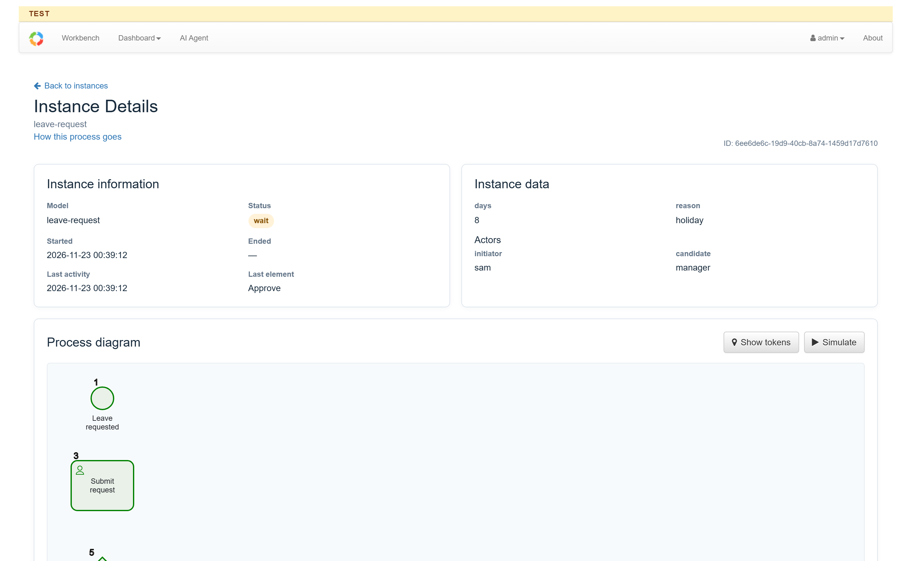

# Try it online

Two sites run OmniWorkflow with nothing to install. One shows a finished application, the other lets you build your
own workflows.

| | [demo.omniworkflow.com](https://demo.omniworkflow.com) | [try.omniworkflow.com](https://try.omniworkflow.com) |
|---|---|---|
| What it is | An HR application with OmniWorkflow inside it | OmniWorkflow's own workbench and model editor |
| You can | Sign in as its people, start a leave request, see the tasks, the cases and why each went its way | Draw a process, check it, test it and run it |
| You cannot | Change anything: the site is read-only | Keep anything private: there are no accounts yet |
| Good for | Seeing what an integrated application looks like | Trying the modeling and testing yourself |

## demo.omniworkflow.com: a finished application

An HR application, with its own screens, its own people and its own records. OmniWorkflow runs its processes behind
them: leave requests, onboarding, performance reviews.

Its welcome page lists the accounts to sign in with, each a different role: an employee, a manager and an HR
administrator. Signing in as each one shows how the same process looks to different people.

What to look at:

- **A leave request from both sides.** Start one as an employee: it appears as a task for the manager. Sign in as the
  manager to see it waiting for them.
- **The application's own screens.** The employee list, the reviews and the leave pages are the application's. The
  tasks and the cases come from OmniWorkflow through its API.
- **Why a case went its way.** Open a case and read its Rationale: each step, and what decided it, including which
  rule assigned a task and which path a gateway took.
- **The workflow pages inside the application.** Under **Workbench** and **My Work**, OmniWorkflow's own pages appear
  in the HR application's layout, for the people whose role allows it.

The site is read-only: you can sign in, start cases and look at everything, but saving a model, changing settings or
editing users is refused. That is a setting, `READ_ONLY`, not a special build: see
[Environments and read-only servers](environments.md).

How an application is put together this way: [Integrate an existing application](integrate.md), and the HR demo's
own code in the repository under `apps/hrdemo`.

## try.omniworkflow.com: your own workflows

OmniWorkflow's workbench, where you can build processes. **There are no accounts: everyone shares the site**, so
everything you make is visible to other visitors, and they can change it. Accounts are planned.

To build a process:

1. Open **Design**, then **New model**, or open one that is already there.
2. In the model editor, draw a start event, a user task and an end event. Give the task a name, and the people or
   group it goes to.
3. Open **Problems**: it lists what is wrong or missing as you draw, and what to do about it.
4. Open **Test**, write a scenario, and run it. It runs in the engine, exactly as a real case would.
5. Save the model, then start a case from the **Workbench**.
6. Do the task in **My Work**, then open the case to see its steps and its Rationale.

**A first process to try.** Start → Submit request (a user task) → Approve request (a user task) → End. Once that
runs, add a gateway after Submit: more than five days goes to a manager, the rest is approved automatically. That
small change exercises forms, assignment, a decision and two paths, which is most of what a real process needs.

Because anyone can run anything there, the site limits what a case may do: how long it may run, what a script may
reach, and how many models and cases it keeps, and it clears them from time to time. Don't put anything confidential
in a model or a case, and don't use it to hold work you want to keep: install your own
([Trying it locally](index.md#trying-it-locally)) for that.

## Then

The same steps work on your own machine, with your own models, users and services:
[Build an application](build.md), or the [tutorials](tutorial/start.md), which build one leave request from the first
diagram to its release.
