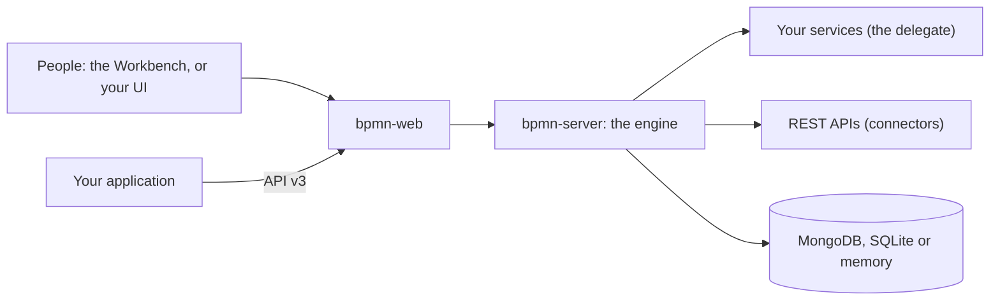

# Omni Workflow (BPMN Server)

**A BPMN 2.0 and DMN workflow engine for Node.js, with a web application to design, test and run the workflows.**

Workflows run long-lived business processes for your application: tasks for people, calls to services, decisions,
timers and messages, each case kept until it ends, and why it went its way. Your application keeps its own UI,
users and business records.

The packages are `bpmn-server` (the engine), `bpmn-web` (the web application: the Workbench, the model editor,
the Settings page and the APIs) and `bpmn-client` (calling a server from another application).

## Where to start

| You want to | Start here |
|---|---|
| **See what it does**, with nothing to install | [The online demo](first-workflow.md) |
| **Run your own workflow application**: your models, users and services | [Build an application](build.md), then the [tutorials](tutorial/start.md) |
| **Add workflows to an application you have**, from its own UI and users | [Integrate an existing application](integrate.md) |
| **Run processes from your own Node.js code**, with no web application | [Embedding the engine](embedding.md) |
| **Have an AI agent build and test the workflows** | [Building workflows with an AI agent](ai/building-workflows.md) |

Not sure? Try the demo, then build an application: the [tutorials](tutorial/start.md) take one example, a leave
request, from the first model to its release.

## Try it in a minute

```sh
npx bpmn-server init my-app --memory
cd my-app
npm start
```

Open **http://localhost:3000**. The first page asks for the administrator: enter the setup token the server printed
at start, then a name and a password ([The first start](setup.md#the-first-start)). `--memory` keeps nothing when
the server stops; without it, choose MongoDB or SQLite ([Installation](setup.md)).

## How it fits



The engine runs the models; bpmn-web gives people and applications a way in; your application owns its business
records and is called for what only it knows. The engine can run in the web application's process or in its own:
[Architecture](architecture.md).

## What it does

| | |
|---|---|
| **Runs BPMN** | User, service, script, business-rule and receive tasks; gateways; events; timers; messages and signals; subprocesses and multi-instance; errors and compensation |
| **Decides with DMN** | Decision tables with FEEL, tested like the models ([Decisions](decisions.md)) |
| **Assigns and secures the work** | Lanes, candidates and assignment policies; who may see a case and do what in it ([Add-ons](add-ons/assignment.md), [Security](security.md)) |
| **Calls REST APIs** | Connectors from OpenAPI documents, with their keys kept encrypted ([Connectors](connectors.md)) |
| **Designs and tests** | A model editor with model checks, a Test tab and Gherkin tests run in the engine ([Model editor](modeler.md), [Testing](testing.md)) |
| **Explains each case** | Its Rationale: every step, what decided it and why |
| **Runs where you need it** | Development, test and production environments, read-only servers ([Environments](environments.md)) |

Every feature, with its documentation, its code and its tests: [Features](features.md).

## Workflow state and business data

The engine keeps the models, the cases, their tasks and their workflow data. **Your application keeps its business
records**: claims, orders, employees. A workflow carries their keys (a `claimId`), calls your services to change them,
and reads them through [data objects](data-objects.md).

## Before production

Use a database that keeps its data, sign people in (bpmn-web's or your application's own), keep the keys secret, and
test the models before release: [Installation](setup.md#production), [Security](security.md),
[Tutorial 12: Release](tutorial/release.md).

The public demo is at [bpmn.omniworkflow.com](https://bpmn.omniworkflow.com); the code is
[MIT-licensed on GitHub](https://github.com/bpmnServer/bpmn-server).
