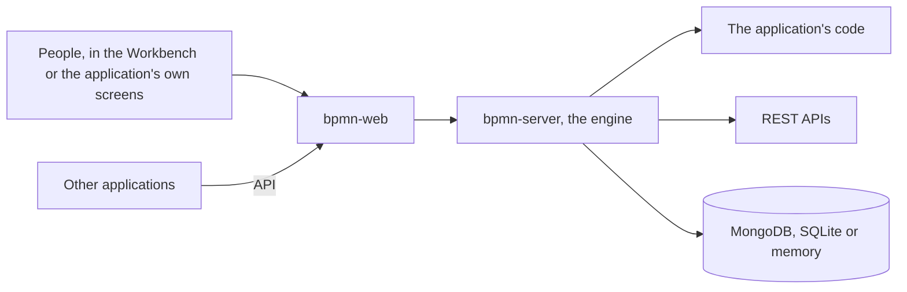

# OmniWorkflow (BPMN Server)

OmniWorkflow runs business processes. A process is drawn as a BPMN diagram: the steps, who does each one, the
decisions along the way and the deadlines. OmniWorkflow follows the diagram for every case: it gives tasks to the right
people, calls the services that do the automatic steps, waits for answers and timers, and keeps each case until it ends.
For every case it records what happened and why.

It is open source, written in TypeScript for Node.js, and comes as three packages:

- **bpmn-server**, the engine. It runs the processes and stores the cases.
- **bpmn-web**, the web application on top of it: the Workbench where people see and do their tasks, the model editor
  where the processes are drawn and tested, the Settings page, and the API other applications call.
- **bpmn-client**, for another application that calls a running server.

## What it does

**Runs BPMN processes.** User tasks, service and script tasks, gateways, timers, messages and signals, subprocesses,
loops, error handling and compensation: the parts of BPMN 2.0 that business processes use.

**Makes decisions with DMN.** Business rules are written as decision tables and called from the processes.

**Gives the work to the right people.** A task goes to a person or a group, by the diagram's lanes or by an assignment
policy. Access policies say who may see a case and what they may do in it.

**Connects to other systems.** A service task calls the application's own code, or a REST API described by its OpenAPI
document. Other applications start processes and complete tasks through the API.

**Tests the processes before they run for real.** The model editor checks a model as it is drawn, and runs its test
scenarios in the engine. The same tests run in a build.

**Explains each case.** Every step is recorded with what decided it, so anyone can see why a case went the way it did.

**Works with AI agents.** A person can give an AI agent a link to work on the site as them: to build and test
processes, or to work on their tasks.

The full list of features, each with its documentation and its tests, is on the [Features](features.md) page.

## How it is used

OmniWorkflow can be used in four ways:

- **On its own, as a workflow application.** bpmn-web is the application: people sign in, start processes and do their
  tasks in the Workbench. [Build an application](build.md) sets one up; the [tutorials](tutorial/start.md) build one
  example, a leave request, from the first diagram to its release.
- **Behind an existing application.** The application keeps its own screens and users, and calls OmniWorkflow's API to
  start processes and to list and complete its users' tasks. See
  [Integrate an existing application](integrate.md).
- **Inside a Node.js program.** The engine runs in the program's own process, with no web application. See
  [Embedding the engine](embedding.md).
- **With an AI agent doing the work.** An agent builds the processes and their tests over the API. See
  [Building workflows with an AI agent](ai/building-workflows.md).

A public demo runs at [bpmn.omniworkflow.com](https://bpmn.omniworkflow.com), with nothing to install:
[The online demo](first-workflow.md) shows what to try there.

## Trying it locally

With Node.js 20 or later:

```sh
npx bpmn-server init my-app --memory
cd my-app
npm start
```

Then open **http://localhost:3000**. The first page asks for the administrator's name and password, with the setup
token the server printed when it started ([The first start](setup.md#the-first-start)). With `--memory` nothing is
kept when the server stops; without it, the application keeps its data in MongoDB or SQLite
([Installation](setup.md)).

## How the parts fit



The engine runs the processes; bpmn-web is how people and other applications reach it. The engine can run inside the
web application or as a separate service: see [Architecture](architecture.md).

The engine keeps the processes, the cases, their tasks and the data the process needs. The business records, such as
orders, claims or employees, stay in the application's own database. A case carries their keys, calls the application
to change them and reads them when it needs them ([Data objects](data-objects.md)).

## Running it in production

A production server keeps its data in a database, signs people in (with bpmn-web's own accounts or the application's),
keeps its keys secret, and runs only processes whose tests pass. [Installation](setup.md#production),
[Security](security.md) and [Tutorial 12: Release](tutorial/release.md) cover each of these.

OmniWorkflow is [MIT-licensed on GitHub](https://github.com/bpmnServer/bpmn-server).
