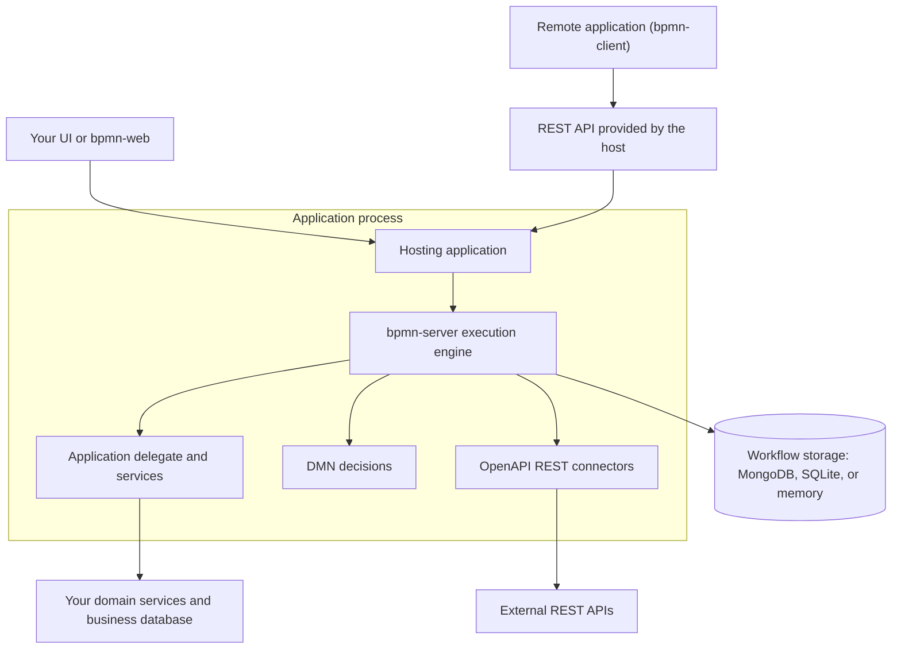
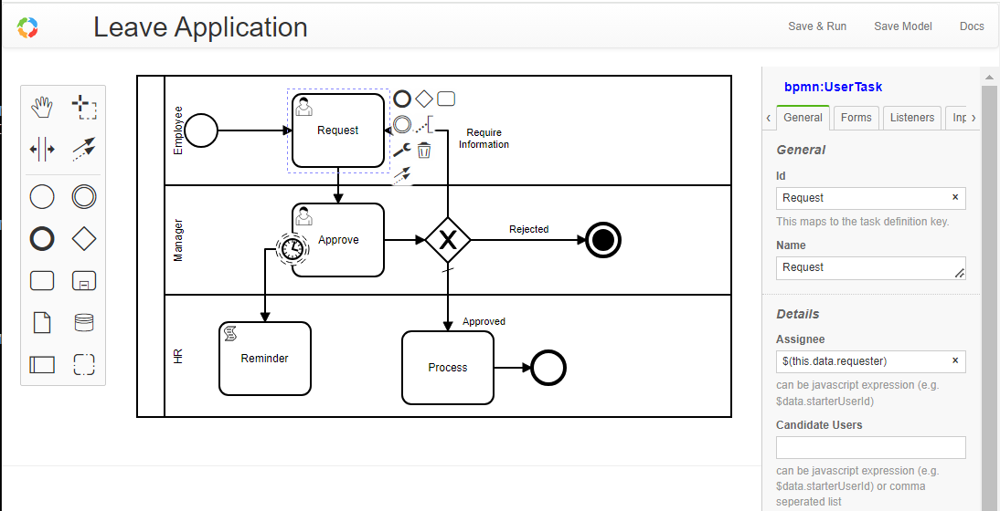

# BPMN Server

**An embeddable BPMN 2.0 workflow engine for Node.js and TypeScript.**

Build and run long-lived business processes **inside your application**. BPMN Server executes workflow models, coordinates human and service tasks, handles events and timers, and persists execution state. Your application remains responsible for its UI, authentication, domain services, and business records.

!!! info "BPMN Server 3.5"
    Version 3.5 adds [OpenAPI-based REST connectors](connectors.md), [DMN decisions](decisions.md), [SQLite storage](setup.md#storage), [data objects](data-objects.md), an improved [model editor](modeler.md), and a one-command application starter. See [What's new in 3.5](whats-new-3.5.md) and the [3.x upgrade guide](whats-new-3.md).

## Get started

Try a small application without running a database server:

```sh
npx bpmn-server init my-app --memory
cd my-app
npm start
```

Open **http://localhost:3000** and sign in with the starter application's development credentials (`admin` / `admin`). **Change these credentials before making the application accessible to others.** The in-memory store is for evaluation and tests; it is not durable across restarts.

For a persistent installation, run `npx bpmn-server init my-app` without `--memory` and choose a supported database. See [Installation and configuration](setup.md) for the monorepo source build, SQLite, MongoDB, and deployment options.

| I want to… | Start here |
| --- | --- |
| Run the example application | [Quick Start and setup](setup.md) |
| Design and test workflows visually | [Model editor](modeler.md) |
| Add workflows to an existing application | [Application integration](customization.md) |
| Call external REST APIs from tasks | [Connectors](connectors.md) |
| Build decision tables and business rules | [Decisions (DMN)](decisions.md) |
| Validate or debug a model | [Model verification](verify.md) and [Testing](testing.md) |
| Use the engine directly | [Invoking workflows](invokation.md) and [API summary](api-summary.md) |

## How it fits into your application



**BPMN Server is a library, not a stand-alone web server.** A host application creates the engine and supplies its configuration and application delegate. The optional `bpmn-web` package provides a ready-to-use web application, modeler, administration tools, and REST endpoints. The `bpmn-client` package calls a running host over HTTP.

The [monorepo](https://github.com/bpmnServer/bpmn-server) contains the engine (`packages/bpmn-server`), web application (`packages/bpmn-web`), remote client (`packages/bpmn-client`), starter (`sampleApp`), and test host (`testSampleApp`). Read [Application integration](customization.md) to understand responsibilities and extension points.

## What the engine provides

| Capability | Details |
| --- | --- |
| BPMN execution | Service, script, user and business-rule tasks; gateways; events; timers; subprocesses; multi-instance activities |
| Long-running processes | Workflow instance state, variables, waiting tasks, locking, and recovery facilities |
| User work | Assignments, candidate users/groups, task completion, and security integration with your host |
| Business decisions | DMN decision tables, FEEL expressions, and decision tests |
| External integration | OpenAPI 3.0/3.1 REST connectors with input/output mappings and configured credentials |
| Pluggable persistence | MongoDB, SQLite (Node.js 22.5+), in-memory, or a custom document-store adapter |
| Model development | BPMN/DMN editors, model verification, linting, scenarios, and debugging |
| Application integration | TypeScript/JavaScript services, delegates, listeners, and runtime/admin APIs |

See the [feature examples](examples.md), [execution model](execution.md), [data model](data.md), and [security](security.md).

## Workflow state versus business data

The engine owns the BPMN definition, process instances, execution items, workflow variables, and task state. **Your application should normally own business entities** such as claims, orders, employees, and customers.

For example, a workflow can carry a `claimId`, call your service to update that claim, and load claim information via a [data object](data-objects.md). Avoid treating the workflow instance as the authoritative database for your business records.

## Model a process

`bpmn-web` includes a BPMN editor built on bpmn.io with a properties panel, model checks, and test scenarios.



Models are BPMN XML; they can be imported from other BPMN tools or edited visually. The [model editor guide](modeler.md) explains supported properties and validation. **BPMN 2.0 notation coverage is not the same as full support for every extension from other engines**; check the [examples](examples.md) and [model checker](verify.md) before importing advanced models.

## Use in production

Use a persistent data store; configure authentication and access controls in your host; secure connector credentials; review timer and lock settings; and test shutdown/recovery before deploying. See [Setup](setup.md), [Security](security.md), and [Advanced topics](advanced.md).

The full demonstration is available at [bpmn.omniworkflow.com](https://bpmn.omniworkflow.com). The project is [MIT-licensed on GitHub](https://github.com/bpmnServer/bpmn-server).
