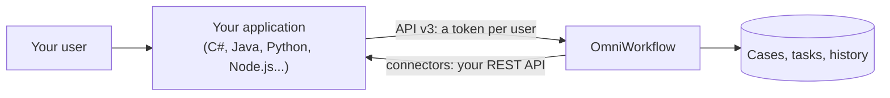
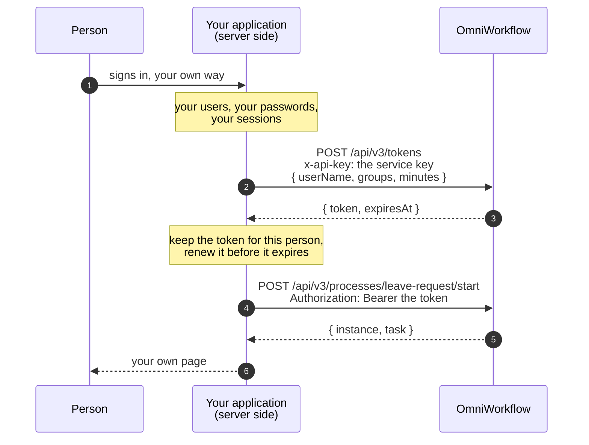
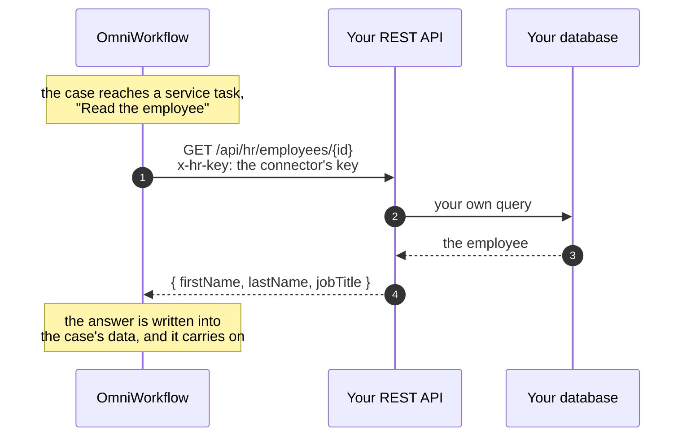

# Calling OmniWorkflow from your application

Any application that can make HTTP calls can run workflows: C#, Java, Python, Go, PHP, Ruby, or Node.js. This page
shows the same four calls in several languages, with the parts that are easy to get wrong spelled out.



Your application calls OmniWorkflow to start cases and work on tasks. OmniWorkflow calls your application back when a
process needs something only it knows: both directions are covered below.

The API describes itself, so you never have to guess a route:

```
GET https://your-server/api/v3/openapi.json
```

Point an OpenAPI generator at that document and you get a typed client in your own language, or read it in Postman
or Swagger UI.

## The two credentials

This is the part to understand before writing any code.

| | What it is | Use it for |
|---|---|---|
| **The service key** (`x-api-key`) | One key for the whole application, from its `.env` | System work: issuing tokens, delivering messages and signals |
| **A user's token** (`Authorization: Bearer ...`) | Issued per person, lasts minutes | Everything a person does: starting processes, listing and completing their tasks |

**Keep the service key on your server.** It can act for any user, so it must never reach a browser or a mobile app.



The person never talks to OmniWorkflow, and never sees a token. Your application decides who they are; OmniWorkflow
decides what that person may do, from the models' own rules.

The usual shape: your application authenticates its own user however it already does, then asks OmniWorkflow for a
token for that person, and makes the rest of the calls with it. The models' own rules then apply: a person is only
offered the tasks they may do, and a task they may not complete is refused.

## The four calls

| | |
|---|---|
| `POST /api/v3/tokens` | A token for one of your users (service key) |
| `POST /api/v3/processes/{name}/start` | Start a process as that person |
| `GET /api/v3/tasks` | The tasks waiting for them |
| `POST /api/v3/tasks/{id}/complete` | Complete one, with its form's data |

## C# (.NET)

A small service you can drop into an ASP.NET application. It issues a token per user, keeps it until shortly before
it expires, and makes the calls with it.

```csharp
using System.Net.Http.Headers;
using System.Net.Http.Json;
using System.Text.Json;

public sealed class OmniWorkflow(HttpClient http, string baseUrl, string serviceKey)
{
    private readonly Dictionary<string, (string Token, DateTimeOffset Expires)> _tokens = new();

    /// A token for this user, issued when there is none and renewed a minute before it expires.
    private async Task<string> TokenFor(string userName, string[] groups)
    {
        if (_tokens.TryGetValue(userName, out var kept) && kept.Expires > DateTimeOffset.UtcNow.AddMinutes(1))
            return kept.Token;

        using var request = new HttpRequestMessage(HttpMethod.Post, $"{baseUrl}/api/v3/tokens");
        request.Headers.Add("x-api-key", serviceKey);          // the service key issues tokens
        request.Content = JsonContent.Create(new { userName, groups, minutes = 30 });

        var answer = await Send(request);
        var token = answer.GetProperty("token").GetString()!;
        _tokens[userName] = (token, answer.GetProperty("expiresAt").GetDateTimeOffset());
        return token;
    }

    /// A call made as this user: every call carries their token, so the models' rules apply to them.
    private async Task<JsonElement> AsUser(string userName, string[] groups, HttpMethod method, string path, object? body = null)
    {
        using var request = new HttpRequestMessage(method, $"{baseUrl}/api/v3{path}");
        request.Headers.Authorization = new AuthenticationHeaderValue("Bearer", await TokenFor(userName, groups));
        if (body is not null) request.Content = JsonContent.Create(body);
        return await Send(request);
    }

    private async Task<JsonElement> Send(HttpRequestMessage request)
    {
        using var response = await http.SendAsync(request);
        var json = await response.Content.ReadFromJsonAsync<JsonElement>();
        if (response.IsSuccessStatusCode) return json;

        // a refusal names what was wrong: { error: { code, message } }
        var error = json.GetProperty("error");
        throw new OmniWorkflowException(
            (int)response.StatusCode,
            error.GetProperty("code").GetString() ?? "ERROR",
            error.GetProperty("message").GetString() ?? "");
    }

    public Task<JsonElement> Start(string userName, string[] groups, string process, object data) =>
        AsUser(userName, groups, HttpMethod.Post, $"/processes/{Uri.EscapeDataString(process)}/start", new { data });

    public Task<JsonElement> MyTasks(string userName, string[] groups) =>
        AsUser(userName, groups, HttpMethod.Get, "/tasks?limit=50");

    public Task<JsonElement> Complete(string userName, string[] groups, string taskId, object data) =>
        AsUser(userName, groups, HttpMethod.Post, $"/tasks/{Uri.EscapeDataString(taskId)}/complete", new { data });

    /// Signing out, or a user who has left: their tokens stop working at once.
    public async Task SignOut(string userName)
    {
        _tokens.Remove(userName);
        using var request = new HttpRequestMessage(HttpMethod.Delete, $"{baseUrl}/api/v3/tokens?userName={Uri.EscapeDataString(userName)}");
        request.Headers.Add("x-api-key", serviceKey);
        await Send(request);
    }
}

public sealed class OmniWorkflowException(int status, string code, string message)
    : Exception($"{status} {code}: {message}")
{
    public int Status { get; } = status;
    public string Code { get; } = code;
}
```

Using it from a controller:

```csharp
// an employee asks for leave: the case is started as them, and its first task comes back
var started = await workflow.Start(User.Identity!.Name!, ["Employee"], "leave-request",
    new { startDate = "2026-12-01", endDate = "2026-12-05", reason = "Holiday" });

var instanceId = started.GetProperty("instance").GetProperty("id").GetString();
var task = started.GetProperty("task");          // null when the case waits for someone else

// their own task list, for your inbox page
var tasks = await workflow.MyTasks(User.Identity!.Name!, ["Employee"]);
foreach (var t in tasks.GetProperty("items").EnumerateArray())
    Console.WriteLine($"{t.GetProperty("name")} in {t.GetProperty("processName")}");

// completing one, with what the form collected
await workflow.Complete(User.Identity!.Name!, ["Manager"], taskId, new { approved = true });
```

Register it once:

```csharp
builder.Services.AddHttpClient<OmniWorkflow>((http, _) =>
    new OmniWorkflow(http, builder.Configuration["Workflow:Url"]!, builder.Configuration["Workflow:ServiceKey"]!));
```

## Python

```python
import httpx

class OmniWorkflow:
    def __init__(self, base_url: str, service_key: str):
        self.base, self.key, self.client = base_url.rstrip('/'), service_key, httpx.Client()

    def token_for(self, user_name: str, groups: list[str]) -> str:
        answer = self.client.post(f'{self.base}/api/v3/tokens',
                                  headers={'x-api-key': self.key},
                                  json={'userName': user_name, 'groups': groups, 'minutes': 30})
        answer.raise_for_status()
        return answer.json()['token']

    def start(self, user_name: str, groups: list[str], process: str, data: dict) -> dict:
        answer = self.client.post(f'{self.base}/api/v3/processes/{process}/start',
                                  headers={'authorization': f'Bearer {self.token_for(user_name, groups)}'},
                                  json={'data': data})
        answer.raise_for_status()
        return answer.json()
```

Keep the token between calls rather than issuing one each time, as the C# example does.

## curl

Useful for trying the API by hand, and for a shell script:

```sh
# a token for one of your users
TOKEN=$(curl -s -X POST https://your-server/api/v3/tokens \
  -H "x-api-key: $API_KEY" -H 'content-type: application/json' \
  -d '{"userName":"sam","groups":["Employee"],"minutes":30}' | jq -r .token)

# start a process as them
curl -s -X POST https://your-server/api/v3/processes/leave-request/start \
  -H "authorization: Bearer $TOKEN" -H 'content-type: application/json' \
  -d '{"data":{"startDate":"2026-12-01","endDate":"2026-12-05","reason":"Holiday"}}'

# their waiting tasks
curl -s "https://your-server/api/v3/tasks?limit=50" -H "authorization: Bearer $TOKEN"

# complete one
curl -s -X POST "https://your-server/api/v3/tasks/$TASK_ID/complete" \
  -H "authorization: Bearer $TOKEN" -H 'content-type: application/json' \
  -d '{"data":{"approved":true}}'
```

## Node.js

Plain `fetch` works the same way. For an application acting for many users,
[bpmn-client](bpmn-client.md) handles the tokens (issuing, renewing, revoking) and paging for you:

```ts
import { BPMNClient3 } from 'bpmn-client';

const service = new BPMNClient3({ url: 'https://your-server', apiKey: process.env.API_KEY });
const sam = service.as('sam', ['Employee']);      // its token is issued and renewed as needed

const { instance, task } = await sam.processes.start('leave-request', { reason: 'Holiday' });
await sam.tasks.complete(task.id, { approved: true });
```

## A case from start to finish

What actually happens when an employee asks for leave and a manager approves it:

```mermaid
sequenceDiagram
    autonumber
    participant E as Employee
    participant App as Your application
    participant OWF as OmniWorkflow
    participant M as Manager

    E->>App: "I want leave on these dates"
    App->>OWF: start leave-request, as the employee
    OWF->>OWF: runs the model until it needs someone
    OWF-->>App: the case started; it waits at "Approve"
    Note over OWF: the model says the manager's<br/>group gets that task

    M->>App: opens their inbox
    App->>OWF: GET /tasks, as the manager
    OWF-->>App: only the tasks this manager may do
    App-->>M: your own inbox page

    M->>App: approves, on your own form
    App->>OWF: POST /tasks/{id}/complete { approved: true }
    OWF->>OWF: carries on: the gateway, the next steps
    OWF-->>App: the task and the case, now ended
    App-->>E: "your leave was approved"
```

Two things to notice. The **model** decides that the manager gets the approval, not your code: change the diagram and
the routing changes with it. And OmniWorkflow only ever answers with what **that person** may see, so your inbox page
does no filtering of its own.

## When OmniWorkflow calls you

The other direction: a process needs something only your application has, so a service task calls your REST API
through a [connector](connectors.md). No code goes in the model.



Set it up once by giving OmniWorkflow your OpenAPI document and a key; the key is kept encrypted by the engine, and
never written into the model. The HR demo does exactly this: its models call `hr/getEmployee` and
`hr/createAssignment`. See [Connectors](connectors.md).

## Things worth knowing

**Groups are your roles.** The groups you give a token are what the models mean by a lane, a candidate group or a
role. `SYSTEM`, `ADMIN` and `DESIGNER` are refused: a token cannot make someone an administrator.

**A task the user may not do is not there.** Listing tasks returns only the ones they have a part in, and completing
someone else's is refused with 404 or 403. You do not have to filter the list yourself.

**Revoke on sign-out.** `DELETE /api/v3/tokens?userName=sam` stops every token that person has.

**Errors name themselves.** A refusal answers `{ "error": { "code": "...", "message": "..." } }`, with codes such as
`TASK_NOT_FOUND`, `POLICY_DENIED` and `TOKEN_INVALID`, so your application can act on the code rather than the text.

**Starting a case is not the same as a person having a task.** `start` answers the instance and the first task *if
that person has it*; when the first step belongs to someone else, `task` is null and it appears in their list.

## Next

- Every route, its parameters and its answers: [API v3](api-v3.md).
- The whole integration, with users and events: [Integrate an existing application](integrate.md), and
  [Tutorial 10](tutorial/tutorial-integrate.md).
- Having OmniWorkflow call **your** application, instead of the other way round:
  [Connectors](connectors.md).
