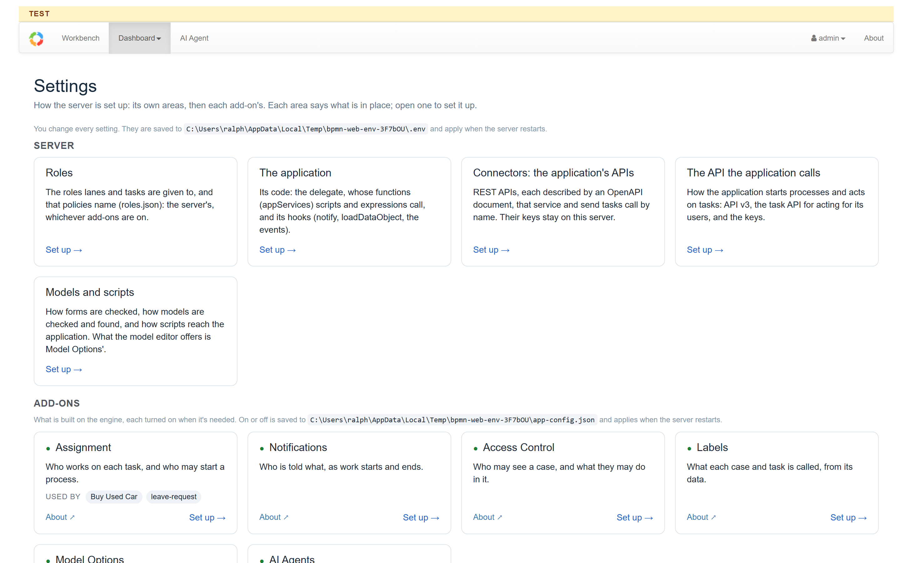

# The Settings page

**Dashboard ▸ Settings** (`/dashboard/settings`; `/dashboard/integration` before 3.7.5, which still leads here) is
where administrators and designers set up the server, and turn the add-ons on and off. It opens on an overview in
two groups: **Server**, an area for each part of the server that is no add-on's, then **Add-ons**, an area for each
add-on, with its own settings. Each card says in a line or two what is in place, what needs setting up (*Site address
not set*, *Email is off*), whether the add-on is on, and *restart to apply* when a saved change waits for a restart.
A card opens its area's page (`/dashboard/settings/<area>`): what is in place, its main settings, and the rest under
**More settings**. Saving comes back to that page.

**Server**

| Area | Shows | Settings (main first) |
|---|---|---|
| **The application's contract** (`contract`) | What the application publishes in `app-contract.json` and how it stands here: its **APIs**, each with the connector made from it (*no connector made*, *no key*, *not tested*, *connected*, *last test failed*, *off*), with a **Test** button for an administrator that runs the connector's test and comes back to the card; its **pages**, **roles** and **functions**; what is wrong with the file; and **how it connects** (the API the application calls and whether the service key is set, the address links this server sends begin with, who signs people in). Without a contract it says so | none |
| **Roles** | The roles (the application's `app-contract.json`): the server's, whichever add-ons are on | none |
| **Security** (`secure`) | Who can reach this server, what each of them may do, and what its models may run — the three apart, with the effective configuration in plain words and a warning for a combination that is not safe. **What each role is allowed to do**: a table with a row for each role — `PUBLIC` (not signed in), `User` (anyone signed in), `SYSTEM` (the server itself), then the application's own — and a column for each permission (User, Designer, Administrator). Every cell is a tick, saved to the application's `app-contract.json`: a role the contract does not mention keeps the server's default for its name, one it mentions decides for itself either way, so a role can be given Administrator or have it taken away. A save that would leave no role an administrator is refused. `DISABLE_ADMIN`, `DISABLE_DESIGN`, `READ_ONLY`, `ENFORCE_SECURITY`, `REQUIRE_AUTHENTICATION`, `ALLOW_INSECURE_NO_AUTH` and `SECURITY_POLICY` are not offered as settings here — they decide for everyone, which the table says — and stay settable in `.env` | **Access:** `REQUIRE_AUTHENTICATION`, `ENFORCE_SECURITY`; `ALLOW_INSECURE_NO_AUTH`, `SESSION_SECRET`, `SECURE_COOKIES`, `AUTH_RATE_LIMIT`, the sign-up settings, `ADMIN_PASSWORD`. **What they may do:** `READ_ONLY`, `DISABLE_ADMIN`, `DISABLE_DESIGN`; `SECURITY_POLICY`. **Credentials:** `API_KEY`, `ADMIN_API_KEY`, `API_ACTING_USER_KEY`, `API_IMPERSONATION`, `API_RATE_LIMIT`, `AI_ACCESS`, `AI_KEY_TTL_GROUPS`. **What runs:** `SCRIPT_SANDBOX`; `SCRIPT_SANDBOX_SERVICES`, `SERVICE_TASKS`, `TIMERS`, `DEMO_MODE`, `CONNECTORS_ALLOW_HOSTS` |
| **The application** | The delegate's class, its functions (`appServices`) and methods (folded), who signs people in | `APP_ENV`, `SITE_URL`; `APP_ENV_LABEL` |
| **Connectors** | Each connector: enabled or not, its key (last 4 characters), the models that call it | `SECRETS_KEY`; `CONNECTOR_CATALOG_URL` |
| **The API the application calls** | API v3, and whether the task API (`/api2/tasks`) is on | the service account (`API_SERVICE_USER_NAME`, its groups, tenant and models owner). Its keys are **Security**'s |
| **Models, forms and scripts** (`models`) | | `FORM_RULES`, `ELEMENT_TEMPLATES`; `VERIFY_MODELS_ON_IMPORT`, `CATALOG_URL`. What a model may run is **Security**'s |
| **AI agents** | | `AI_ACCESS`; `AI_GUIDE` |

**Add-ons**: each add-on's area is named by it (`/dashboard/settings/policies`), and its settings are the ones its
manifest declares (`addon.json`, `settings`: each a `.env` name, its label, `editor: "designer"` when a designer
changes it too, `main` to show it first); its card says what it is in a few words (`brief`) and links to its doc
page (`docs`, opened in a new tab). An application's own add-on gets an area the same way. An add-on's area
says whether it is on and which models use it; what it has (the Policies add-on's roles) shows while it is on, and its
settings are kept while it is off.

| Area | Shows | Settings (main first) |
|---|---|---|
| **Assignment** | The assignment policies | none of its own |
| **Notifications** | The notification policies; who delivers notifications (the delegate's `notify`, or email), how many are kept, by status | `NOTIFICATIONS`, `EMAIL_ENABLE`, `EMAIL_FROM`, `SMTP_USER`, `SMTP_PASSWORD`; `EMAIL_LOG` |
| **Access Control** (`security`) | The security policies, and whether they are on | `SECURITY_POLICY` |
| **Labels** | | none of its own |
| **Extended Forms** | | none of its own |
| **Model History** | | `MODEL_HISTORY` |

Each area's page links to where its parts are managed: the connectors, the roles (Administration), the policies
(Design), the notifications. Before 3.7.5, Roles and policies and Notifications were areas of their own: the roles
are the server's (**Roles**), the policies the Assignment, Access Control and Notifications add-ons'
(`/dashboard/settings/notifications` leads to Notifications); and *Forms, scripts and the model editor* is *Models,
forms and scripts* (`models`), its `MODEL_HISTORY` the Model History add-on's.

## Add-ons on and off

Each add-on's card ([Add-ons](https://github.com/bpmnServer/bpmn-server/blob/main/docs/design/add-ons.md)) says whether it is on and which models use it, and has its
switch: an administrator turns it on or off there (**Turn off** / **Turn on**), or in its area; designers see them.

- **Saved to `app-config.json`**, the application's, beside its `.env` (`appConfig` in the configuration names another):
  `{ "addOns": ["assignment", "labels"] }`. Its other settings are kept. `policies`, one add-on before 3.7.5, means
  the three it became: Assignment, Notifications and Access Control.
- **No `app-config.json`, or no `addOns` in it:** every add-on is on, as before 3.7.5.
- **It applies when the server restarts.** Until then the add-on shows how the server runs, marked *restart to apply*.
- **A model that uses an add-on that's off** keeps its attributes; the engine ignores them, and the model's checks
  say so (`add-on-off`).

| Add-on | What it is |
|---|---|
| **Assignment** | Who works on each task and who may start a process (assignee, candidates, lanes, assignment policies), and the actors expressions read |
| **Notifications** | Who is told what (notification policies), kept and delivered |
| **Access Control** (`security`) | Who may see and do what (security policies) |
| **Labels** | What each case and task is called (`owf:label`, `owf:endLabel`), and their values as the lists' columns. Off: a case is shown as `<model> #<caseId>`, a task by its name |
| **Extended Forms** | A form field's choices from a source: a drop-down (`owf:list`) or a search (`owf:lookup`); a list's value held to its choices |
| **Model History** | The editor's Test tab (scenarios) and History tab (each save kept as a version) |

## Who changes what

- **Administrators** change every setting.
- **Designers** change the design-side settings, marked *designers too*: `FORM_RULES`, `ELEMENT_TEMPLATES`,
  `VERIFY_MODELS_ON_IMPORT` and `MODEL_HISTORY`. They see the other settings but cannot change them, and a form posted
  with one is refused.
- **Everyone else** can't open the page.

## How a change is saved

- A change is written to the server's `.env`. The file as it was before is kept as `.env.bak`. Other lines and
  comments are left as they are.
- **It applies when the server restarts.** Until then the page shows the running value, marked *restart to apply*.
  An administrator can restart from Administration when a supervisor (Docker, pm2, systemd) restarts the server.
- Each value is checked against the settings schema: a number, `true` or `false`, one of its choices, a minimum length.
  If any value is wrong, nothing is saved, and the page says why.
- An empty field removes the setting from `.env`, so its default applies.
- **A secret** (a key, a password) is never shown, only whether it is set. You can type a new value, have a random key
  generated, or remove it. Leaving the field empty keeps it.
- **A setting the environment gives** (Docker, systemd, the shell) wins over `.env`, so the page shows it and doesn't
  change it: change it where it is set.
- **An application that gives its own API settings** (`hostSettings`) keeps them: the API section shows them and
  doesn't change them.
- **With a separate engine** (`ENGINE_AT`), the page writes the host's `.env`. Copy the change to the engine's `.env`
  too, as [Settings](settings.md) says.

An application can name the `.env` the page writes: `envFile` in `start()` or the `WorkflowApplication`. By default it
is the `.env` of the folder the server runs in.

## Related

- [Settings: `.env` and configuration](settings.md): every setting.
- [Connectors](connectors.md), [Assignment policies](assignment-policies.md), [Security](security.md),
  [Notification policies](notification-policies.md).
- [Custom delegates](delegates.md): the application's code.
