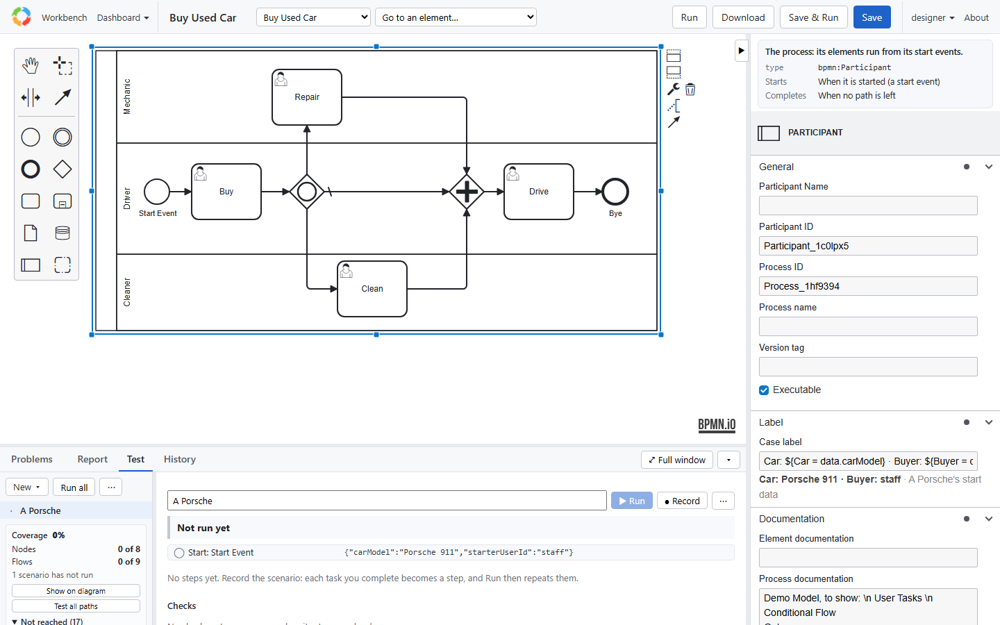
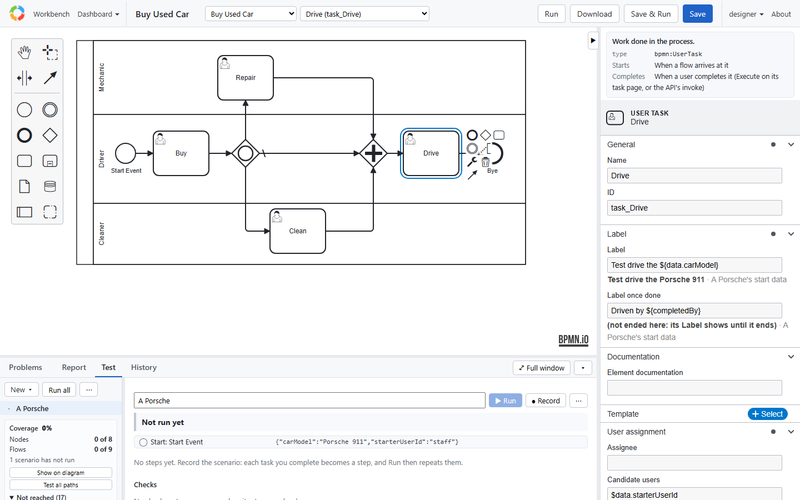
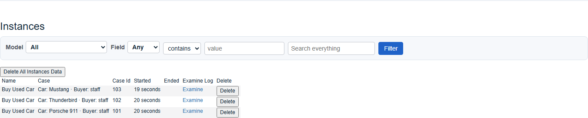
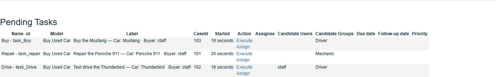
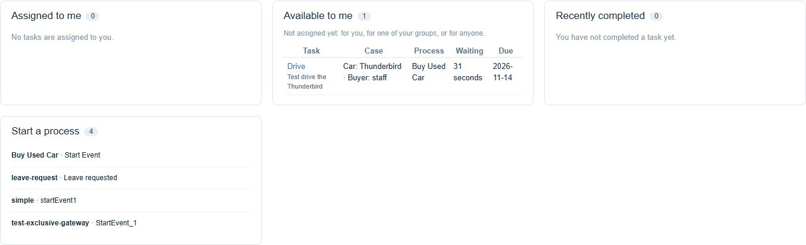
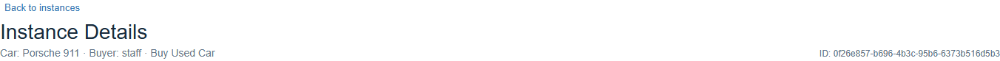
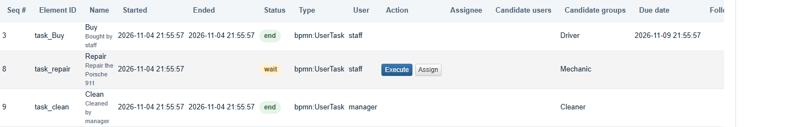
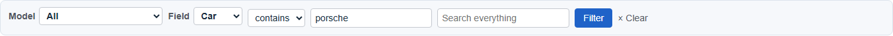
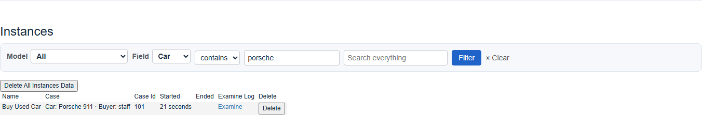

# Labels

A case is known by what identifies it: *Car: Porsche 911 · Buyer: staff*, not only by its case id. Its model says
what that is, with a **label**: a template saved in the model, with its values named. The pages show each case and
task by its label: the Instances and Pending Tasks lists, My work, and the instance page; and the lists can be
filtered by its named values.

The pictures on this page are the sample application's *Buy Used Car*, whose model has these labels:

| Element | Label | Label once done |
|---|---|---|
| The process | `Car: ${Car = data.carModel} · Buyer: ${Buyer = data.starterUserId}` | |
| Buy | `Buy the ${data.carModel}` | `Bought by ${completedBy}` |
| Repair | `Repair the ${data.carModel}` | `Repaired by ${completedBy}` |
| Clean | `Clean the ${data.carModel}` | `Cleaned by ${completedBy}` |
| Drive | `Test drive the ${data.carModel}` | `Driven by ${completedBy}` |

## A case's label

On the process, in the editor's **Label** group (*Case label*), or in the XML:

```xml
<bpmn:process id="Expense" camunda:label="Client: ${Client = data.clientId} · Order: ${Order = data.orderNo}">
```



- **`${Name = data.path}`** is a **named value**: shown in the text, and known by its name.
- **`${data.path}`** is plain text: shown, not named.
- **The text around the placeholders** is shown as written.

A case with `{ clientId: 'abc', orderNo: 1234 }` is shown as `Client: abc · Order: 1234`.

**A missing value takes its name along.** If `data.clientId` is empty, `Client: ` goes too, and the case is shown
as `Order: 1234`. When every value is missing, the default applies.

## An element's label

Any element on the diagram may have its own, in the **Label** group:

- **Label**, while it runs: `Approve ${Amount = data.amount} for ${instance.Client}`.
- **Label once done**, once it has ended: `Approved by ${completedBy}`.



### Where labels are shown

**Instances:** the Case column.



**Pending Tasks:** the Label column, the task's own label and its case's. A task with no label of its own shows its
name and its case's label: *Approve · Client: abc · Order: 1234*.



**My work:** each task's own label under its name, and its case's label in the Case column.



**The instance page:** the case's label at the top, and each element's under its name: a waiting one's label, an
ended one's *label once done*.





## What a placeholder can name

Placeholders are **data, never scripts**:

| In | Placeholder | Value |
|---|---|---|
| A case's label | `data.…` | The case's data |
| | `model` | The model's name |
| An element's label | `data.…` | Its data: the case's, or a loop round's or a sub-process's own |
| | `completedBy`, `assignee`, `userName`, `status`, `startedAt`, `endedAt`, `name` | Its own fields |
| | `instance.<Name>` | A named value of its case's label: `${instance.Client}` |

Paths are names separated by dots; `__proto__`, `prototype` and `constructor` are refused. The editor marks a
placeholder that isn't a path, or a name used twice, as you type, and `verifyModel` (Problems) reports it
(`label-template`).

A value is shown as text: a date in ISO form, a list joined with commas, an object as JSON.

## When labels are filled in

When they are shown, from the case's data and from **the case's own model**: a case keeps the model it started
with, so a later version of the model doesn't relabel it. Nothing is stored. An element that has ended shows its
*Label once done* filled from its data as it is now; a label that must stay as it was should use the element's own
fields (`completedBy`).

## The defaults

| Element | Without a label |
|---|---|
| A case | The application's `instanceLabel(instance)`, else `<model> #<caseId>`, else the model's name |
| A user task | Its name and its case's label |
| Any other element | None |

`instanceLabel` is an optional method of the application's delegate, for labels that must be computed in code:

```ts
class AppDelegate extends WebAppDelegate {
    instanceLabel(instance) {
        return `Claim ${instance.data.claimNo}`;
    }
}
```

## In code

The pages fill labels in with `labelInstances(server, instances)` and `labelItems(server, items)` (bpmn-server):
each case gets `label` and `labelValues` (its named values), each task `label`, `ownLabel`, `caseLabel` and
`labelValues`. `fillTemplate(template, scope)` and `templateProblems(template)` fill in and check one template.

## Filters

The Workbench's Instances section and My work have a filter bar. On the Workbench it filters that section only:



- **Model:** only that model's cases.
- **Field:** a named value of the models' case labels (*Car*, *Buyer*), which **contains** or **is** a value. Its
  tooltip says where each model reads it from (`Buy Used Car: data.carModel`).
- **Search everything:** any named value of any model.

The filter is a database query on the data paths the named values read: *Car contains porsche* is `data.carModel`
contains "porsche" (any case) for Buy Used Car's cases, and on each model's own path when several models name a
*Car*. A number matches as a number too (*Order is 1234*). It's in the URL (`/?field=Car&op=contains&value=porsche#instances`),
so a filtered list can be bookmarked and shared.



Filters query the data as it is; they need no index. On many cases, indexes on the paths filtered most will matter,
but indexing is configuration, apart from labels.

In code: `labelFields(server)` lists the named values the models offer, and `labelQuery(fields, filter)` makes the
query (`{ model, field, op, value, search }`), to add to `findInstances` or `findItems`.

Columns of named values in the lists, and filters in the APIs, are next. See the design, `docs/design/labels.md`.
