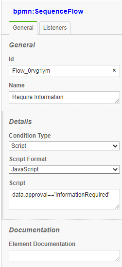

# Scripting

<!-- toc -->

  - [Introduction](#introduction)
  - [Model Expressions/Scripts](#model-expressionsscripts)
    - [Model Expressions](#model-expressions)
    - [Model Listeners](#model-listeners)
  - [Execution Listeners](#execution-listeners)
    - [Task Listeners](#task-listeners)
  - [Application Listener](#application-listener)
- [Scripts Scope and variables](#scripts-scope-and-variables)
  - [Item Scope](#item-scope)
  - [Execution Scope](#execution-scope)
  - [Application Listener](#application-listener)

- [Conditions in FEEL](#conditions-in-feel)
- [Conditions that give their value by next](#conditions-that-give-their-value-by-next)
- [Variables of your own in scripts](#variables-of-your-own-in-scripts)

<!-- tocstop -->

## Introduction

BPMN-Server provides scripting throughout the workflow.
- The primary(default) script language is `JavaScript`.
- `Python` support is also available, using prefix `$py` at the start of any script.

Scripts are passed parameters values to the context:

## Model Expressions/Scripts

### Model Expressions 

A value in a model is read one of three ways:

| Written as | Read as | Example |
|---|---|---|
| `$js`, `$(js)` or `${js}` (the whole value) | an expression: the JavaScript's value, of its own type | `${data.amount > 1000}`, `$(data.requester)` |
| a text with `${...}` parts | the text, each part's value in its place | `Order ${data.id} for ${data.customer}` |
| anything else | the text as written (a list when it has commas, for assignments) | `managers,auditors` |

Expressions are JavaScript, and they see `data`, `item`, `instance`, `input`, `output`, `appServices`,
`appUtils` and `appDelegate`, not each process variable by name. Coming from Camunda, write
`${data.amount > 1000 && data.approved}` rather than `${amount gt 1000 and approved}`: the model check
(`bpmn-server verify`, the editor's Problems) reports JUEL operators and names an expression does not have.

#### conditional flow examples:


{align=right}


```
    data.approval=='Approved'
  or 
    (data.approval=='Approved')
    (this.data.v1 + this.data.v2)
    (this.data.v1 == this.data.v2)
    (this.data.v1 + this.data.v2)>0
    (this.data.v1 + this.data.v2)<4
    
```
<div style="clear:both;" />

#### timers examples:
For duration timers
```
    $appServices.dateAdd(item.dateStarted,10,'days')
    PT${data.reminderHours}H
```   


#### Input/Output

<table>
<tr><th>Type</th><th>Example Value</th></tr>
<tr><td>Text/String</td><td>hello</td></tr>
<tr><td>List</td><td>[ 'str1', 'str2', item.data.myExistingVar ]</td></tr>
<tr><td>Map</td><td>\{ 'key1':  'val1', 'key2': 'val2' \}</td></tr>
<tr><td>JavaScript</td><td>data.item.myExistingVar</td></tr>
<tr><td>JavaScript</td><td>\{ 'key1': 'val1', 'key2': 'val2' , 'key3': [item.data.myExistingVar, 'hello'], 'key4': \{ 'ikey5': item.data.myExistingVar\}\}</td></tr>
</table>

#### Assignment properties

User Task Assignment properties can be JavaScript expression, in this case they must start with '$'

For example:

`assignee` 	`$(this.data.requester)` or `${data.requester}`

`candidateGroups`	`${data.region}-managers,auditors` (filled in, then split at the commas)

### Model Listeners

Inside your model, you can attach Listeners to various nodes as `JavaScript Listeners`

These are similar to expressions above but can invoke async functions and can include more complete Javascript

No syntax required for these scripts

#### Examples
```
    let userManager=await appServices.retrieveManagerForUser(item.userName);

    data.manager=userManager;
    
    if (data.var1>5) {
        data.message='any text here';
    }
```
## Execution Listeners
These are for all node types and processes


{align=left}

| event         |       Description        |
|-------------  |-----------------------|
| start   |   is fired at the start of item execution|
| end   |	  is fired at the end of item execution|

<div style="clear:both;" />


### Task Listeners
These are for User Tasks only

| event        |       Description        |
|-------------  |-------------   |
| assign   |   invoked after `assign` command is issued |
| validate  |invoked after `assign` or `invoke`  command is issued|

`validate` scripts have a special handling, that they can stop execution by raising errors, to return errors to the execution:
```
    // do some checking here
    return {error:'Not a valid Input'};

```
As a result execution will raise an exception and the command will fail.


## Application Listener

You can place a listener in your application delegate or your execution scripts class to listen to all events
Example:
```
    const api = new BPMNAPI(new BPMNServer(configuration,new Logger({ toConsole: false}),{cron:false}));

    let options= {option1:1234}; //,option2:SystemUser};

    api.server.listener.on('all', async function ({ context, event, }) {
        if (event=='process.restored')
            {
            context.options=options;
            context.options['restored']=true;
            }
        if (event.startsWith('process.'))
            console.log('---Event: -->' + event , context.options);
        else 
            console.log('---Event: -->'+event, 'item:',context.item.elementId,context.options );
    });

```

# Scripts Scope and variables
## Item Scope
Items Expressions and Listeners have the following variables

| Variable        |       Description        |
|-------------  |-------------   |
| item   |   reference the current item	|
| this   |	same as item|
| data 	|	item data object|
| input |   item input 	|
|output |	item output|
|appDelegate| reference to appDelegate object	|
|appServices| reference to appServices object	|
|appUtils|	   reference to appUtils object|


- Common Item properties:
```
    id;                 
    options;
    context;    //execution options
    elementId;  // Model Node Id
```
- Item methods 
```
    log(msg)        // issues a log message into the logger
    info(msg)       // issues an information message
```
- Execution (context) properties
```
    instance: InstanceObject;
    tokens = new Map();
    definition: IDefinition;
    process : Process;
    item;
    messageMatchingKey;
    userName;
    servicesProvider;
    options;
    operation;
```
## Execution Scope
Expressions and Listeners have the following variables

| Variable        |       Description        |
|-------------  |-------------   |
| this   |	refers to execution object |
|appDelegate| reference to appDelegate object	|
|appServices| reference to appServices object	|
|appUtils|	   reference to appUtils object|


## Application Listener

You can place a listener in your application delegate or your execution scripts class to listen to all events
Example:
```
    const api = new BPMNAPI(new BPMNServer(configuration,new Logger({ toConsole: false}),{cron:false}));

    let options= {option1:1234}; //,option2:SystemUser};

    api.server.listener.on('all', async function ({ context, event, }) {
        if (event=='process.restored')
            {
            context.options=options;
            context.options['restored']=true;
            }
        if (event.startsWith('process.'))
            console.log('---Event: -->' + event , context.options);
        else 
            console.log('---Event: -->'+event, 'item:',context.item.elementId,context.options );
    });

```

# Conditions in FEEL

A sequence flow's condition is JavaScript unless it says otherwise: `language="FEEL"` makes it FEEL, over the data's values by name
(and `data` itself). `${...}` around a condition is a wrapper, and does not change its language. As with JavaScript, the flow is taken
only when the value is `true`.

```xml
<bpmn:conditionExpression xsi:type="bpmn:tFormalExpression" language="FEEL">amount > 1000</bpmn:conditionExpression>
```

In the editor, a flow's **Language** offers FEEL. The Condition field follows it; the Problems tab checks a FEEL condition.

# Conditions that give their value by next

With a language of `JavaScript`, a condition may call `next(error, value)` instead of being an expression: on its own, or in statements. An
error fails the call, and if `next` is never called the flow is not taken. It must be called before the condition's code ends.

```xml
<bpmn:conditionExpression xsi:type="bpmn:tFormalExpression" language="JavaScript">
  if (data.amount > 1000) next(null, true); else next(null, false);
</bpmn:conditionExpression>
```

# Variables of your own in scripts

The application can add variables to what scripts and expressions see. Each is computed from a copy of the data each time, so changing it
does not change the process's. They can not replace `data`, `item`, `instance`, `input`, `output`, `appServices`, `appUtils` or
`appDelegate`, and models can not add them. It works the same in `SandboxScriptHandler`, and in FEEL conditions.

```ts
import { ScriptHandler } from 'bpmn-server';

const configuration = webConfiguration({
    scriptHandler: () => new ScriptHandler({ context: { environment: ({ data }) => ({ variables: data }) } }),
});
```

# Where scripts run: in the server or in a sandbox

Every script and expression in a model runs through the configuration's `scriptHandler`. bpmn-server has two:

- **`ScriptHandler`, the default.** Scripts run in the server's own Node.js process, with its permissions. They
  see the real objects (`this`, `data`, `item`, `appServices`, `appDelegate`) and may call the application,
  `await` its services and use Node.js.
- **`SandboxScriptHandler`.** Scripts run in QuickJS, a JavaScript engine compiled to WebAssembly, with no
  access to Node.js, files, the network or the server's objects. bpmn-web uses it with `SCRIPT_SANDBOX=true`
  ([What runs](security.md#what-runs)).

The default is chosen because the sandbox takes away what most applications use scripts for. **Use the
sandbox when the people who write the models are not trusted to run code on the server.** Otherwise, keep the
default.

| | `ScriptHandler` (default) | `SandboxScriptHandler` |
|---|---|---|
| Who may write models | People trusted with the server: whoever saves a model can run code on it | Anyone |
| The application (`appServices`, `appDelegate`, `appUtils`) | Called directly | Calling one returns `undefined`, and the run's decisions say so; with `callServices`, `appServices` and `appUtils` run (below). No `appDelegate` |
| `require`, Node.js, files, network | Available | None |
| Data | The real objects | JSON copies in; only the keys a script changed are copied back |
| An item's fields a script may set | Any | `assignee`, `candidateUsers`, `candidateGroups`, `dueDate`, `followUpDate`, `priority`, `vars` |
| Limits | None | 200 ms and 32 MB per script |
| Cost of a script | Microseconds | A few milliseconds (copies, a QuickJS context); 650 KB of WebAssembly loaded on first use |
| Breakpoints in the Test tab's debugger | Yes: each script is compiled under its element's name | No: Node's inspector does not see into QuickJS (Evaluate still works) |
| JavaScript engine | V8, as the rest of the server | QuickJS: `Date`, `Intl`, error messages and stack traces can differ |

## What changes when a model moves to the sandbox

A model written for the default handler may still run, or may fail or behave differently. Watch for:

1. **Calls to the application.** A script that reads `appServices.lookUp(...)` gets `undefined`, unless the
   handler has `callServices`. Move that work into a service task, which the application implements.
2. **Objects that are not plain data.** Class instances, functions, Buffers and object identity do not
   survive the copy. Dates do when the script leaves them alone.
3. **Long or heavy scripts.** A loop over a large data set, or a wait on something slow, stops at the time or
   memory limit with an error.
4. **Writes the sandbox does not copy back.** Setting any other field of `item`, or anything on `this`,
   is lost.

## Choosing the handler

In bpmn-web, `SCRIPT_SANDBOX=true` picks the sandbox and changes nothing else: timers and service tasks run, and so do a
script's calls to `appServices` and `appUtils`, unless `SCRIPT_SANDBOX_SERVICES=false` (see
[What runs](security.md#what-runs)).

**With `callServices` (`SCRIPT_SANDBOX_SERVICES`), whoever writes a model can call every method of `appServices` and `appUtils`, with any
arguments.** They run in the server, with its permissions, so each must be safe to be called so. A method gets JSON
copies of its arguments and the script a JSON copy of what it returns, so `this` or `item` passed to a service is a
copy: what the service changes on it is lost, and it has no `token` or `context`. A script reaches methods only,
through plain objects: not a service's other objects (`appServices.appDelegate`), nor `constructor` and the like.
What a script waits for a service is not counted in its time limit.

An application that wants the sandbox otherwise sets the handler in its configuration:

```ts
import { SandboxScriptHandler } from 'bpmn-server';

const configuration = webConfiguration({
    scriptHandler: () => new SandboxScriptHandler({ timeLimit: 500, memoryLimit: 64 * 1024 * 1024, callServices: true }),
});
```

`runSandboxed(values, body)`, from the same module, runs other code the same way.

## Python

A script that starts with `$py` is meant to run in Python (`PYTHON_CMD`, default `python`). **This is a
prototype:** it writes test values into the item's data and is not covered by tests, so do not use it in
models yet.
