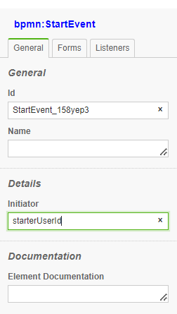
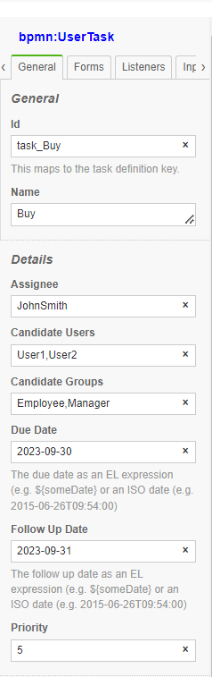

# Security 
In general Application Security deals with the following topics:

- [User Identification and Authentication](#User-Identificaiton-and-authentication)

- [Access Control Rules](#Access-Control-rules)

- [Access Rules Enfocement](#access-control-enforcement)

# User Identification and Authentication

BPMNServer does not provide user identification and authentication component, but relies on the calling application to authenticate the user. The companion package BPMN-web provides full authentication and identification as a mere demo.

Every API call names the user it runs for: a principal your application built after authenticating the user
(since 3.x, a call without one is refused; there is no default user).

### Web App example/ Server Side Scripts

```ts
import { SecureUser, SystemUser } from 'bpmn-server';

const user1 = new SecureUser({ userName: 'user1', userGroups: ['Owner', 'Others'], tenantId: 'acme' });

await api.engine.start(modelName, data, user1, options);
```

`tenantId` keeps a tenant's instances and models apart: the user's calls see only its tenant's.
`SystemUser` is for system work (setup scripts, scheduled jobs); security rules are not applied to it.

### Runtime and administration APIs

`BPMNAPI` runs processes and reads models. Changing models (`save`, `delete`, `rename`, `export`) needs
`BPMNAdminAPI`. Give the runtime API to the parts of the application that run processes (task lists, forms,
integrations), so they can not change models; the admin API only to deployment and model administration.

### WebAPI/REST

    Since WebAPP is already authenticated by **APIKey** is trusted to pass user object

```ts

    // get api-key from header
    // url/engine/start

    await api.engine.start(processName,data,user,options);  

``` 
## Using BPMNClient as a service

```ts

    const client= new BPMNClient(url,apiKey);
    // userId is passed here bypassing authentication, assuming user is already authenticated
    
    // await server.engine.start(processName,data,startNode,userId,options);  
    let response = await server.engine.start('Buy Used Car', { caseId: 1050 },null,'user1');

    //await  server.engine.invoke(query, data, userId);

    response = await server.engine.invoke({id: response.id , "items.elementId": 'task_Buy' },{},'user1');

```
## Access Control Rules

bpmn along with Camunda Extensions, provide adequate means of defining access Rules:

### Task Assignment
The following properties can be defined for each `User Task`


| Property| Description|
| ------------ | -------------- |
| assignee | defines the userName to perform the task   |
| candidateUser | defines potential users that can perform the task|
| candidateGroups | defines potential userGroups whose members can perform the task|
| dueDate    | Date the task is due|
| followUpDAte    | Date to followup|
| priority        | Task periority |

Values provided in the model editor, can be static string or an [Model Expressions](scripting.md#ModelExpressions)

#### Process Initiator
You can define the variable name for the instance initiator 



This will assign the userId of that started the process
```
    console.log(data.starterUserId)
```
## Pool as a role

BPMNServer allows you to define pools and using the pool name as userGroup

### BPMN Editor



At the start of the userTask the designer values are evaluated into the instance item.

These fields can accept the following:

- A string value

- JavaScript expression `$(this.data.requester)`

- JavaScript Async function call `$(return services.getSupervisorUser(this.data.requester))`


For example: variable data.dueDate is copied into item.dueDate 


## Manual Assignment

An application can prove a UI to allow users to assign tasks to others, this can be done throught the 'assign' method:

```

    const assignment = {assignee: 'user3', candidateUsers: ['user4','user5'],dueDate: new Date()};
    const newData={var1:650};


    response = await server.engine.assign({id: response.id , "items.elementId": 'task_Buy' },newData,userId,assignment);
```

# Access Control Enforcement

## Security Rules:

To enable security Rules, you have to edit `.env'
```
ENFORCE_SECURITY=true

```
### When security checks are bypassed

- A user in the `ADMIN` or `SYSTEM` group has privileged access according to the engine's access-control checks.
- For a `SecureUser` created without an explicit `enforceSecurity` override, the engine disables task access checks when **either** `REQUIRE_AUTHENTICATION=false` **or** `ENFORCE_SECURITY=false` is set in the environment. This decision is made when that user is constructed.
- `new SecureUser(userInfo, { enforceSecurity: true })` explicitly enables security checks for that user, regardless of the environment default.

!!! warning "Production security"
    Set **both** `REQUIRE_AUTHENTICATION=true` and `ENFORCE_SECURITY=true` for a network-accessible application. The host must authenticate callers and pass a trusted principal; never let an untrusted client choose privileged groups or use `SystemUser`. See the implementation in `packages/bpmn-server/src/API/SecureUser.ts`.
   
### User can View/Assign Item if:

-1. Item has no restrictions if (Assignee==null and CandidateUsers == null and CandidateGroups==null)

-2. User has a group indicated in item.CandidateGroups 
  
### User can Execute Item if:

-1. User is the Assignee
   
### Scenarios:

-1. User is Assignee

 --  Can Invoke/Complete Task

 --  Can Assign to another User

-2. User is not Assignee but Can View (see rules above)

-- Can Assign Task to either another user or self (Take Task)

-- Then User can Invoke Task
 

## Searching for Assignment Data

`api.data` provides a method [api.data.getPendingUserTasks](api/interfaces/IAPIData.md#getpendingusertasks) that User Task that a User has access to.

Alternativly, to search for specific items for a particular user or group:

```

    var res = await server.dataStore.findItems(
        {
            "items.status": "wait", "items.elementId": "task_Buy",
            "$or": [
                {"items.candidateUsers":"user5"},
                {"items.candidateGroups":"group1"},
                {"items.candidateGroups":"group2"},
                ]

        }
    );
```

The above will return all items Buy Tasks in wait state assigned to 'user5' or 'group1' or 'group2'

If you have selected to enforce Security Rules, the above will by automatically done for you.

-- check following if covered here

### Demo Application Authentication and Security

Default installation, disables `User Authentication` and `Security Rules`
To enable them, edit the .env file 

```
# -- Security Setting
# if true, would direct users to login page, requires registration
# valid values:	true	flase
# set to false if you just want to run in DEV environment
REQUIRE_AUTHENTICATION=false
ENFORCE_SECURITY=false
```
To:
```
REQUIRE_AUTHENTICATION=true
ENFORCE_SECURITY=true
```

### A public demo

To let the public try a bpmn-web server, turn administration off:

```
DISABLE_ADMIN=true
```

With it, nobody can reach the administration pages (`/dashboard/admin`, `/admin`, impersonating another user,
deleting instances, resetting data, backup, restart) or the `/admin/api` and `/admin/api2` REST APIs. That
includes administrators, and it holds even with `REQUIRE_AUTHENTICATION=false`; those pages and APIs answer 404.
Everything else works as usual. To administer the server, use its console (`npm run cli`) on the machine.

A safe demo setup:

```
REQUIRE_AUTHENTICATION=true
ENFORCE_SECURITY=true
DISABLE_ADMIN=true
```

- Visitors sign up (`/signup`) and sign in. A new account has no groups: it can start processes and work
  on its own tasks, but it cannot design models or administer anything.
- Do not give visitors the `DESIGNER` group, and do not run a demo with `REQUIRE_AUTHENTICATION=false`.
  Without authentication, every visitor is a designer. Models contain scripts, and scripts run inside the
  server process with its permissions: whoever can save a model can run code on the server.
- To let visitors write and run their own models, also set `DEMO_MODE=true`:
    - Scripts and expressions run in a sandbox (QuickJS, a JavaScript engine compiled to WebAssembly). They
      have no access to Node.js, files, the network or the server's objects, and each one stops after 200 ms.
      Calling `appServices` from a script returns `undefined`.
    - Timers are disabled so they do not keep the server busy. A timer event waits until it is invoked, and
      no process starts on a timer.
    - Service tasks do not run: they end with no output.
    - Each of these says so in the run's decisions (the Test tab's "Why").
- To let visitors try it without signing in, also set `GUEST_ACCESS=true`. The server refuses to start with
  it unless `DEMO_MODE`, `DISABLE_ADMIN`, `REQUIRE_AUTHENTICATION` and `ENFORCE_SECURITY` are all `true`.
    - A visitor's first page makes them a guest: a user of their own (`guest-<random>`) with a session cookie
      that lasts a year. A guest can design models.
    - Each guest has their own models folder (under `GUESTS_PATH`, default `./guests`), started as a copy of
      the application's models. A guest changes, adds and deletes only their own models; the application's
      models and other guests' never change.
    - A guest's instances and test runs carry their own tenant, so nobody else sees them, and they see
      nobody else's.
    - Guests download their models one by one or all at once as a `.zip` (Models, Export).
    - Limits: `GUEST_MAX_MODELS` models per guest (default 50), and `GUEST_RATE_LIMIT` new guests per address
      per hour (default 20).
    - Guests' models are not in the models database, so a message or signal does not start another guest's
      process.
- Run the demo on its own machine or container, with its own database. Give it no secrets it does not need
  (no SMTP account, no API keys of other systems), and reset its database on a schedule.
- Set `API_KEY` and `ADMIN_API_KEY` to long random values, or leave `SERVE=ui` so that only the web pages
  are served.

## Handling Access Control

Here is a typical flow of a Process:

1. User1 will `Start` Process `Request Vacation`
2. System will store the initiator as `item.data.requester='User1'` 
3. Since Task Request has `assignee=item.data.requester` only `User1` can invoke this task
4. Once Task Request is completed by User1 , Task Approve will be created.
5. `Task Approve` Need to be assigned to the requester supervisor
    A Javascript event trigger on `start' will determine the supervisor userName and assign it the task
```ts
    item.assignee=appServices.getSupervisor(item.data.requester);
```
    Assuming appServices class contain such an async method that my call MongoDB
    Alternatively; in the model editor 
        `assignee` field `$(appServices.getSupervisor(this.data.requester))`

7. To `Notify` the supervisor user, a JS trigger will invoke `notify` function

### Filtering data for Security:
```ts
    let pending = await bpmnAPI.data.findItems({ "items.status": 'wait', "items.type": 'bpmn:UserTask' }, user); 
```
or
```ts
    let pending = await bpmnAPI.data.getPendingTasks({}, user); 

```
will return all pending tasks that the user is **AUTHORIZED TO SEE** 
To See only Tasks Assigned to User
```ts
    let pending = await bpmnAPI.data.getPendingTasks({'items.assignee':user.userName},user); 
```
or you can use filter for the items to check `item.assignee`

