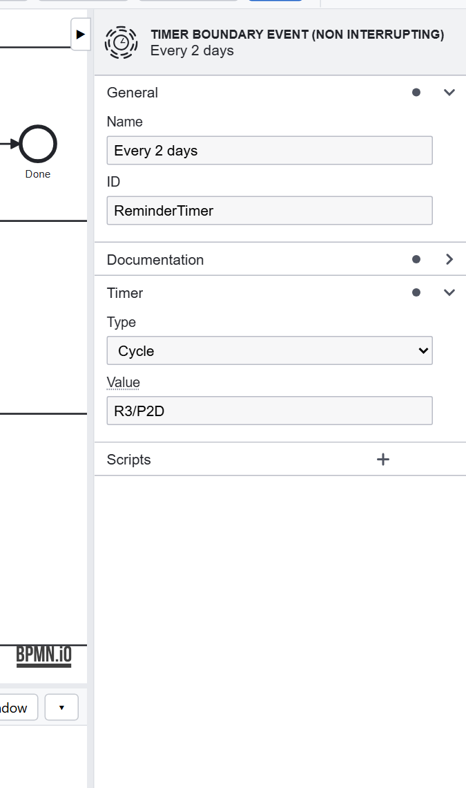

# Tutorial 5: Deadlines

**The requirement:** a request nobody decides on is not forgotten. While Approve waits, the managers are reminded.

## A timer on the task

**Every 2 days** is a **timer boundary event** on Approve:

- **Cycle** `R3/P2D`: every 2 days (`P2D`), 3 times at most (`R3`), in ISO 8601. A **Duration** (`P7D`) fires
  once, after that long; a **Date** at that time.
- **Non-interrupting** (the dashed circle): Approve goes on waiting, and the timer starts a path of its own,
  **Remind the managers**, which ends at **Reminder sent**. An interrupting timer would cancel Approve instead.
- When Approve is completed, its timer stops: nobody is reminded of a request already decided.

Timers are kept in the database: a server that restarts picks them up where they were.

## Escalation

To take a request away from managers who don't answer, add an **interrupting** timer to Approve, `P7D`, leading to a
task in the HR lane with the same form, and join it into the **Outcome?** gateway. Tutorial 7's tests show how to
test it without waiting a week.

## Design choices

- **Every waiting task asks: what if nobody acts?** A reminder, an escalation, or a deadline that decides by itself.
- **Reminders don't interrupt**; escalations do.
- **Put the period in the model** (`P2D`), where it is documented and tested; or compute it from the data with an
  expression, when it varies.

Previous: [Tutorial 4](paths.md). Next: [Tutorial 6, calling services, and failing well](services.md).
