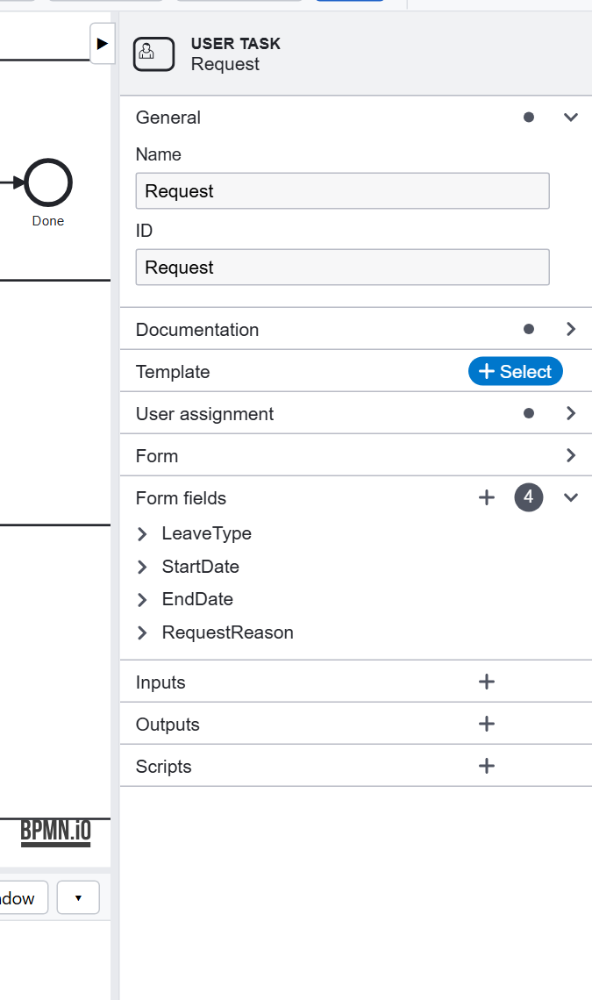

# Tutorial 3: Forms and data

**The requirement:** the employee says what kind of leave, from when to when, and why. Dates that make no sense go back
to them, before any manager sees the request.

## The form

A user task's **Form fields** are what its page asks for, and they become the instance's data:



| Field | Type | Becomes |
|---|---|---|
| `LeaveType` | enum: Vacation, Sick Leave, Study, Parental | `data.LeaveType` |
| `StartDate`, `EndDate` | date | `data.StartDate`, `data.EndDate` |
| `RequestReason` | string | `data.RequestReason` |

The leave type and both dates are **required** (a field's **Constraints**: `required`).

An **enum** is a list to choose from: a value the process can test, unlike free text. **Approve**'s form has
`approval` (Approve, Reject, Information Required) and a `comment` for the employee.

## Checking what was entered

The form checks what was entered when Request is completed, before anything is saved: its fields' rules (a type, a
**required** value, lengths and limits; see [Form rules](../form-rules.md)), then Request's **validate** listener, a
script for the rules that compare fields:

```js
if (!data.StartDate || !data.EndDate) return;
const day = 24 * 60 * 60 * 1000;
const days = Math.round((new Date(data.EndDate) - new Date(data.StartDate)) / day) + 1;
if (!(days >= 1)) return { error: 'The end date is before the start date', field: 'EndDate' };
data.days = days;
```

A form that breaks a rule is refused: the employee sees why, Request still waits for them, and nothing reaches a
manager. A form that passes keeps `data.days`, used later by the approval and by HR's system. The editor checks a
script as you type it: a syntax error is in the **Problems** tab at once.

## The data the process keeps

Everything a form fills in, and everything a script or service sets, is the instance's data. It is on the instance
page, in each task's page, in the API's answers, and in the tests' checks. Choose names you will be glad to read in a
year: `RequestReason`, not `f3`. See [Data](../data.md).

## Design choices

- **Validate in the form** when a rule is about what was entered (required, dates in order, amounts): it is refused
  at once, with the reason, and the diagram keeps only the steps of the process. The rules are in the model, and tested.
- **Keep what later steps need** (`days`) rather than computing it again in each.
- **One form per role.** The manager's form has only what the manager decides.

Previous: [Tutorial 2](roles.md). Next: [Tutorial 4, decisions and paths](paths.md).
