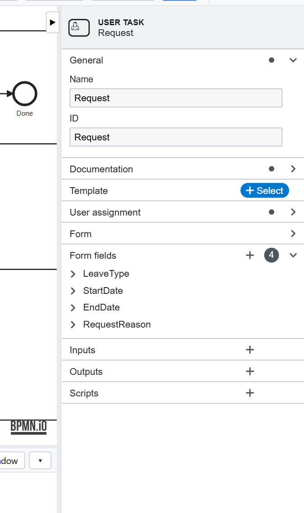
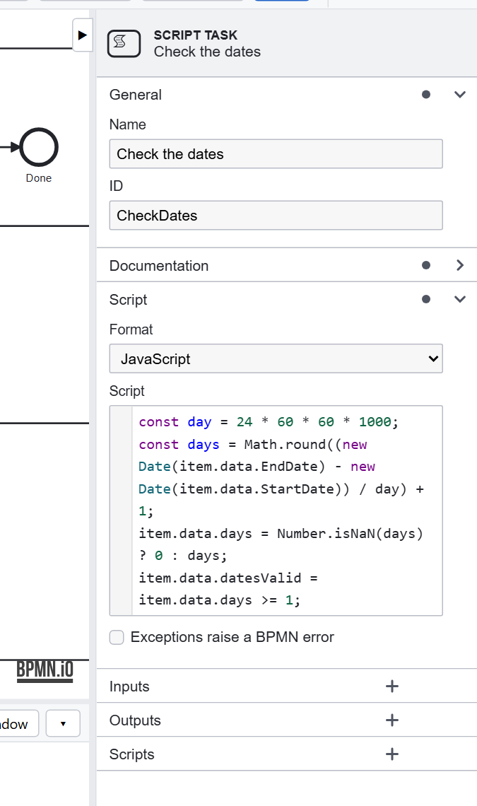

# Tutorial 3: Forms and data

**The requirement:** the employee says what kind of leave, from when to when, and why. Dates that make no sense go back
to them, before any manager sees the request.

## The form

A user task's **Form fields** are what its page asks for, and they become the instance's data:



| Field | Type | Becomes |
|---|---|---|
| `LeaveType` | enum: Vacation, Sick Leave, Study, Parental | `data.LeaveType` |
| `StartDate`, `EndDate` | date | `data.StartDate`, `data.EndDate` |
| `RequestReason` | string | `data.RequestReason` |

An **enum** is a list to choose from: a value the process can test, unlike free text. **Approve**'s form has
`approval` (Approve, Reject, Information Required) and a `comment` for the employee.

## Checking what was entered

A form field has no rules of its own, so the model checks the request itself, where every rule can be read and
tested. **Check the dates** is a script task:



```js
const day = 24 * 60 * 60 * 1000;
const days = Math.round((new Date(item.data.EndDate) - new Date(item.data.StartDate)) / day) + 1;
item.data.days = Number.isNaN(days) ? 0 : days;
item.data.datesValid = item.data.days >= 1;
```

It keeps `data.days`, used later by HR's system, and `data.datesValid`. The gateway after it, **Dates valid?**, sends
a request with wrong dates (missing, or the end before the start) back to Request. The editor checks a script as you
type it: a syntax error is in the **Problems** tab at once.

## The data the process keeps

Everything a form fills in, and everything a script or service sets, is the instance's data. It is on the instance
page, in each task's page, in the API's answers, and in the tests' checks. Choose names you will be glad to read in a
year: `RequestReason`, not `f3`. See [Data](../data.md).

## Design choices

- **Validate in the model** when a rule is about the process (dates, amounts, combinations of fields), so it is
  documented, visible in the diagram, and tested.
- **Keep what later steps need** (`days`) rather than computing it again in each.
- **One form per role.** The manager's form has only what the manager decides.

Previous: [Tutorial 2](roles.md). Next: [Tutorial 4, decisions and paths](paths.md).
