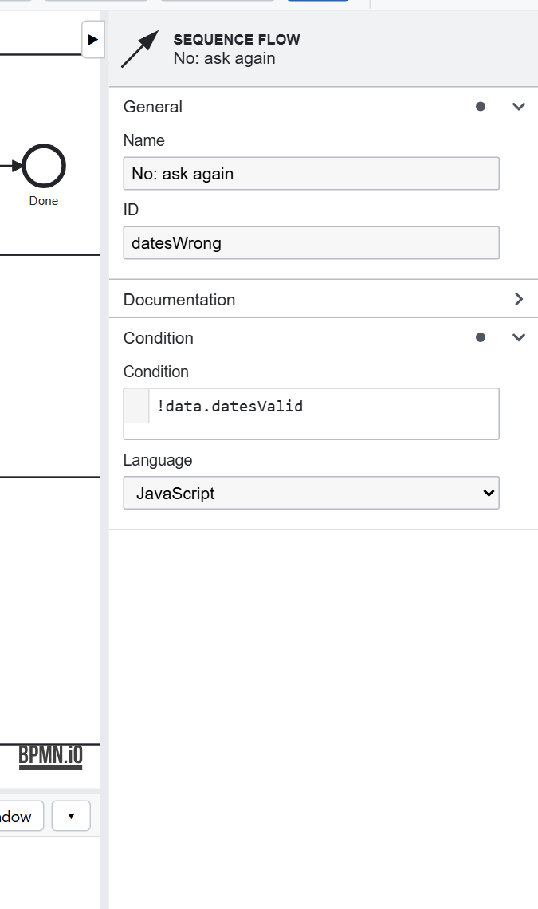

# Tutorial 4: Decisions and paths

**The requirement:** each of the manager's choices leads somewhere: approved requests are recorded, rejected ones are
not, and a request that needs more information goes back to the employee. Whatever happens, the employee is told.

## The gateway and its conditions

The **Outcome?** gateway after Approve has three flows out. Each has a **Condition**, a JavaScript expression on the
instance's data:

| Flow | Condition |
|---|---|
| Rejected | `data.approval == 'Reject'` |
| Information required | `data.approval == 'InformationRequired'` |
| Approved | none: the gateway's **default flow**, taken when no other condition holds |

A default flow (the small slash on it) means the gateway always has somewhere to go. The editor completes the names a
condition can use, such as the fields of the forms before it, and checks it as you type.

## Joining paths

Request can be reached three ways (the start, wrong dates, information required); **Record the leave** two (approved,
and after HR's fix); **Tell the employee** two (recorded, rejected). Each has a gateway in front of it that **joins**
those flows. Without one, the Problems tab warns *Incoming flows do not join*: flows arriving straight at a task each
start it, which is rarely meant.

## Every path ends

Each path ends at an end event: **Done** after the employee is told, **Reminder sent** after a reminder. The
instance is over when no path is left. The **Rationale** on its instance page tells, for each gateway, which
condition held and why: what you read when someone asks why a request went the way it did. See
[Workflow execution](../execution.md).

## Design choices

- **Enums, not free text, decide paths**: `data.approval == 'Reject'` can't be misspelled by a user.
- **A default flow on every deciding gateway**, so new values don't leave an instance stuck.
- **Join before a task** that several paths reach.
- **Name the flows** a gateway chooses between, as in *Rejected*: the diagram is read by people.

Previous: [Tutorial 3](forms.md). Next: [Tutorial 5, deadlines](deadlines.md).
