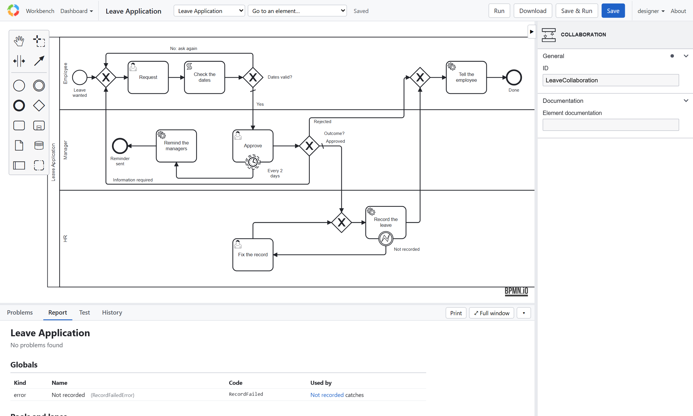
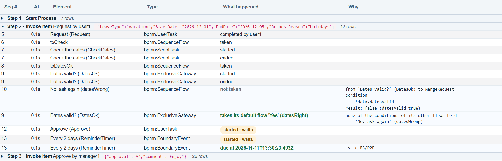

# Tutorial 8: Review before release

**The requirement:** before anyone relies on it, the model is checked, read by the people who own the process, and run
once as its users would run it.

## Checked

- The **Problems** tab says *Model is validated: no problems found*. `npm run verify` checks every model the same way, from the command
  line.
- **Run all** in the Test tab, or `npm test`: every scenario passes.

## Read

The **Report** tab is the whole model as one document, in flow order: every element, its documentation, its
assignment, its form, its conditions, its timers and services:

Print it, or send it, to the people who own the process: it is what they review, not the XML. The **History** tab
keeps each saved version, by who saved it: **Compare** shows what changed between two.

## Run once, as its users

1. Sign in as `user1`. **My work → Start a process → Leave Application**, then open **Request** under **Assigned to
   me**, fill it in, and complete it.
2. Sign in as `manager1`. **Approve** is under **Available to me**: offered to the Manager group. Approve it, with a
   comment.
3. As the administrator, open the instance (**Workbench → Instances**). Its page shows the data, the diagram with the
   path it took (**Show animation** replays it), every item, and the **Rationale**, step by step: each step's line (who took it, its data) opens to what followed,
   each decision and why. The filters open the steps with a row of what they show.

   

`user1` never sees Approve: tutorial 2's rules at work. The server's log shows what `notifyUsers` and `recordLeave` were
asked to do.

## What to look for

- A path a reviewer says "and then what?" about: it needs a next step, a timer, or an end.
- A task whose form asks for something nobody uses, or misses something somebody needs.
- Names the business doesn't use.

Previous: [Tutorial 7](tutorial-testing.md). Next: [Tutorial 9, release](release.md).
