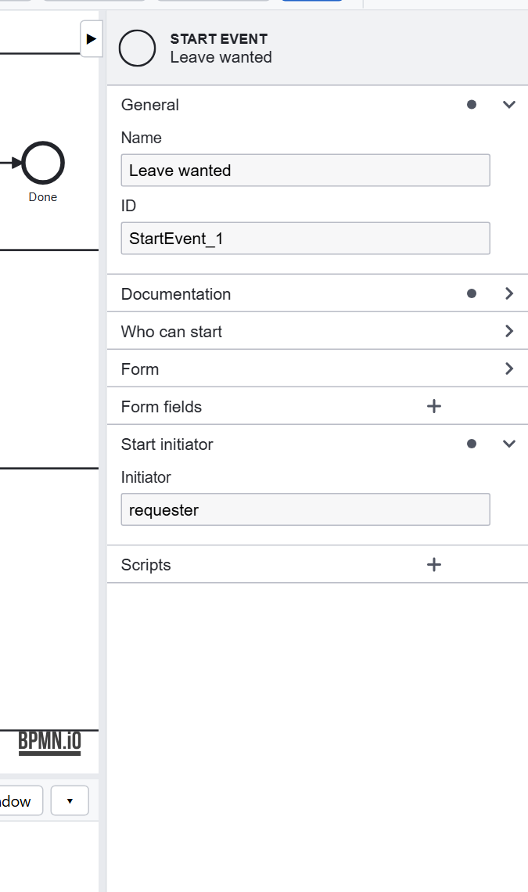
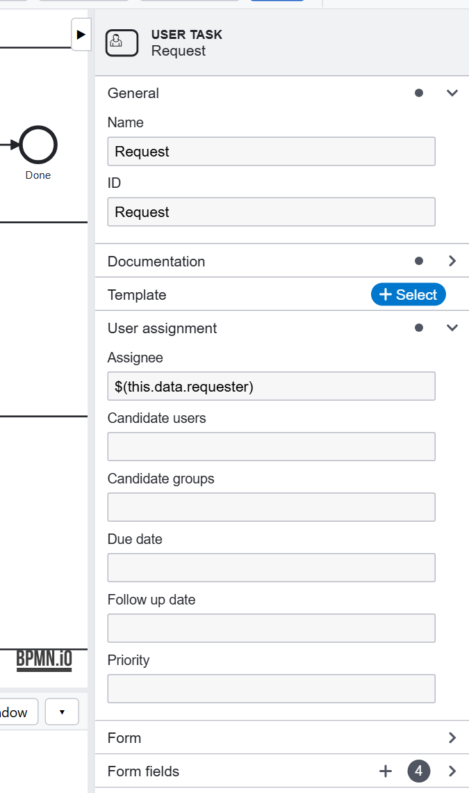

# Tutorial 2: Roles and assignment

**The requirement:** the employee who asked does Request; any manager may decide; HR fixes what HR's system refuses.
Nobody else sees those tasks, or can complete them.

## Lanes give tasks to groups

The model has three **lanes**: Employee, Manager and HR. A user task in a lane is offered to the group with the
lane's name: **Approve** is for everyone in the `Manager` group, **Fix the record** for everyone in `HR`. Nothing else
has to be set on those tasks.

A group is only a name, until a model gives it work. Users get their groups in **Dashboard → Administration**
(**Add a user**, or **Edit**): `manager1` is in `Employee` and `Manager`.

## The requester

**Request** is not for every employee, but for the one who asked:



The start event's **Start initiator** keeps the user who started the process as `data.requester`; Request's
**Assignee** is `$(this.data.requester)`:



So the request comes back to the same person when the dates are wrong or the manager needs more information, and to
nobody else.

## The rules are enforced

Two settings, both on in a new application's `.env`:

```
REQUIRE_AUTHENTICATION=true
ENFORCE_SECURITY=true
```

With them, a task can be seen and completed only by its assignee, a candidate user, or a member of a candidate group
(a lane's included). The same rules apply to the REST APIs and scripts: a call says which user it acts for. See
[Security](../security.md).

## Design choices

- **Groups, not people.** A model that names a person breaks when that person is away. Use a group (a lane, or
  **Candidate groups**), and let anyone in it take the task.
- **Computed assignment.** An assignee can be computed by your code: `#(appServices.managerOf(this.data.requester))`
  would give Approve to the requester's own manager. See [Scripting](../scripting.md).
- **Due dates and priority** are in the same **User assignment** group, for the task lists to show.

Previous: [Tutorial 1](start.md). Next: [Tutorial 3, forms and data](forms.md).
