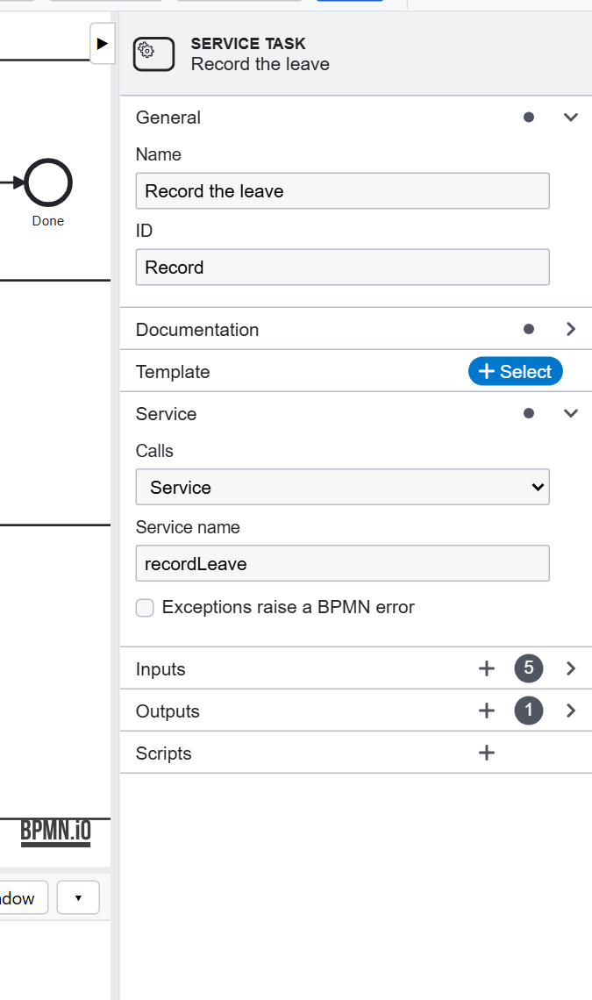
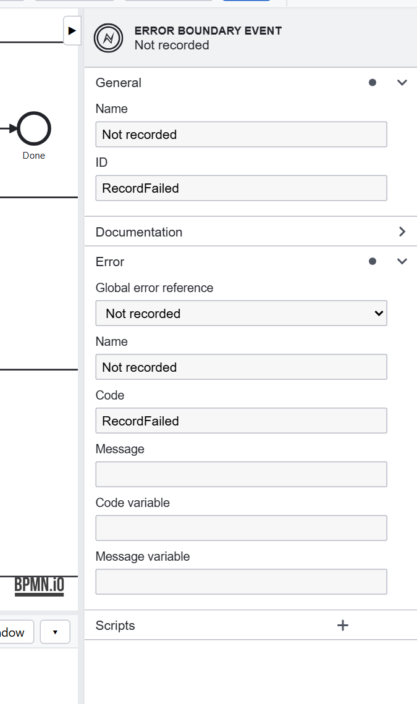

# Tutorial 6: Calling services, and failing well

**The requirement:** an approved request is recorded in HR's system. If that system refuses it, HR fixes it and it is
tried again. Reminders and the outcome reach people.

## A service task calls your code

**Record the leave** is a service task. Its **Service name** is `recordLeave`, a method of your application's
services, in `connectors/appServices.ts`:



Its **Inputs** say what it is given (`requester`, `LeaveType`, the dates, `days`, each from the data), and its
**Outputs** what is kept of the answer (`recordId`). The service:

```ts
async recordLeave({ requester, LeaveType, StartDate, EndDate, days }, context) {
    if (!requester || !(days > 0))
        return { bpmnError: 'RecordFailed' };
    const recordId = `LV-${Date.now()}`;
    console.log(`leave recorded: ${recordId} ...`);       // put your HR system's call here
    return { recordId };
}
```

**Remind the managers** and **Tell the employee** call `notifyUsers`: whom to tell (`users`, user names, or `groups`,
group names: one or a list), a subject and a message. The model decides when and why; the service only sends. In the
sample both services only log what they would do: put your HR system and your email there.

**Test is an environment of its own:** its own configuration (`.env`), its own database, and its own services:
`connectors/testServices.ts`, a class `TestServices` with the same service names, which answer as the real ones and
send or record nothing. `APP_ENV=test` in the test environment's `.env` makes the application use it; production
never loads it. `npm test` runs as the test environment. After adding a service, run
`npm run services` so the editor knows it, and offers it under **Service name**.

A service task can also call a **REST API** with no code, through a connector: [Connect external services](tutorial-connectors.md).

## When the service fails

A service answering `{ bpmnError: 'RecordFailed' }` raises that BPMN error. **Not recorded** is a boundary error
event on Record the leave, catching `RecordFailed`:



It leads to **Fix the record**, a task for HR, and back to Record the leave. The instance never stops halfway: either
the leave is recorded, or someone in HR has it on their list.

What is not a BPMN error is a failure of the service itself (an exception, a timeout): the item is marked failed, the
instance stops there, and an administrator can **Retry** it from its instance page. Tick **Exceptions raise a BPMN
error** on the task to raise those as BPMN errors too, with the exception's code (`ETIMEDOUT`), and catch them with an
error event of their own: one with no error catches any. See [Exceptions as BPMN errors](../execution.md#exceptions-as-bpmn-errors).

## Design choices

- **Model the failures the business knows about** (a refusal, a missing record) as BPMN errors with a path of their
  own, and leave unexpected ones to the retry.
- **Keep services small and named for the business** (`recordLeave`, not `post`): the model reads as the process.
- **Keep what a service answers** that later steps or people need (`recordId`).

Previous: [Tutorial 5](deadlines.md). Next: [Tutorial 7, testing every path](tutorial-testing.md).
