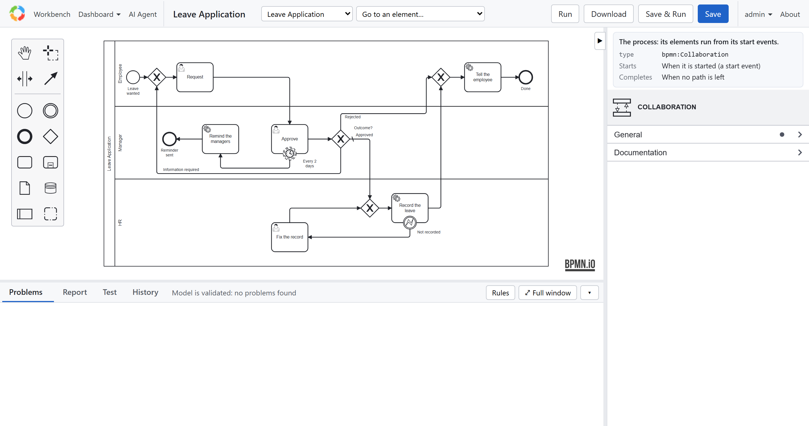

# Tutorial 1: Build a workflow ready for production

These tutorials are for developers building a production workflow. You will design, implement, test, integrate, and
release one example: a **leave request**. The business scenario uses employees, managers, and HR so the requirements
are concrete; your job is to turn them into BPMN, forms, services, security, and tests.

The sample application has the finished model. Each tutorial explains what to change, why it belongs in the model or
application, and how to verify it before release.

## Part 1: Modeling — straight BPMN

Start with BPMN structure and business behavior. Keep this part free of JavaScript and external services.

| Tutorial | Build this |
|---|---|
| [1. The workflow brief](#developer-brief-what-the-process-must-do) | Define the process and its acceptance criteria |
| [2. Roles and assignment](roles.md) | Model lanes, task ownership, and authorization boundaries |
| [3. Forms and data](forms.md) | Define user-task forms and the data contract |
| [4. Decisions and paths](paths.md) | Model gateways, outcomes, and joins |
| [5. Deadlines](deadlines.md) | Model timers and the behavior of waiting work |

## Part 2: Adding logic — JavaScript and FEEL

Add the smallest amount of executable logic needed to validate data, calculate values, call services, and handle
failures. Prove each path with automated tests.

| Tutorial | Add this |
|---|---|
| [6. Calling services, and failing well](services.md) | JavaScript, service tasks, errors, and retries |
| [7. Testing every path](tutorial-testing.md) | Gherkin scenarios, stubs, and assertions |
| [8. Review before release](review.md) | Model verification and acceptance checks |

## Part 3: Integration — application and deployment

Connect the workflow to your application, users, APIs, and production environment.

| Tutorial | Integrate this |
|---|---|
| [Run a workflow from Node.js](tutorial-script.md) | Start and complete work from application code |
| [Integrate an existing application](tutorial-integrate.md) | Use API v3 with your users and UI |
| [Connect external services](tutorial-connectors.md) | Configure REST connectors |
| [Release](release.md) | Deploy safely and keep the checks running |

## Developer brief: what the process must do

An employee asks for leave. Before it is used for real:

1. The employee says what kind of leave, from when to when, and why. **Dates that make no sense go back to them.**
2. **Any manager** may decide: approve, reject, or ask for more information. Employees who are not managers may not.
3. A request nobody decides on is **not forgotten**: the managers are reminded.
4. An approved request is **recorded in HR's system**. If that system refuses it, **HR fixes it**, and it is tried again.
5. The employee is **told the outcome**, with the manager's comment.
6. Every path is **tested** before each release.

## Set up the developer environment

You need Node.js 20 or later.

```sh
npx bpmn-server init my-app
cd my-app
npm start
```

`init` asks for the database (MongoDB; `--memory` to try it without one). Open **http://localhost:3000**: a new
server's first page asks for its administrator, with a setup token printed where `npm start` runs. Tick **Add user1
and manager1**: the tutorials use them. See [The first start](../setup.md#the-first-start).

## The model

Open **Leave Application** in the model editor (Workbench → Models → **Open model**):



| Lane | Elements |
|---|---|
| Employee | **Request** (its form checks the dates), **Tell the employee** |
| Manager | **Approve**, its reminder timer, **Remind the managers**, the **Outcome?** gateway |
| HR | **Record the leave**, its error event **Not recorded**, **Fix the record** |

The **Problems** tab under the diagram says *Model is validated: no problems found*: the model is checked as it is edited, against the
way the server runs it. Every element says what it is for in its **Documentation**, which is printed in the
**Report** tab: the model explains itself.

Its tests are in `processes/Leave Application.feature`, beside it: open the **Test** tab and choose **Run all**, or
run `npm test`. Tutorial 7 explains them.

Next: [Tutorial 2, roles and assignment](roles.md).
