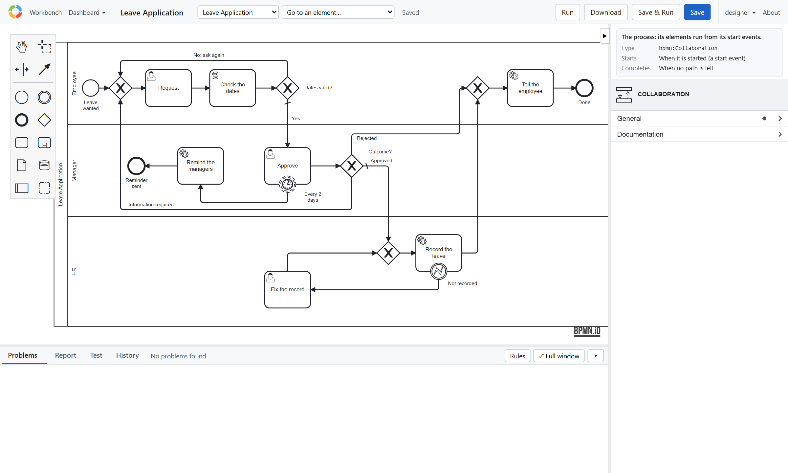

# Tutorial 1: A workflow ready for production

These tutorials design one workflow, a **leave request**, so that it is ready for real users: every path thought
through, nothing left waiting forever, failures handled, every path tested, and released with the checks that keep it
that way. The sample application has the finished model; each tutorial explains one part of its design, why it is
there, and how to change it.

| | Designs |
|---|---|
| 1. A workflow ready for production (this page) | What the process must do, and the application it runs in |
| [2. Roles and assignment](roles.md) | Who does each task, and who may not |
| [3. Forms and data](forms.md) | What each person fills in, and how bad input is caught |
| [4. Decisions and paths](paths.md) | Every outcome leads somewhere, and the paths join cleanly |
| [5. Deadlines](deadlines.md) | Nothing waits unnoticed |
| [6. Calling services, and failing well](services.md) | The process works with other systems, and survives their failures |
| [7. Testing every path](tutorial-testing.md) | Each path proved, without sending a message or touching HR's system |
| [8. Review before release](review.md) | The model checked, read, and run once as its users |
| [9. Release](release.md) | The checks on every change, and the application on a server |

## What the process must do

An employee asks for leave. Before it is used for real:

1. The employee says what kind of leave, from when to when, and why. **Dates that make no sense go back to them.**
2. **Any manager** may decide: approve, reject, or ask for more information. Employees who are not managers may not.
3. A request nobody decides on is **not forgotten**: the managers are reminded.
4. An approved request is **recorded in HR's system**. If that system refuses it, **HR fixes it**, and it is tried again.
5. The employee is **told the outcome**, with the manager's comment.
6. Every path is **tested** before each release.

## The application

You need Node.js 20 or later.

```sh
npx bpmn-server init my-app
cd my-app
npm start
```

`init` asks for the database (MongoDB; `--memory` to try it without one). Open **http://localhost:3000**: a new
server's first page asks for its administrator, with a setup token printed where `npm start` runs. Tick **Add user1
and manager1**: the tutorials use them. See [The first start](../setup.md#the-first-start).

## The model

Open **Leave Application** in the model editor (Workbench → Models → **Open model**):



| Lane | Elements |
|---|---|
| Employee | **Request**, **Check the dates** and its gateway, **Tell the employee** |
| Manager | **Approve**, its reminder timer, **Remind the managers**, the **Outcome?** gateway |
| HR | **Record the leave**, its error event **Not recorded**, **Fix the record** |

The **Problems** tab under the diagram says *No problems found*: the model is checked as it is edited, against the
way the server runs it. Every element says what it is for in its **Documentation**, which is printed in the
**Report** tab: the model explains itself.

Its tests are in `processes/Leave Application.feature`, beside it: open the **Test** tab and choose **Run all**, or
run `npm test`. Tutorial 7 explains them.

Next: [Tutorial 2, roles and assignment](roles.md).
