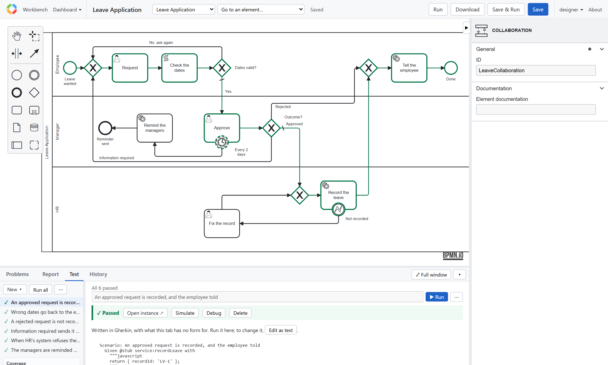
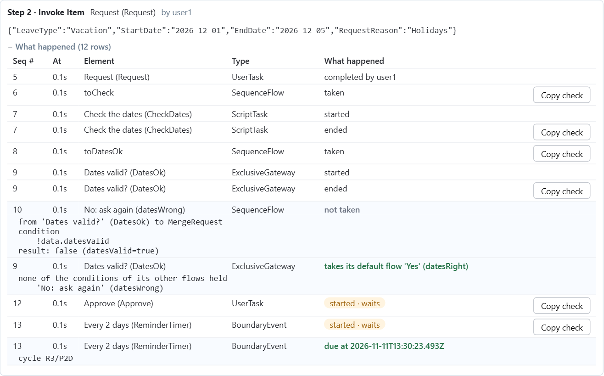

# Tutorial 7: Testing every path

**The requirement:** every path of the leave request is proved before each release: approved, wrong dates, rejected,
information required, HR's system refusing the record, and the reminders. Without sending a message or touching HR's
system, and without waiting two days.

## The tests

They are in `processes/Leave Application.feature`, beside the model, in Gherkin. Open the **Test** tab and choose
**Run all**:



Each scenario starts the process as a user, completes its tasks with data, and checks where it went:

```gherkin
Scenario: An approved request is recorded, and the employee told
  Given @stub service:recordLeave with
    """javascript
    return { recordId: 'LV-1' };
    """
    And @stub service:notifyUsers with
    """javascript
    return { sent: 'now' };
    """
  When user:user1 @login with role of "Employee"
    And @start process:"Leave Application" as :leave
    And @invoke element:Request in :leave
      | LeaveType     | Vacation   |
      | StartDate     | 2026-12-01 |
      | EndDate       | 2026-12-05 |
      | RequestReason | Holidays   |
    And user:manager1 @login with role of "Manager"
    And @invoke element:Approve in :leave
      | approval | A     |
      | comment  | Enjoy |
  Then @check :leave status is "end"
    And @check :leave data.days is 5
    And @check :leave data.recordId is "LV-1"
    And @check :leave passed element:Tell 1 times
```

- `@login` says who acts: the security rules of tutorial 2 apply.
- `@invoke` completes the waiting task, with the table as its form's data.
- `@check` reads the instance: its status, its data, the elements it passed and how often, its items.

## Stubs: no real messages, no real records

A **stub** replaces a service for this scenario's instances only. `notifyUsers` sends nothing; `recordLeave` records
nothing. A stub can also fail on purpose, as HR's system would:

```gherkin
Given @stub service:recordLeave with
  """javascript
  return data.fixed ? { recordId: 'LV-2' } : { bpmnError: 'RecordFailed' };
  """
...
Then @check :leave last element:FixRecord status is "wait"
When user:hr1 @login with role of "HR"
  And @invoke element:FixRecord in :leave
    | fixed | true |
Then @check :leave status is "end"
```

A **timer** is stubbed too, so the reminder is tested in a second, not in two days:

```gherkin
Given @stub timer:ReminderTimer with 1 seconds
...
Then @wait :leave passed element:Remind
  And @check :leave last element:Approve status is "wait"
```

## Running them

- **In the editor:** **Run all** in the Test tab, or one scenario's **Run**. A run is a real instance: under each
  step, **What happened** opens to its part of the Rationale, with **Add as a check** on what the step changed and
  the step's checks under the rows they check; **Open instance** shows its page. **Edit as text** edits the file.

  
- **On the Design dashboard:** every model's tests.
- **From the command line:** `npm test` runs every model's tests in memory (no database, no server), and exits 1 if
  one fails: what tutorial 9 runs before each release.

Every command and check: [Testing and debugging models](../testing.md#tests-in-gherkin).

## Design choices

- **One scenario per path**, named for what it proves.
- **Stub what is outside the process**: messages, other systems, time.
- **Check outcomes, not steps**: where it ended, what it kept, what it passed.

Previous: [Tutorial 6](services.md). Next: [Tutorial 8, review before release](review.md).
